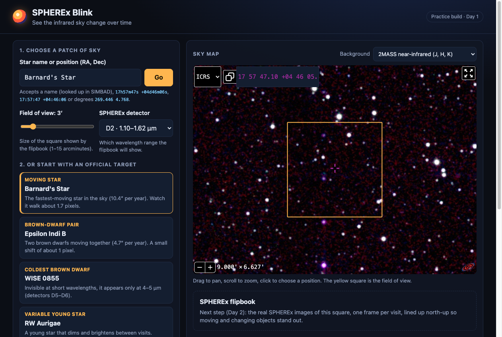
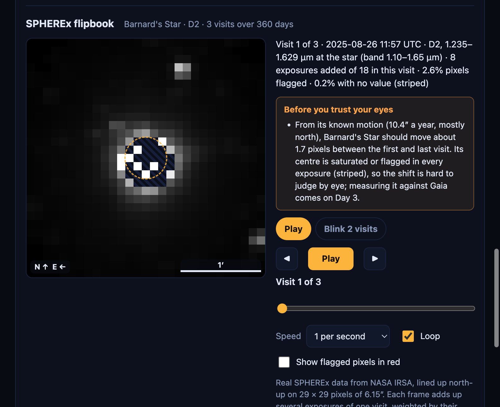
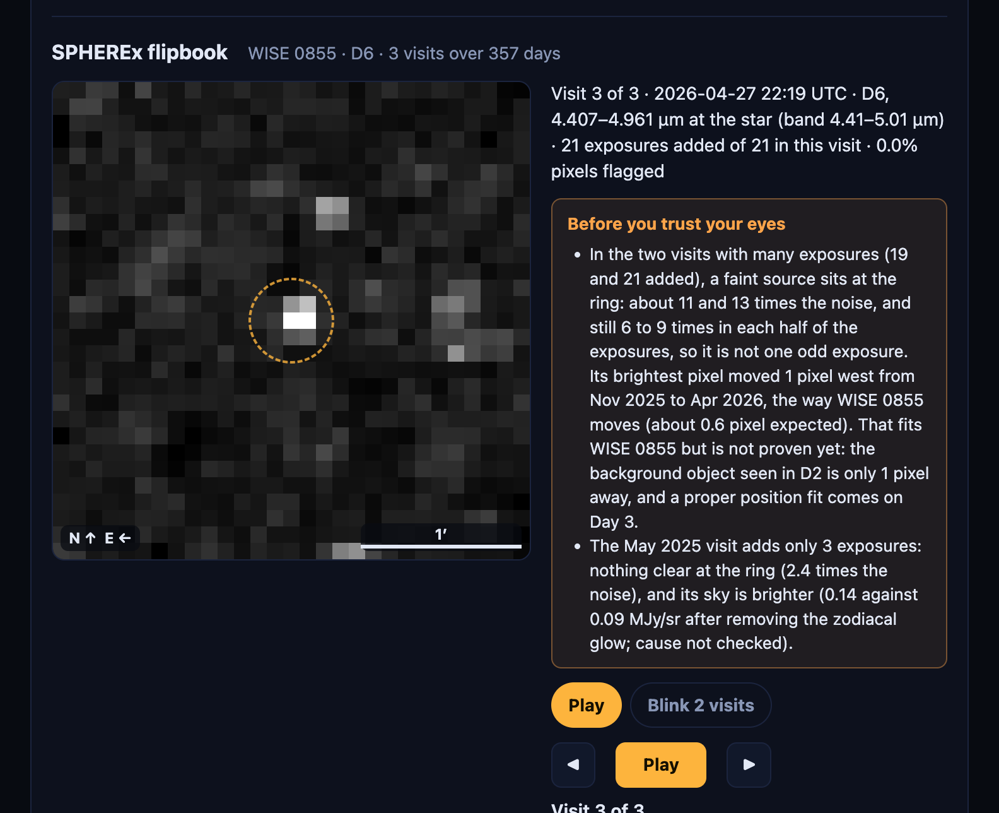

# [Friend's name]: review guide (what we built, how to check it, what to research)

**Your role from 31 Oct:** you do not have to write code. Kripas builds everything (website and data code, now and on all future days). You are our **checker and researcher**:

1. **Check** that every number and picture is true (Part C).
2. **Research** the open questions (Part D).
3. **Find problems**: wrong, unclear, overclaimed, slow or fragile things (Part E).
4. **Suggest new things** that would help users or judges (Part F).

Write what you find in [`notes/REVIEW_NOTES.md`](../../notes/REVIEW_NOTES.md) (Part G). Your own rule guides everything: **no fake, no hype, only ground truth.**

Time: as much as you like. Part B + C1–C4 take about 1 hour and are the most useful start.

---

## Part A. What we built, in simple words

### The idea
SPHEREx is a NASA space telescope that photographs the whole sky again and again (each spot about every 6 months), in 102 colours of infrared light. Our tool lets anyone type a sky position (or pick one of the challenge's 5 targets) and **see SPHEREx's pictures of that spot from different dates as a flipbook**, so things that move or change stand out. That is how Pluto was found in 1930 ("blinking" two photos).

### Day 1 (done, 31 Oct)
| What | In simple words | Where |
|---|---|---|
| Archive search | Asks NASA's archive (IRSA) which SPHEREx pictures cover a position, using the picture outlines (`s_region`), only the 4 science collections | `backend/app/archive.py` |
| Star motion | Stars move a little each year; we move the catalogue position (year 2000) to 2026 before searching | `backend/app/motion.py` |
| Name lookup | "Barnard's Star" → position, from SIMBAD (with a backup server) | `backend/app/resolve.py` |
| Bad pixels | Reads which pixels are bad from each file's own header (two release formats) | `backend/app/flags.py` |
| Coverage report | How many pictures and visits exist for the 5 targets | [`notes/DAY1_REPORT.md`](../../notes/DAY1_REPORT.md) |
| Website | Search box, sky map (Aladin) with a ring on the target, 5 target buttons, shareable link | `frontend/` |



### Day 2 (done, 31 Oct)
| What | In simple words | Where |
|---|---|---|
| Flipbook | Plays the visits in time order; ◀ ▶, slider, speed, loop, arrow keys | `frontend/js/flipbook.js` |
| Blink | Swaps two chosen visits quickly (the Pluto method) | same |
| Honest label | Under each picture: date, detector, the **wavelength at the star**, how many exposures, % bad pixels, % with no value | `frontend/js/frames.js` |
| Overlays | Ring on the target, N/E arrows, 1′ scale bar, bad pixels in red (toggle), stripes where the file has no value | `frontend/` |
| Orange warnings | "Before you trust your eyes": measured cautions per target | `backend/app/frame_notes.py` |
| Data pipeline | Raw pictures → clean (subtract the zodiacal glow, mark bad pixels) → line up on one north-up grid → **add up** the exposures of each visit (less noise) → PNG + `manifest.json` | `backend/app/clean.py`, `align.py`, `coadd.py`, `render.py` |
| Tests | 9 pipeline tests on fake files, plus the Day 1 tests and the website tests | `backend/tests/`, `frontend/tests/` |





**Findings so far** (numbers and method in [`notes/DAY2_FINDINGS.md`](../../notes/DAY2_FINDINGS.md)):
- The bright dot inside the WISE 0855 ring in D2 (1–1.6 µm) is **not** WISE 0855: it does not move in a year. What it is: unknown.
- WISE 0855 in D6 (4.4–5.0 µm): **not seen in single exposures** (2–5σ); in the **add-ups** a source appears at the ring in the two big visits (11 and 13σ by the file's own noise, still 6–9σ in each half of the exposures), but only 2.4σ in the first visit (3 exposures). Its brightest pixel moved 1 pixel west between Nov 2025 and Apr 2026, the direction WISE 0855 moves. Whether that source really is WISE 0855 is **not proven yet** (Part D, question 1).
- The add-ups mix exposures at different wavelengths (each label shows the range), so they show *where* things are, not *how bright* they got.
- R Draconis still shows single exposures: IRSA's search for its 2,483 images kept timing out on 31 Oct.
- Saturated star centres (Barnard, R Dra) have no value; shown striped, never as dark sky.
- Each exposure sees a slightly different wavelength (SPHEREx's filter changes across the detector), so **brightness changes between frames are not claimed**.

---

## Part B. Run it yourself (15 min)

```bash
git clone https://github.com/kripas1369/wise-blink-practice.git   # or: git pull
cd wise-blink-practice/frontend
python3 -m http.server 8000          # then open http://localhost:8000
```
Click **Barnard's Star**, scroll to **SPHEREx flipbook**, press Play, try Blink and "Show flagged pixels".

Optional (to run the data code and tests; Python 3.11+):
```bash
cd wise-blink-practice
python3 -m venv .venv && source .venv/bin/activate     # Windows: .venv\Scripts\Activate.ps1
pip install -r requirements.txt
python -m pytest -q                  # expect: 33 passed, 3 skipped
cd frontend && npm test              # expect: all pass (Node 20+)
```

---

## Part C. Check our claims (tick each, write what you see)

### C1. The number of pictures is NASA's, not ours
Open this link. It asks IRSA directly (without our code) how many science images cover Barnard's Star:

https://irsa.ipac.caltech.edu/TAP/sync?LANG=ADQL&FORMAT=csv&QUERY=SELECT%20COUNT%28%2A%29%20AS%20n%20FROM%20spherex.obscore%20WHERE%20CONTAINS%28POINT%28%27ICRS%27%2C269.446269%2C4.768204%29%2Cs_region%29%3D1%20AND%20obs_collection%20IN%20%28%27spherex_qr2%27%2C%27spherex_qr2_deep%27%2C%27spherex_qr3%27%2C%27spherex_qr3_deep%27%29

- [ ] It said **359** on 31 Oct (`notes/DAY1_REPORT.md`). A bigger number later is fine (new data each week); a smaller one is a problem.
- [ ] Also try IRSA's own [SPHEREx Data Explorer](https://irsa.ipac.caltech.edu/applications/spherex/) at `269.446269 4.768204`. If its count differs, find out why.

### C2. The ring is in the right place
- [ ] On the website, Barnard's Star: the ring should sit on the star in the sky map. Compare with SIMBAD's position and proper motion ([SIMBAD page](https://simbad.cds.unistra.fr/simbad/sim-id?Ident=Barnard%27s+star)). The website says how far it moved since 2000 (about 270″).

### C3. The pictures are real SPHEREx data, lined up correctly
- [ ] Each `frontend/frames/<target>/d<detector>/manifest.json` says how it was made (`method`, `made_by`, `made_at`) and lists each visit's time, wavelength and exposure count.
- [ ] **North up, east left:** compare the flipbook frame with the Aladin map above it (same 3′ size): bright neighbour stars should be on the same side in both.
- [ ] **Same pixel = same sky:** blink the first and last visit of WISE 0855 D2. The background dot should not jump. Barnard's Star should move about 1.7 pixels north over a year (hard to see: its centre is saturated).

### C4. The labels are true
Pick one visit, e.g. Barnard D2 visit 1:
- [ ] The **date** comes from `MJD-AVG` (the time the picture was taken), never `DATE` (processing time). Download one exposure from the Data Explorer, open the header (e.g. with [astropy](https://docs.astropy.org/en/stable/io/fits/) or any FITS viewer), and check `MJD-AVG` is inside the visit.
- [ ] The **wavelength at the star** changes from visit to visit (e.g. Barnard 1.23 → 1.54 µm). Check this is expected: SPHEREx Explanatory Supplement, the "LVF" (linear variable filter) section.
- [ ] **% flagged:** our bad-pixel list is in `backend/app/config.py` (`BAD_FLAG_NAMES`). Compare with the Supplement's recommended flags. SOURCE must **not** be in the list (it marks a known object, not a defect).

### C5. The add-up is done right
- [ ] Read `backend/app/coadd.py` (30 lines) and its tests in `backend/tests/test_pipeline.py`. The rule: weight = 1 / variance, bad pixels get weight 0, noise of the result = 1 / √(sum of weights). Is this the standard method? (Any astronomy data-reduction text; the Supplement may recommend something.)
- [ ] `python -m scripts.compare_frames <folder A> <folder B>` compares two runs. Single-exposure mode gives exactly the old sample pictures (checked 31 Oct: grey difference 0, correlation 1.000).
- [ ] `python -m scripts.measure_ring frontend/frames/wise0855/d6` re-measures the WISE 0855 numbers in [`DAY2_FINDINGS.md`](../../notes/DAY2_FINDINGS.md) (offline, but only after the cutouts are in `cache/`, i.e. after running `python -m backend.app.render wise0855 6 --max-per-visit 21` once; that needs the internet and about 5 minutes).

---

## Part D. Research questions (most important first)

1. **Is the D6 source at the WISE 0855 ring really WISE 0855?** In the add-ups it is 11 and 13σ in Nov 2025 and Apr 2026 (file noise; 15σ by the scatter method), and its brightest pixel moved 1 pixel **west** between those visits; WISE 0855 should move about 0.6 pixel west (8.1″ a year). That fits, but a brightest pixel is only a ±0.5 pixel position, and the D2 background object (question 2) is just 1 pixel away. Please find: WISE 0855's exact proper motion and parallax (SIMBAD and papers, e.g. Luhman 2014), what brightness SPHEREx should see at 4.4–5.0 µm (its Spitzer [4.5] / WISE W2 brightness), and whether the D2 background object is also bright at 4–5 µm (AllWISE W2 in Aladin).
2. **The fixed dot inside the WISE 0855 ring in D2:** about **RA 133.7580°, Dec −7.2405°** (1 pixel west and 1 pixel north of the ring centre 133.759765°, −7.242186°). What is it? Try Gaia DR3 (IRSA table `gaia_dr3_source`, or the [ESA Gaia archive](https://gea.esac.esa.int/archive/)), 2MASS, WISE (in Aladin: add the catalogues). Note: our earlier note gave the ring centre as the dot's position; this is the corrected one.
3. **Epsilon Indi B, Apr 2026 visit (`2026W17_2A_0403_1`, D2): 30% of pixels flagged** in that exposure. Which flags (bits)? Is something wrong with that exposure, or is it normal (e.g. a nearby bright star, Epsilon Indi A)? (The add-up fills those pixels from the other 6 exposures, so the website frame is fine; the question is why it happened.)
4. **R Draconis:** the Day 1 report found 9 visits (all detectors together), the flipbook shows 3 in D2. Is that right? (Hint: the `_deep` collections near the ecliptic pole.) Also: IRSA's position search for R Dra (2,483 images) kept timing out on 31 Oct while smaller targets worked. Is there a faster way to ask (e.g. one detector at a time)?
5. **D2 wavelength range:** the files say 1.103–1.650 µm, our `config.DETECTORS` says 1.10–1.62. Which is right? (Explanatory Supplement, detector table.)
6. **Noise:** the file's own noise (from VARIANCE) gives smaller σ values than the pixel scatter (e.g. 11.1 vs 14.7). Lining up the pictures smooths neighbouring pixels, which lowers the scatter. Which should we quote? Is VARIANCE known to be over- or under-estimated?
7. **Is our "wavelength at the star" allowed?** Kripas's older prototype notes say the Explanatory Supplement calls the WCS-WAVE table "display-only". We use it for the wavelength in every label and will use it to pick visit pairs for the Difference view. Find the exact sentence (Supplement section and page) and what SPHEREx recommends instead, if anything.
8. **Known asteroids in the Difference view:** NASA JPL's Small-Body Identification API (`ssd-api.jpl.nasa.gov/sb_ident.api`) lists known asteroids and comets near a position at a time. Check whether it works for SPHEREx (Earth-orbiting telescope: which observer location code to use?) and how big a search box we need for 6.15″ pixels.
9. **NASA's own tools:** what can IRSA's SPHEREx tools already do that we also do? What can they **not** do that we do? (Start: [`learning/05_nasa_tools_review.md`](../../learning/05_nasa_tools_review.md).) This becomes a judge slide.

## Part E. Find problems (where to look)
- **Overclaiming:** any sentence on the website or in the docs that says more than the data shows. The orange notes on the website and `DAY2_FINDINGS.md` are the first place to look.
- **Numbers without a source:** any value you cannot trace to IRSA, SIMBAD, Gaia or a document.
- **Website:** try odd inputs (`0 0`, `400 100`, a made-up star name, a phone), slow internet, a different browser.
- **Docs:** anything a beginner would not understand.

## Part F. New ideas we want
Features, checks or explanations that would help a student, a citizen scientist or a judge. For example: what should the light curve (Day 4) show? Which other objects are good demos? Is there a better way to show the wavelength problem?

## Part G. How to report
1. Add an entry to [`notes/REVIEW_NOTES.md`](../../notes/REVIEW_NOTES.md) using its template (CHECK / PROBLEM / RESEARCH / IDEA; what, how, found, how sure).
2. Commit on your branch and open a pull request to `main`:
   ```bash
   git checkout friend-backend && git pull && git merge origin/main
   # edit notes/REVIEW_NOTES.md
   git add notes/REVIEW_NOTES.md && git commit -m "Review: <short title>" && git push
   ```
   Or just send it to Kripas; he will add it.
3. Kripas answers each entry (fixed, explained, or open). Please re-check the fixes.

## Part H. What comes next (Kripas builds, you check)
| Day | Kripas builds | You check |
|---|---|---|
| Day 3 | Gaia markers on the flipbook, **synced Before / After / Difference view** (visit A, visit B, (B − A) in σ, side by side; rules in [HACKATHON_PLAN.md](HACKATHON_PLAN.md) C1), the API (`/api/frames` etc.), centre fits for moving objects | Gaia positions of the 5 targets; does Barnard's Star land on its Gaia markers? Is WISE 0855 moving the right way (D question 1)? In the Difference view: are residuals explained (motion, wavelength change, alignment) before anything is called a change? |
| Day 4 | Light curve (brightness per visit with error bars and wavelength), deploy, tests on the 5 targets | Compare brightness with IRSA's Spectrophotometry Tool; test the public link on your phone |
| Later | Spectrum panel, proof panel, About page, spot evidence panel with known-object check (JPL), video, pitch | Each spot's evidence text; known-object matches against JPL by hand for one case; science text, references, limitations |
