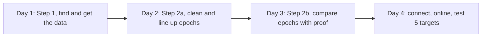

# NASA Space Apps 2026: "Planet X and SPHEREx" team plan

**Team Not42:** Kripas Khatiwada (web and presentation lead) and [Friend's name] (data and science lead, GitHub `lazylog00`). Roles swapped on 31 Oct.

**Working name:** "Blink: SPHEREx for Everyone" (or "SPHEREx TimeLens"; decide together).

**Hackathon:** 14–15 Nov 2026. Submission closes Sun 15 Nov, 23:59 local time.

**Personal plans:** [KRIPAS_PLAN.md](KRIPAS_PLAN.md) and [FRIEND_PLAN.md](FRIEND_PLAN.md) (day by day, hour by hour).

---

## PART A: Where we are today (who built what)

### A1. What Kripas built (repo `nasa`, prototype "SPHEREx TimeLens")
- **Data access:** `processing/irsa_client.py` (IRSA SIA search, picks multi-epoch images), `processing/download.py` (cutout or S3/IRSA download with retries and sha256), `scripts/query_region.py`, `scripts/download_region.py`.
- **Image processing:**
  - `processing/io_fits.py` (loads SPHEREx FITS);
  - `processing/register.py` (aligns frames onto one sky grid with `reproject`);
  - `processing/difference.py` (epoch B − A, candidate spots with a 5-sigma threshold);
  - `processing/tracking.py` (follows candidates across 3 epochs);
  - `scripts/register_and_diff.py` and `scripts/build_demo_bundle.py` (PNG and JSON demo bundle).
- **Web demo:** Django + DRF backend (SkyRegion, Observation, Candidate, CandidateDetection, ProcessingJob) and React + TypeScript + Vite + Three.js frontend (demo mode, 3D time-stack view).
- **Data on disk:** 4 SPHEREx Level-2 files (detector D1) at RA 304.69°, Dec +42.44°, epochs MJD 60794 / 60831 / 60986 / 61201.
- **Knowledge and docs:**
  - `PROJECT_PLAN.md` (21-step research plan) and `CONVERSATION_NOTES.md`;
  - `LEARN.md` plus beginner lessons `learn/01`–`07` (sky coordinates, time, light, FITS, WCS, SPHEREx, noise and flags);
  - notes from the official Explanatory Supplement v2.0 (flag lists, PSF fix, WCS-WAVE is display-only, releases).
- **Known problems** (do not repeat at the hackathon):
  - uses `DATE` (the processing date) instead of `MJD-AVG`;
  - flag mask falls back to "keep everything";
  - VARIANCE and ZODI unused;
  - "movement" threshold smaller than one pixel;
  - only detector D1 and 4 epochs.

### A2. What [Friend's name] built (repo `SPHEREXPLANETX`)
- **Feature 1, a 3D sky selector** (`web/`: Three.js globe, point and radius selection 0.10–1.75°, hover RA/Dec readout, equator and ecliptic, 88 constellation borders, sector briefing card).
- **Live NASA query** (`web/serve.py`): IRSA TAP `spherex.obscore` count of images, detectors, first and last dates, exposure time; cross-checked against an independent PyVO query.
- **Science code:** `spherex_pipeline.py` (`SpherexImage`: IMAGE/FLAGS/VARIANCE/ZODI/PSF, IMAGE − ZODI, patch extraction, WCS-WAVE wavelength; `PlanetXDetector`: two-epoch difference with variance-based SNR), `spherex_processor.py` (TAP + DataLink download), 3 notebooks.
- **Rust crate** `crates/spherex_spatial` (sky maths, HEALPix; tested, not connected).
- **Research docs:** `spherex_data_bible.md`, `chain_of_truth.md`, `learning_md.md`, the feature `JOURNEY.md`, official resources (Supplement PDF, IRSA tutorials including cutouts, PSF and Source Discovery Tool, Tractor).
- **Known problems** (do not repeat):
  - `preserve_sources` lets SOURCE cancel bad flags (55–86% of bad pixels survived in our 4 files);
  - coverage query checks image centres, not `s_region`;
  - fake fallback values (made-up dates, "705 Slices", default "Draco");
  - D3/D4 swapped in the band table;
  - constellation lookup needs B1875 coordinates.

### A3. What neither of us has done yet
- Variance-weighted add-up per epoch and detector.
- Gaia "should be here" markers.
- Light curves.
- Spectrum on click.
- A flipbook built from many real epochs.
- The 5 official test targets.

### A4. The rule that shapes everything
The official site says: "Do not begin work on your projects until the hackathon begins." We decided (29 Oct) to practise the real SPHEREx tool anyway, so we keep these safeguards:
- **Kripas asks the Nepal local lead in writing** whether practising with SPHEREx before the event is allowed, and we follow the answer.
- **Practice and rehearsal repos are never submitted**, and we make them **private**.
- On 14 Nov we start a **new, empty repo** and write the code again during the event. **No copying** from practice, rehearsal or old prototypes. Notes (`FACTS.md`, cheat sheets) are allowed.

---

## PART B: The challenge (official, restated)
- **Required:** a public-facing web tool. The user enters **RA and Dec**, and the tool shows a **series of SPHEREx images of that patch like a little video**, making it easy to spot moving objects.
- **Test targets:**
  - Barnard's Star;
  - Epsilon Indi B (a brown-dwarf pair);
  - WISE 0855 (RA 08h55m10.831s, Dec −7d14m42.53s);
  - RW Aurigae and R Draconis (variable stars).
- **Optional, each worth extra points:**
  1. easy to update with new data releases;
  2. creative use of the 102 bands (add up per detector; **extra kudos for spectra on the fly**);
  3. add or subtract images from different times;
  4. user-chosen field of view;
  5. Gaia and WISE overlays;
  6. coordinates in the URL (embeddable);
  7. show contamination flags;
  8. use Astropy and Aladin.
- **The Resources tab opens Fri 13 Nov;** read it that evening.
- **Judging criteria:** Impact, Creativity, Validity, Relevance, Presentation.
- **Nepal:** 3 local winners, and 1 team goes to global nomination. We aim for #1.

---

## PART C: What we will build (full specification)

### C1. Screens
1. **Home**
   - Search bar: RA/Dec (degrees or `08h55m10.8s -07d14m42s`) or a name (SIMBAD lookup), plus a field-of-view slider (default 3′, range 1–15′).
   - Aladin Lite sky view (2MASS/WISE background). Clicking it fills RA/Dec.
   - 5 test-target buttons with short explanations.
   - The URL updates live: `?ra=269.45&dec=4.69&fov=3&det=1`.
2. **Viewer** (the main screen)
   - **Flipbook** in the centre: play, pause, step back and forward, speed, blink (two chosen epochs), loop.
   - **Frame label:** date (from MJD-AVG), detector, wavelength range, number of images added, % pixels flagged.
   - **Detector buttons D1–D6** (short to long wavelength), plus "all bands" mode.
   - **Toggles:** flags overlay (bad pixels in red), Gaia markers, SOURCE label layer.
   - **Modes:** single frames / add-up per epoch / difference (B − A in sigma).
   - **Side panel:** target info, image count, date range, data release, links to IRSA.
   - **Click a pixel** to see its light curve (brightness over time) and its spectrum (brightness versus wavelength).
3. **About the data:** how we clean the data (each step plus the official sources), limitations (6.15″ pixels, about 1.5 years of data, subtle motions), credits (NASA/IPAC IRSA, ESA Gaia, AAVSO, CDS Aladin).

### C2. Backend API (Python FastAPI)
- `GET /api/resolve?name=` → `{ra, dec, source:"SIMBAD"}`, or an error. Never a guess.
- `GET /api/coverage?ra&dec` → a list of `{obs_id, detector, mjd_avg, em_min, em_max, release, cutout_url}` using `CONTAINS(POINT('ICRS',ra,dec), s_region)=1`.
- `GET /api/frames?ra&dec&fov&det&mode=single|coadd` → a list of `{png_url, mjd, epoch_id, detector, wl_min, wl_max, n_images, pct_flagged}`.
- `GET /api/diff?ra&dec&fov&det&epochA&epochB` → a PNG of (B − A)/sigma, plus statistics.
- `GET /api/gaia?ra&dec&fov&mjds=` → Gaia DR3 stars propagated to each date, `{source_id, ra, dec, pm_ra, pm_dec, G}`.
- `GET /api/lightcurve?ra&dec&det` → `{mjd, flux, flux_err, flagged}` per frame.
- `GET /api/spectrum?ra&dec&epoch` → `{wavelength, flux, flux_err}` across all detectors.
- Cache: a cutout folder on disk keyed by `obs_id + ra + dec + size`. The 5 targets are pre-cached early in the hackathon.

### C3. Data pipeline (agreed, ground truth at every step)
1. **Find:** TAP `s_region` query. The count must match an independent IRSA query.
2. **Get:** IRSA cutouts only (never 70 MB full files).
3. **Time:** `MJD-AVG`. Never `DATE`.
4. **Flags, the official Mosaic Tool list** (Supplement v2.0, Section 3.4.3): TRANSIENT, SUR_ERROR, NONFUNC, DICHROIC, MISSING_DATA, HOT, COLD, PHANMISS, NONLINEAR, PERSIST, CROSSTALK, GHOST, GHOST_FPA, GHOST_EXT, STREAK, BLOOM, SNOWBALL, HALO, SATELLITE_HALO.
   - Read bit positions from the FLAGS header: `MP_*` keywords in QR2, `MSKN*`/`MSKM*` in QR3. If neither is present, stop with an error (never "keep everything").
   - **SOURCE (bit 21) = a known star, galaxy or asteroid. It's a label only:** never mask on it, and never let it cancel a bad flag.
5. **Background:** IMAGE − ZODI.
6. **Noise:** sigma = sqrt(VARIANCE). Differences are shown in sigma.
7. **Align:** `reproject` onto one TAN grid per target. Check that Gaia stars land on the same pixel.
8. **Group:** epochs are clusters of MJD (survey visits about 6 months apart). Detectors:
   - D1: 0.75–1.09 µm
   - D2: 1.10–1.62 µm
   - D3: 1.63–2.41 µm
   - D4: 2.42–3.82 µm
   - D5: 3.83–4.41 µm
   - D6: 4.42–5.00 µm
9. **Add up:** a 1/variance-weighted mean per epoch and detector.
10. **Display:** the same stretch (percentile limits) for every frame of one target, so brightness changes are real, not display tricks.
11. **Verify:** Gaia markers for motion; AAVSO for variable stars; anything unmeasurable shows "unknown".

### C4. Acceptance tests (the definition of "done")

| Target | What must be visible | Check |
|---|---|---|
| Barnard's Star | Moves about 1.7 px (10.3″) from first to last epoch (data released by 31 Oct; `FACTS.md` §5) | Measured shift within about 0.5 px of the Gaia prediction |
| WISE 0855 | Faint or invisible in D1–D3, visible in D5–D6, about 1.3 px motion | Position consistent with the published proper motion (8.15″/yr) |
| Epsilon Indi B | About 1 px shift (subtle); visible near Epsilon Indi A | Gaia or catalogue motion direction agrees |
| RW Aur | Brightness changes between epochs | Light curve trend roughly consistent with AAVSO |
| R Dra | Clear brightening and fading (Mira variable, period about 245 days) | Light curve shape consistent with AAVSO |
| Any RA/Dec | No crash; "no SPHEREx data here yet" shown honestly if empty | Coverage count = IRSA count |

### C5. Feature levels
- **Level 1, a complete entry (by hour ~22):** search, name lookup, field of view, URL; cutouts and cleaning; **north-up aligned** flipbook with frame labels; detector buttons; 5 target buttons; flags toggle; honest empty/error states; "data as of" line (newest release date); deployed link.
- **Level 2, a strong contender (by hour ~34):** add-up per epoch and detector; difference in sigma; Gaia markers; light curve (points coloured by wavelength, because of the LVF); Aladin with Gaia and WISE overlays; **epoch picker (+/−)**; **proof panel** per target (expected vs measured motion, % flagged, images/epochs, release); coverage timeline.
- **Level 3, winner level (only if Level 2 is solid):** spectrum on click and **spectrum per epoch** (R Dra two dates); measured motion compared with Gaia; GIF download + links to the original files at IRSA; one cross-check against IRSA's Spectrophotometry Tool; Nepali language toggle; a small Planet X explainer.
- **Why these:** they fill the gaps in IRSA's own tools (no time view, not north-up, expert-only, queued jobs). See [`learning/05_nasa_tools_review.md`](../../learning/05_nasa_tools_review.md) and [`learning/06_how_to_win.md`](../../learning/06_how_to_win.md).
- **Not building:** a custom Three.js globe, Rust, freehand lasso, Django, a database, accounts, Planet X detection claims.

### C6. Stack
- **Backend:** Python 3.11, FastAPI, astropy, astroquery (IRSA, SIMBAD, Gaia), pyvo, reproject, numpy, Pillow.
- **Frontend:** Vite with plain JS or React, Aladin Lite v3, Chart.js or Plotly for graphs.
- **Deploy:** one small server (for example Render, Railway or a VPS) with the frontend served as static files. Test the deploy early in the hackathon.

---

## PART D: Phases from now to the hackathon

**Team decision (29 Oct):** we practise the **real hackathon project**: the same SPHEREx data, the same 5 official targets, the same features (Part C), the same split of work. Then at the hackathon we build it again, fast, from memory.

### Phase 1: 4-day practice build of the real tool (Sat 31 Oct – Tue 3 Nov, repo `wise-blink-practice`, to be renamed `spherex-blink-practice`)
(Moved from 29 Oct – 1 Nov on 31 Oct: 29–30 Oct went to checking the real archive. Learning notes for every step: [`learning/`](../../learning/README.md).)
About **7 hours a day each**, in 3 blocks. Each of us types our own code; the AI explains each step and reviews it. Each day ends with the learning log, a pull request into `main`, and a 15-minute call.

#### Day 1, Sat 31 Oct: Step 1, find and get the data
**Status (31 Oct): the data part is done** (code in `backend/app/`, results in `notes/DAY1_REPORT.md`, 24 offline + 3 network tests pass), made before the role swap and now owned by [Friend's name]. Found on the way: the archive mixes releases QR2 + QR3 and calibration rows (we filter to 4 science collections); each cutout is ~4–5 MB because of the PSF; SIMBAD's main server was down (mirror works).
- **Both together (block 1, 2 h):** Kripas walks [Friend's name] through the Day 1 data code and results (`learning/01`–`03`): IRSA TAP, `spherex.obscore`, the `s_region` condition, collections, cutouts, what is inside a cutout (IMAGE, FLAGS, VARIANCE, ZODI, header `MJD-AVG`), Gaia DR3 at IRSA (`gaia_dr3_source`), SIMBAD and its mirror.
- **[Friend's name] (blocks 2 – 3):** take over the data code: run the tests and `scripts/day1_report.py`; read `learning/02_code_walkthrough.md`; re-type `coords`, `motion`, `resolve`, `flags`, `archive.find_images` from the walkthrough; check one count against IRSA's own SPHEREx search.
- **Kripas (blocks 2 – 3):**
  - `index.html`: search box (RA/Dec or name), field of view, `?ra&dec&fov&det` in the URL.
  - Aladin Lite v3: moves to the position; clicking fills the box.
  - 5 official target buttons with one-line explanations.
- **Done when:** the coverage table of the 5 targets is in `FACTS.md` (done), [Friend's name] can explain and run the data code, and clicking "Barnard's Star" centres Aladin on it with a shareable URL.

#### Day 2, Sun 1 Nov: Step 2a, clean and line up the epochs
- **[Friend's name]:**
  - Group images into epochs (`MJD-AVG`, gaps of months), per detector.
  - Clean each cutout: official flag mask (SOURCE is a label only), IMAGE − ZODI, sigma = sqrt(VARIANCE), % flagged.
  - Line up every cutout on one sky grid (`reproject`); check background stars stay on the same pixel.
  - One PNG per epoch per detector with **the same brightness scale**; send PNGs + JSON to Kripas.
- **Kripas:**
  - Flipbook player: play, pause, step, speed, loop, blink two epochs.
  - Frame label: date, detector, wavelength range, number of images, % flagged.
  - Detector buttons D1 – D6; flags overlay toggle.
- **Done when:** Barnard's Star frames from different epochs play in the flipbook, lined up, with labels.

#### Day 3, Mon 2 Nov: Step 2b, compare epochs with proof (integration day)
- **Morning call (both):** fix the API format (`FACTS.md` section 7).
- **[Friend's name]:**
  - Add-up per epoch and detector (1/variance weighted).
  - Gaia: stars near the target from `gaia_dr3_source`, moved from 2016.0 to each epoch's date.
  - Difference: epoch B − epoch A in sigma.
  - FastAPI: `/api/resolve`, `/api/coverage`, `/api/frames`, `/api/gaia`, `/api/diff`, plus a disk cache.
- **Kripas:**
  - Call the real API; honest error messages (no fake values).
  - Gaia markers on the flipbook (move per epoch).
  - Difference mode with a sigma colour scale.
- **Done when:** **Barnard's Star walks across the browser flipbook onto its Gaia markers.**

#### Day 4, Tue 3 Nov: connect, online, test
- **[Friend's name]:**
  - `/api/lightcurve` (brightness at one position across epochs).
  - Pre-cache the 5 targets; run the C4 acceptance tests and write the results.
- **Kripas:**
  - Light-curve chart when a star is clicked.
  - **Deploy** (Render, Railway or a VPS); check on a phone.
- **Both:** lessons note (planned vs actual hours, blockers).
- **Done when:** a public link works and the C4 tests are run on all 5 targets (Barnard's Star moves with Gaia; WISE 0855 shows in D5 – D6 only; R Dra and RW Aur change brightness).

#### Wed 4 – Fri 6 Nov
- **Wed 4 morning (both):** fix whatever did not pass on Day 4.
- **Wed 4 afternoon:** Level 3. [Friend's name]: `/api/spectrum` (brightness vs wavelength, per epoch) and measured motion vs Gaia. Kripas: spectrum panel, epoch picker (+/−), proof panel, About page.
- **Thu 5:** [Friend's name] reads Supplement 2.2, 3.2.5, 3.2.9, 3.4.3 and finishes `FACTS.md`; one cross-check against IRSA's Spectrophotometry Tool. Kripas makes a draft 30-second video from the practice tool and a pitch draft. Evening (both): speed drill. In an empty folder, rebuild search → coverage → one cutout → flipbook in 3 hours from memory. Delete afterwards.
- **Fri 6:** rest; rehearsal checklist.

### Phase 2: Timed rehearsal of the real hackathon (Sat 7 – Sun 8 Nov, 48 hours)
**Goal:** do the real hackathon once, exactly as on 14 – 15 Nov: same challenge text, same SPHEREx data, same 5 targets, same Part E schedule, same submission. Start from an **empty repo** and build from memory and notes (do not copy the practice repo). This tells us how fast we really are.

#### 2.1 Before the clock starts (Fri 6 Nov evening)
- Challenge text printed; this plan and `FACTS.md` open.
- Both laptops: Python venv, Git, hosting account logged in.
- Empty private repo `spherex-rehearsal`.
- **Time log sheet:** planned hours vs actual hours vs blocker, for each task.
- Phone hotspot tested; food and sleep shifts agreed.

#### 2.2 Hour-by-hour
Follow **Part E** exactly. Checkpoints:
- **Hour 10:** Barnard's Star plays end to end.
- **Hour 22 (Level 1):** run the C4 tests.
- **Hour 34 (Level 2).**
- **Hour 46:** mock submission (fill a copy of the Part G form fields in a document).

#### 2.3 Mock judging (Sun 8 Nov evening, 1 hour)
- 1 – 2 people watch the 30-second video and a 3-minute live demo, score 1 – 5 on the 5 criteria, and ask 3 questions each.
- Write down every question we could not answer well.

#### 2.4 Lessons learned (Mon 9 – Tue 10 Nov)
- Planned vs actual hours, top 5 blockers and fixes, slow archive calls, deploy problems, what to cut or move earlier.
- Update Part E timings with the real numbers.
- A **1-page cheat sheet each** ([Friend's name]: query, cutout, cleaning, Gaia, API steps; Kripas: Aladin, flipbook, URL, deploy steps). Notes, not code.

#### 2.5 Rehearsal "done" means
- Public link works; all 5 targets pass C4; 30-second video exists; mock form filled; lessons note written.
- If Level 1 is not reached by hour 22, the real plan cuts Level 3 and moves the deploy earlier.

### Phase 3: Final preparation (11 – 13 Nov)
- Part E adjusted with the rehearsal timings.
- **Speed drill (12 Nov, 3 hours):** from an empty folder, rebuild Level 1 from memory. Delete afterwards.
- Pitch script (3 – 5 minutes) and the 30-second video storyboard.
- Laptops ready; IRSA and the SIMBAD mirror reachable from the venue network or a phone hotspot.
- Team and local event registered on spaceappschallenge.org.
- **13 Nov evening:** read the challenge Resources tab and the Project Submission Guide together; adjust the plan.

### Phase 4: The hackathon (14 – 15 Nov), a fresh build
- New empty repo at the start; write the code again (fast, because we have done it twice). **Do not copy the practice or rehearsal code.** Commit often (the history shows the code was written during the event).
- Follow Part E.

### Phase 5: After the hackathon
- Resume the research track (`PROJECT_PLAN.md`: moving objects, the Planet Nine sensitivity map, a possible RNAAS paper).

---

## PART E: 48-hour build schedule

| Hours | [Friend's name] (backend and science) | Kripas (frontend and presentation) |
|---|---|---|
| 0–2 | Read the statement and resources together; create the repo; agree on the API format | Same |
| 2–10 | `/api/resolve`, `/api/coverage`, cutouts, cleaning, PNG frames, `/api/frames` | Layout, search, URL, Aladin, flipbook using sample frames |
| 10–14 | **Integration: Barnard's Star plays end to end.** Pre-cache the 5 targets | Same |
| 14–22 | Alignment, add-up per epoch and detector, `/api/gaia` | Detector buttons, frame labels, flags toggle, target buttons, **deploy** |
| 22–26 | Run the C4 acceptance tests on all 5 targets; fix problems; sleep in shifts | Same |
| 26–34 | `/api/diff` (sigma), `/api/lightcurve` | Difference mode UI, Gaia markers, light-curve panel, Aladin Gaia and WISE overlays |
| 34–40 | Level 3: `/api/spectrum`, measured motion vs Gaia (only if Level 2 passes) | Spectrum panel, About page, polish |
| 40–46 | Limitations text, references, NASA data section | **30-second video** from the real tool, project page; **submit by hour 46** |
| 46–48 | Rehearse the live pitch twice; prepare the backup demo video | Same |

**Hard rules during the event:** no new features after hour 40; if a feature isn't working by its deadline, cut it.

---

## PART F: Story, pitch and video
- **One line:** "In 1930 one person found Pluto by blinking two photos. Today SPHEREx photographs a billion objects in 102 colours, and our tool lets anyone, anywhere, do what Tombaugh did."
- **Five beats:**
  1. Tombaugh's blink.
  2. Too much SPHEREx data for one person.
  3. Our tool.
  4. Proof: Barnard's Star walks and matches Gaia; WISE 0855 appears only at 4–5 µm, so it's cold; R Dra brightens and fades, matching AAVSO.
  5. Impact: anyone can discover. Two students from Nepal learned SPHEREx in a month.
- **30-second video:**
  1. 0–5 s: Pluto plates blinking.
  2. 5–10 s: the SPHEREx sky.
  3. 10–20 s: type "Barnard's Star"; it walks over the Gaia markers.
  4. 20–26 s: WISE 0855 appearing from D1 to D6, plus a spectrum.
  5. 26–30 s: name and URL.
- **Live pitch (3–5 minutes):** live demo in the first 30 seconds, then the 5 beats, then limitations, then questions.
- **Practise these questions:** how we know motion is real (Gaia, sigma differences, official flags); why WISE 0855 shows only in some bands (it's cold); what happens with new data (live IRSA queries); whether it can find Planet X (it shows how such an object would move; a real search needs more data); who uses it (volunteers, students, scientists).
- **Honesty:** no "discovered" or "Planet X found" claims; every number has a source.

## PART G: Submission checklist (English)
- Title, high-level summary, **30-second demo video** (or 7 slides max) at a public link with no login.
- Public GitHub repo and the live link; project details and tools.
- NASA data used (SPHEREx/IRSA); partner and other data (ESA Gaia, AAVSO, CDS).
- References; AI tools disclosure (honest; it does not affect judging).
- All team members on the project page. Deadline: Sun 15 Nov, 23:59 local time (check whether the local event has an earlier deadline).

## PART H: Risks and what we do about them
- **IRSA down or slow:** pre-cached targets, small cutouts, a timeout with an honest message.
- **Faint targets:** D5–D6 presets and add-ups.
- **Venue internet:** phone hotspot; cached demo.
- **Scope creep:** Level 1 first; nothing new after hour 40.
- **Demo failure during judging:** a backup video, and the page pre-loaded before the pitch.
- **Rule risk (we practise on SPHEREx):** written answer from the local lead; private practice repos; fresh repo on 14 Nov; no copied code.
- **SIMBAD down** (the main CDS server failed on 29 Oct): use the Harvard mirror `simbad.harvard.edu`; target buttons carry fixed positions as a backup.
- **Fast stars not found:** move the position to today with proper motion before searching (Barnard's Star moved about 4.5′ since 2000).
- **New data releases:** QR2 and QR3 are both live and new data arrives weekly. Query all science collections (`config.COLLECTIONS`), never one hard-coded release; skip the `_cal` rows. Read flag bits from each file's header (they can differ by release).
- **IRSA rate limits:** "503 busy" with 4+ parallel cutouts; max 3 at a time, retries, disk cache; each cutout is ~5 MB, so pre-cache the 5 targets.
- **Brightness vs wavelength confusion (LVF):** each measurement has its own wavelength; light curves keep it, spectra compare per epoch.
