# 00. The big picture

## The challenge in one paragraph
NASA's **SPHEREx** telescope photographs the whole sky every ~6 months in infrared light
(0.75 to 5 micrometres, split into 102 "colours"). Things that **move** (nearby stars, brown dwarfs,
maybe an unknown "Planet X") or **change brightness** (variable stars) look different in photos
taken at different times. The challenge "Planet X and SPHEREx" asks for a **public web tool**:
type a sky position (RA, Dec), and see the SPHEREx images of that spot **like a little video**
(a "flipbook" or "blink"), so anyone can see what changed.

The 5 official test targets:

| Target | Kind | What a good tool shows |
|---|---|---|
| Barnard's Star | fast-moving star (10.4″ per year) | it walks across the frames |
| Epsilon Indi B | brown-dwarf pair (4.7″ per year) | a small shift (about 1 pixel) |
| WISE 0855 | coldest known brown dwarf | invisible at short wavelengths, visible at 4–5 µm (detectors D5–D6) |
| RW Aurigae | young variable star | brightness changes |
| R Draconis | pulsating giant (Mira, ~245-day period) | brightness rises and falls |

## What the finished tool does (the user's view)
1. Type `Barnard's Star` or `17h57m48s +04d41m36s` (or click a target button).
2. The tool finds every SPHEREx image of that spot, from every visit.
3. It cuts a small square out of each image, cleans it, turns it so north is up, and lines them up.
4. It plays them as a flipbook: date, detector and wavelength under each frame.
5. Extra proof: Gaia markers show where the star *should* be on each date; a difference image
   shows what changed (in units of noise, "sigma"); click a star to see its light curve and spectrum.

## How the data flows (the whole system)

```mermaid
flowchart LR
    user["User types name or RA/Dec"] --> resolve["1. Name to position (SIMBAD)"]
    resolve --> move["2. Move position to today (proper motion)"]
    move --> find["3. Find images covering it (IRSA TAP)"]
    find --> cut["4. Download small cutouts (IRSA cutout service)"]
    cut --> clean["5. Clean: flags, background, noise"]
    clean --> align["6. Line up on one north-up grid"]
    align --> epochs["7. Group by visit, add up per detector"]
    epochs --> frames["8. PNG frames with one brightness scale"]
    frames --> web["9. Website flipbook + Gaia markers + charts"]
```

- **Day 1 (done, 31 Oct):** boxes 1 to 4, tested on all 5 targets. See [01](01_day1_what_we_built.md).
- **Day 2:** boxes 5 to 8 (Step 2a). **Day 3:** proof (Gaia, difference images, API) (Step 2b).
  **Day 4:** connect the website, put it online, test the 5 targets. See [04](04_whats_next.md).

## Who does what

| | Kripas (data and backend) | [Friend's name] (website and presentation) |
|---|---|---|
| Language | Python (astropy, pyvo, astroquery, FastAPI) | HTML/JS, Aladin Lite, Chart.js |
| Owns | boxes 1–8 and the API | box 9, deploy, video, pitch |
| Branch | `kripas-backend` | `friend-frontend` |
| Meeting point | the API format (`docs/plan/FACTS.md` section 7) | same |

## Why practise the full tool before the hackathon?
At the hackathon we have 48 hours. Most teams lose the first day learning how the archive works.
We already know the traps (wrong time keyword, wrong flags, proper motion, rate limits, a dead
name server), so on 14 Nov we can rebuild fast and spend the saved time on proof and presentation.

**Rule safeguards (important):** the official site says "Do not begin work on your projects until
the hackathon begins". So: (1) Kripas asks the Nepal local lead in writing whether practice is OK;
(2) practice repos stay private and are never submitted; (3) on 14 Nov we start a new empty repo and
write the code again, without copying. Notes (like this folder) are allowed.

## The road to 15 Nov

| Date | What |
|---|---|
| Sat 31 Oct | Day 1, Step 1: find and get the data (done for Kripas's part) |
| Sun 1 Nov | Day 2, Step 2a: clean and line up the epochs |
| Mon 2 Nov | Day 3, Step 2b: compare with proof (Gaia, difference), API |
| Tue 3 Nov | Day 4: connect, online, test the 5 targets |
| Wed 4 – Fri 6 Nov | fix, Level 3 extras, speed drill |
| Sat 7 – Sun 8 Nov | timed 48-hour rehearsal in an empty repo |
| 9 – 13 Nov | lessons, cheat sheets, pitch, read the Resources tab (13 Nov) |
| **14 – 15 Nov** | **the hackathon: fresh build, submit by 23:59 on 15 Nov** |
