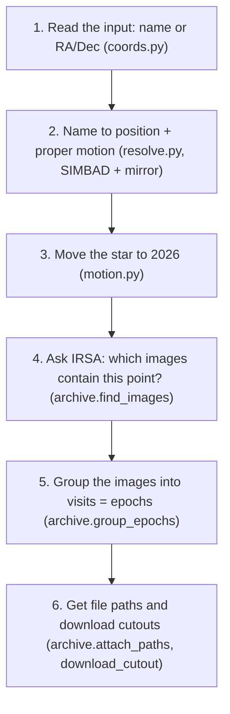

# 01. Day 1 (Step 1): find and get the data. What we built.

**Goal of Step 1:** for any sky position, know **which SPHEREx images exist** (how many, when,
which detectors, which release) and be able to **download a small cutout** of each one.
Status (31 Oct): done and tested on all 5 official targets.

## The 6 steps, in plain words



1. **Read the input.** `"17h57m48s +04d41m36s"`, `"269.45 4.69"` or a star name. Bad input gets
   a clear error, never a guess.
2. **Name → position.** SIMBAD knows star names. Its main server was down, so we try a mirror
   too and remember which one works.
3. **Move the star.** SIMBAD gives the position in the year 2000. Barnard's Star has moved 270″
   since then, so we move it to 2026 using its proper motion before searching.
4. **Which images?** One ADQL query to IRSA: "every SPHEREx image whose outline contains this
   point", only real sky images (not calibration rows).
5. **Epochs.** Sort by time and split into visits (a gap of more than 30 days, or more than 60
   days long).
6. **Cutouts.** A second query finds each image's file path; the cutout service sends us a
   small square (29×29 pixels for 0.05°). Cached on disk, max 3 at a time, with retries.

## How to run it yourself
```bash
cd ~/wise-blink-practice
source .venv/bin/activate
python -m pytest backend/tests -q                                 # 24 offline tests
RUN_NETWORK=1 python -m pytest backend/tests/test_network.py -q   # 3 tests against real servers
python -m scripts.day1_report                                     # ~4-6 min; writes notes/DAY1_REPORT.md
```
Try it in Python:
```python
from backend.app import archive
from backend.app.resolve import resolve_name
from backend.app.motion import position_at

star = resolve_name("Barnard's Star")
ra, dec = position_at(star["ra"], star["dec"], star["pmra"], star["pmdec"], 2000.0, 2026.0)
images = archive.find_images(ra, dec)
print(archive.summarize(images)["epochs"])
archive.attach_paths(images[:1])
print(archive.describe_cutout(archive.download_cutout(images[0], ra, dec)))
```

## The result (31 Oct 2026)

| Target | Images | Epochs | First → last | Expected motion first → last epoch |
|---|---|---|---|---|
| Barnard's Star | 359 | 3 | 2025-08-15 → 2026-09-22 | 10.3″ ≈ 1.7 px |
| Epsilon Indi B | 445 | 4 | 2025-04-24 → 2026-10-02 | 6.4″ ≈ 1.0 px |
| WISE 0855 | 256 | 3 | 2025-05-05 → 2026-05-14 | 8.1″ ≈ 1.3 px |
| RW Aurigae | 333 | 3 | 2025-09-01 → 2026-09-16 | none (variable star) |
| R Draconis | 2483 | 9 | 2025-04-24 → 2026-09-27 | none (variable star) |

Full tables: [`notes/DAY1_REPORT.md`](../notes/DAY1_REPORT.md) and `docs/plan/FACTS.md` §6.

## What this means for the next days
- **Every target has 3+ epochs in all 6 detectors.** A flipbook is possible for all 5.
- **The motions are small (1–2 pixels).** The flipbook only shows them if the alignment is very
  good. Step 2a (alignment + check on background stars) is the most important step for winning.
- **R Draconis has thousands of images** (it is near the ecliptic pole and in a deep field).
  It will make the best light curve, but we must not download all 2483 cutouts for a demo; pick
  per epoch.
- **Cutouts are 4–5 MB each.** A few hundred per target = ~1–2 GB. Pre-cache the 5 targets; send
  PNGs, not FITS, to the browser.
- **Two releases with different file layouts** (QR2: PSF cube + `MP_*` flags; QR3: EPSF table +
  `MSKN*` flags). Code must handle both; new releases will come.

Next: [02_code_walkthrough.md](02_code_walkthrough.md) explains each file.
