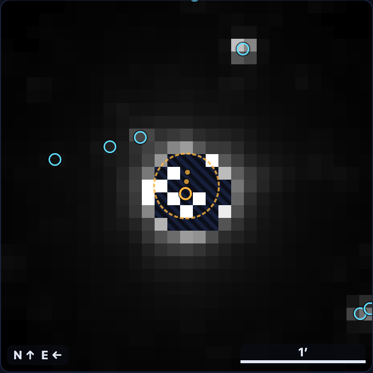
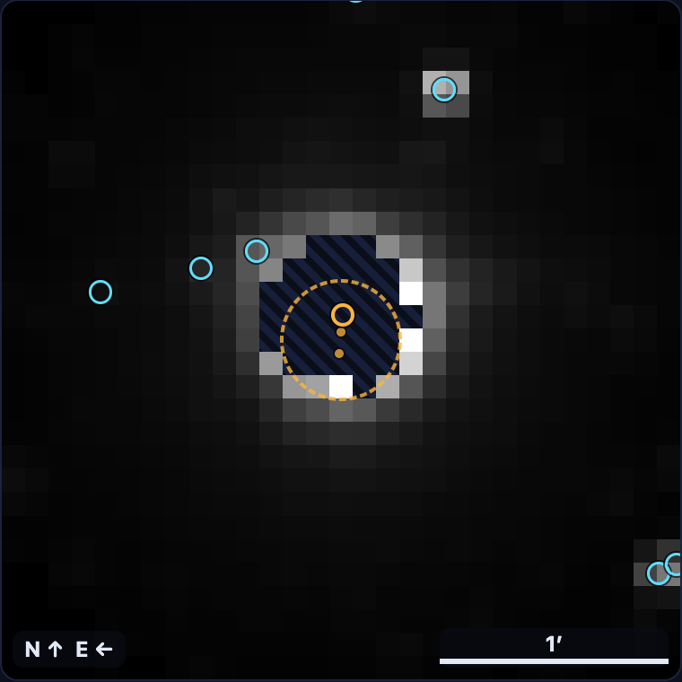
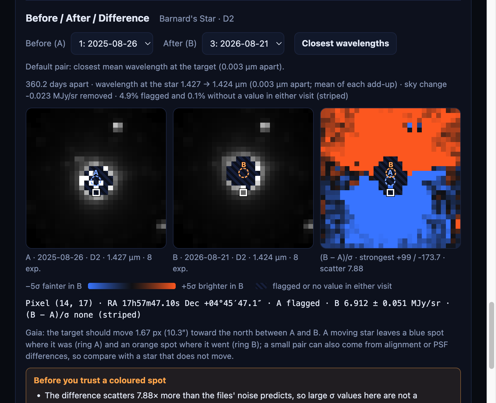
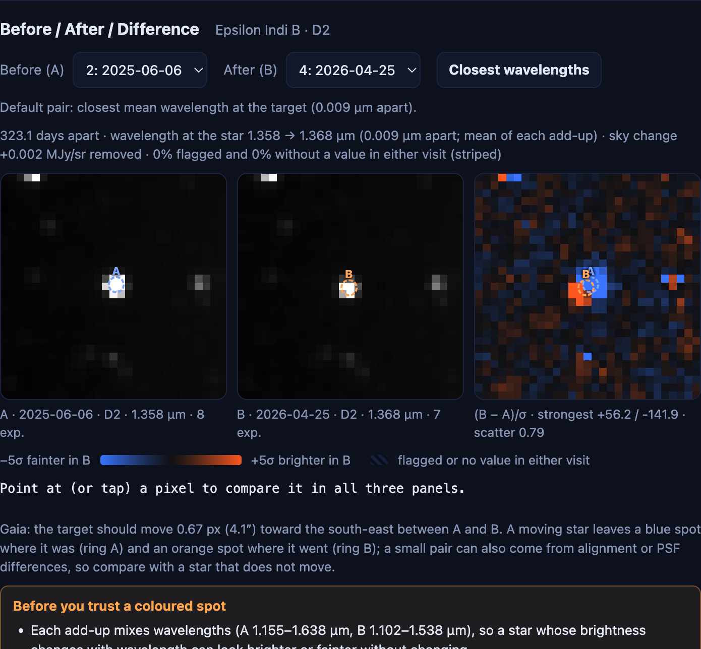

# Day 3 findings: Gaia markers and the Before / After / Difference view (31 Oct 2026)

Every number here comes from the files in `frontend/frames/` and can be re-made offline:

```bash
python -m scripts.measure_motion frontend/frames/eps_ind_b/d2     # measured position per visit vs Gaia
python -m backend.app.gaia frontend/frames/barnard/d2             # needs the internet (IRSA Gaia DR3)
python -m backend.app.diff frontend/frames/barnard/d2             # offline, from epoch<i>.fits
```

Pixel conventions: SPHEREx pixels are 6.15″. "North" and "west" are on the sky; the pictures are north up, east left.
Gaia shifts: Gaia DR3 position (epoch 2016.0) moved in a straight line with its proper motion to each visit's `MJD-AVG`; parallax not applied (Barnard's parallax is 0.55″ = 0.09 px, the largest of the 5 targets).

---

## 1. Does the target move with Gaia? (`scripts/measure_motion.py`)

| Target, detector | Visits | Gaia says, first → last visit | We measured | How |
|---|---|---|---|---|
| Barnard's Star, D2 | 3 (Aug 2025 – Aug 2026) | 1.67 px north (0.12 px west) | the striped saturated hole moved **1.59 px north**, 0.03 px east | centre of the flagged / no-value pixels within 3 px of Gaia's position (21–27 px). The centre itself has no value, so no brightness centroid is possible. |
| Epsilon Indi B, D2 | 5 (Apr 2025 – Oct 2026) | 1.09 px south-east (0.93 east, 0.57 south) | the dot's centre moved **0.99 px** (0.76 east, 0.63 south) | brightness-weighted centre of the 5 × 5 pixels around Gaia's position, sky removed |
| RW Aurigae, D2 (control: a star that does not move) | 3 | 0.004 px | 0.04 and 0.07 px | same centroid |

The visits in between also follow Gaia (Eps Ind B: 0.11, 0.31, 0.76 px measured vs 0.08, 0.35, 0.76 px Gaia).
The RW Aur control says our alignment between visits is good to well under 0.1 px for a well-measured star.

**What this does and does not show.**
- Barnard's Star and Epsilon Indi B move the way Gaia says, by the amount Gaia says, within about 0.1–0.2 px. This is the Day 3 "done when" test, checked by numbers and in the browser (screenshots below).
- A 5 × 5 centroid on a picture whose PSF is about one pixel wide moves less than the star when the star is off a pixel centre ("pixel phase"), so treat these as rough. A proper PSF fit is not done.
- The Barnard hole method only works because the hole is centred on the star. It is not a general position method.





---

## 2. The Difference view (`backend/app/diff.py`)

z = (B − A − sky change) / √(σA² + σB²), σ from each visit's VARIANCE (after adding up), sky change = median of B − A over pixels usable in both.
"Scatter" = 1.4826 × MAD of z: about 1 if VARIANCE describes the real noise of the picture.

Default pair = the two visits with the closest mean wavelength at the target (then the longest time apart).

| Target, detector | Default pair | Days apart | Wavelength gap | Scatter | What the difference shows |
|---|---|---|---|---|---|
| Barnard's Star, D2 | visit 1 → 3 | 360 | 0.003 µm | **7.88** | a fainter (blue) / brighter (orange) pair north–south around the star, the way Gaia says it moved; −174σ to +99σ. The website warns that the scatter is far above 1. |
| Epsilon Indi B, D2 | visit 2 → 4 | 323 | 0.009 µm | 0.79 | a pair pointing south-east (fainter where it was, brighter where it went), matching Gaia |
| RW Aurigae, D2 | visit 1 → 3 | 368 | 0.009 µm | 1.04 | a small pair **even though the star does not move**: −52σ to +71σ. Cause not checked (a 0.07 px shift on a very bright star, or a PSF change, is enough). |
| WISE 0855, D6 | visit 2 → 3 (Nov 2025 → Apr 2026) | 162 | 0.022 µm | 0.78 | +5.2σ 1 px west of the centre and −2.7σ 1 px east: fits the 1 px westward step found on Day 2. The pair's −8.3σ minimum is in the corner pixel (x 0, y 2), not near the target; cause not checked. |
| WISE 0855, D2 | visit 2 → 3 | 35 | 0.005 µm | 0.73 | nothing at the centre above ±4σ; the fixed D2 object (1 px west, 1 px north) shows −3.7σ / +9.0σ in some pairs. Cause not checked. |
| R Draconis, D2 (single exposures) | visit 2 → 3 | 201 | 0.016 µm | 21.5 | dominated by the Mira's own change and the saturated core; not a motion test |





**Rules we learned from this table:**
1. **A bright star always leaves a pair in the difference**, moving or not (RW Aur). So a pair is only evidence of motion when its direction and size match a prediction (Gaia) and a non-moving control star is smaller. The website's panel text says this.
2. **Scatter above 1 means the σ values are too small for that picture** (Barnard 7.9, R Dra 11–29): the star's wings change more than VARIANCE allows (a PSF or wavelength change). The website shows a warning when scatter > 1.5.
3. **Scatter below 1** (0.7–0.8 for most pairs) means VARIANCE is larger than the real pixel-to-pixel scatter. Lining up the pictures smooths neighbouring pixels, which lowers the scatter; the same effect was seen on Day 2 (11.1 vs 14.7σ). Which noise to quote is still open (review guide, question 6).

---

## 3. Data files, checks and fixes

- **`epoch<i>.fits` per visit** (IMAGE, SIGMA, FLAGGED, HAS_VALUE, with the grid WCS), so the difference and the measurements use the real values, not the 8-bit PNGs. Rebuilt offline from the cached cutouts with `python -m backend.app.rebuild <folders>`; every rebuilt PNG matched the website's to within 1 grey level.
- **Bug found by that check:** the manifests stored `ra`/`dec` rounded to 6 decimals, so the rebuilt grid sat up to 0.0036″ (0.0006 px) off and one flagged pixel, sitting on a nearest-pixel boundary, flipped (9 grey levels on one pixel). Manifests now keep the full value (`render.py`), and the rebuild re-asks SIMBAD for the exact position (`--exact-position`) and checks it rounds to the stored one.
- **Gaia target match:** the nearest Gaia star to the grid centre at 2026.0 within 3″: Barnard 0.001″, Eps Ind B 0.019″, RW Aur 0.177″, R Dra 0.000″. **WISE 0855 is not in Gaia DR3** (too faint in visible light): no target marker, and the website says "no star within 3″ of the frame centre".
- **API:** the 5 prepared targets load from `frontend/frames`; a typed position (RA 133.8000°, Dec −7.2000°, D2) ran as a background job and gave 4 visits × 4 exposures, Gaia markers and differences; WISE 0855 D6 coverage from IRSA: 43 images in 3 visits.

---

## 4. Not done / open

*Update (Day 4): items 1, 2 and 5 are answered in [`DAY4_FINDINGS.md`](DAY4_FINDINGS.md): the R Dra add-up is installed with an asinh scale, the D6 source moves like WISE 0855, and Eps Ind B's factor of 2 comes from its spectrum. The "fixed D2 object" in section 2 is the Gaia DR3 star 5756956644387831296 (G 16.31).*

1. **R Draconis add-up: made but not installed.** In the add-up the core pixels survive at up to 2,870 MJy/sr (single exposures had no value there), so one linear scale for all frames becomes 0.65–1,290 MJy/sr and the rest of the picture is black. Needs a non-linear display scale (e.g. asinh) with the scale written in the manifest. Day 4. The website keeps the single exposures.
2. **WISE 0855 position fit** (is the D6 source moving like WISE 0855?): still to do. Section 2 only shows that the difference agrees with the Day 2 finding.
3. **PSF-fit positions** instead of 5 × 5 centroids.
4. **Why the RW Aur pair and the WISE 0855 D2 / D6 outlier pixels appear** (see section 2): not checked.
5. **Epsilon Indi B brightness** changes by a factor of 2 between the add-ups, not in step with the mean wavelength; cause not checked (shown as a caution on the website).
