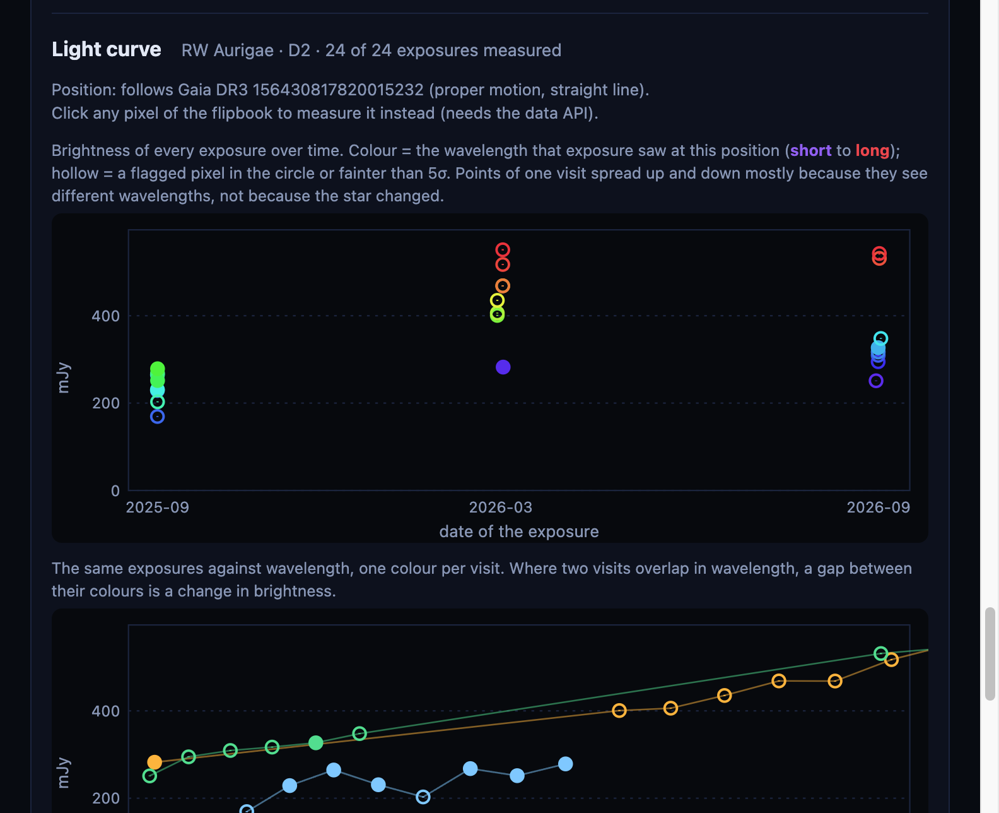
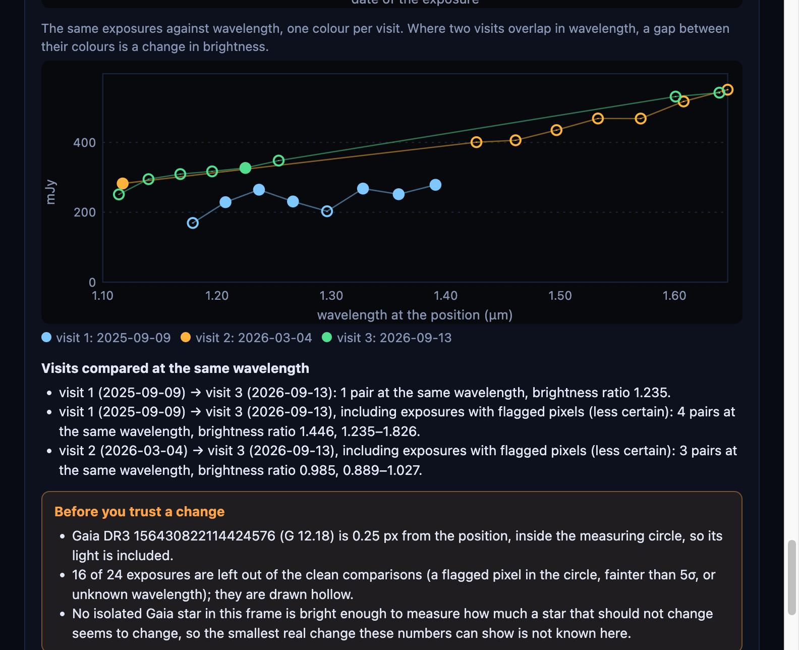
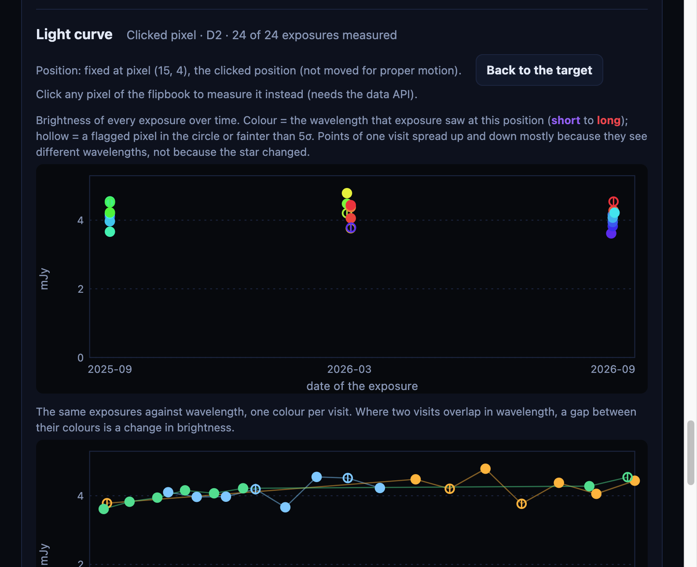
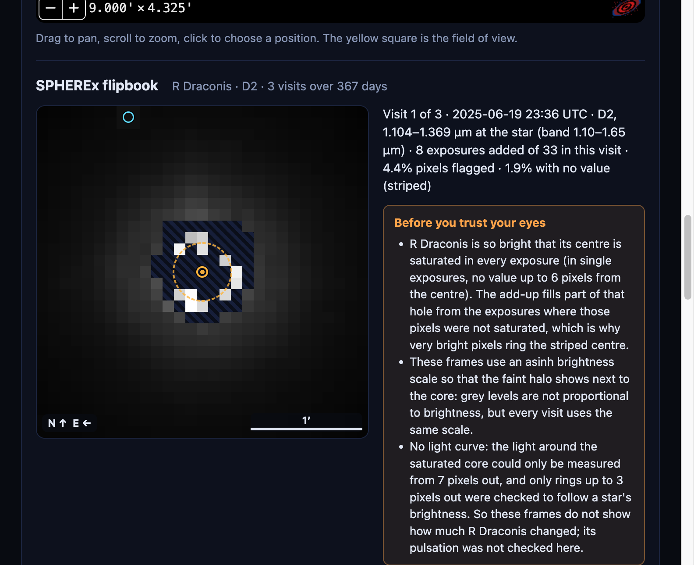
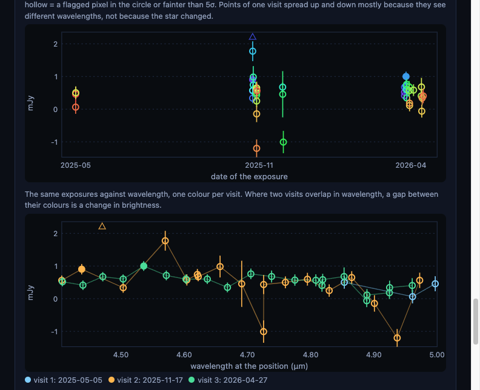

# Day 4 findings: light curves, the asinh scale and the C4 acceptance tests (31 Oct 2026)

Every number here comes from the files in `frontend/frames/` and can be re-made offline:

```bash
python -m backend.app.lightcurve frontend/frames/*/d*      # exposures.fits (if missing) + lightcurve.json
python -m scripts.acceptance --json notes/acceptance_c4.json           # C4 checks (offline)
python -m scripts.acceptance --online --json notes/acceptance_c4.json  # + coverage counts against IRSA
```

The full output of the acceptance script is in [`acceptance_c4.json`](acceptance_c4.json).
Pixel conventions as before: SPHEREx pixels are 6.15″; pictures are north up, east left; PNG x grows to the west, y to the south.
Not done today on purpose: putting the site online (the user's choice: "skip putting it online for now").

---

## 1. The light curve (`backend/app/lightcurve.py`, website panel `frontend/js/lightcurve.js`)

**What is measured.** Every single exposure behind the frames (not the add-ups) is put on the frames grid (`exposures.fits`). In each one: the light inside a circle of 2 px (12.3″) around the target, minus the median sky 10–14 px away, in mJy (1 MJy/sr over one pixel = 0.889 mJy). The circle follows the target: Gaia's proper motion, or SIMBAD's when the target is not in Gaia (WISE 0855).

**Why single exposures.** SPHEREx's filter gives each exposure a different wavelength at the target. An add-up mixes them, so it can look brighter or fainter without the star changing. Each light-curve point keeps its own wavelength.

**The comparison rule.** Two exposures of different visits are compared only when their wavelengths at the target differ by less than half the bandwidth, and both are at least 5σ. "Clean" pairs also need no flagged pixel inside either circle; pairs that include flagged pixels are listed separately as less certain.

**How big a change is real? (field-star floor).** Gaia stars (G ≤ 17, no other Gaia star within 4 px) measured the same way, with the same rule. Only the Barnard frame has one bright enough: Gaia DR3 4472836047939582592 (G 13.6) changes by **4.5%** between visits at the same wavelength (10 clean pairs, median ratio 1.004; 4.9% with 13 pairs including flagged pixels). The other frames are 3′ wide and have no such star, so their floor is unknown and the website says so.

**Saturated stars.** Barnard's Star and R Dra have no value in their cores (up to 5.2 and 6.2 px from the centre). A ring outside the hole would have to start at 6–7 px. On RW Aur (not saturated) a 3–6 px ring follows the core within 9.8% (correlation 0.93); a 6–9 px ring does not follow it. So rings that start beyond 3 px are not used, and both stars get "no light curve" with that reason. (A first try with a 6–9 px ring gave Barnard's Star a 0.62 ratio between visits: a fake change, which is why this rule exists.)

| Target, detector | Light curve | What it shows |
|---|---|---|
| Epsilon Indi B, D2 | 39 exposures, all above 59σ | Brightest near 1.27 and 1.58 µm and about 7× fainter at 1.36–1.40 µm (water and methane absorption in a cool brown dwarf). This explains the factor-2 changes between the add-ups (Day 3, open item 5). Same wavelength, different visits: ratios **0.86–1.05** (7 visit pairs, clean). No clear sign of variability; the floor in this frame is unknown. |
| RW Aurigae, D2 | 24 exposures, 16 with flagged pixels in the circle | Sep 2025 → Sep 2026 at 1.2–1.27 µm: **1.235** (1 clean pair), 1.235–1.826 including flagged pairs (4). Mar → Sep 2026: 0.889–1.027 (3 pairs, all including flagged pixels). So it was fainter in Sep 2025, by 24% in the one clean pair. The Gaia star 1.5″ away (G 12.18, a known companion) is inside the circle. Not compared with AAVSO (section 3). |
| WISE 0855, D2 | 30 exposures | **Not WISE 0855's light.** The circle follows WISE 0855's motion across a fixed Gaia star (G 16.31, 1.3 px away), so it takes in more or less of that star: visit 1 → 2 ratio 1.86. The website warns that the moving circle alone makes this. |
| WISE 0855, D6 | 43 exposures, most below 5σ each | No same-wavelength pair passes the 5σ rule, so no change between visits is measured. Nov 2025 and Apr 2026 overlap at about 0.5–0.7 mJy. One exposure (2025W46_1A_0076_2) measures 520.6 mJy with 2 flagged pixels in the circle (probably a cosmic-ray hit; not checked); the chart draws it as ▲ at the edge and names it. |
| Barnard's Star, D2 | none (saturated core to 5.2 px) | field-star floor 4.5% (above) |
| R Draconis, D2 | none (saturated core to 6.2 px) | — |





**Click any pixel.** With the API running, clicking the flipbook measures that fixed position the same way (`/api/lightcurve?…&x=&y=`). Tried on RW Aur pixel (15, 4), next to a G 15.93 Gaia star: the three visits agree at the same wavelengths (ratios 0.96–1.06). Without the API the panel says that a click needs it.



---

## 2. R Draconis: the asinh scale (`render.py --stretch asinh`)

The R Dra add-up keeps core pixels up to 2,870 MJy/sr (the exposures where they were not saturated), so one linear scale made the rest black (Day 3, open item 1). The frames now use grey = asinh(t / 0.002) / asinh(1 / 0.002), t = (value − 0.65) / (2,870 − 0.65): faint halo and bright ring both show. The manifest's `scale` says `stretch: "asinh"`, the website says grey levels are not proportional to brightness, and the check (`checkManifest`) refuses an unknown stretch. Gaia markers and differences were remade for the add-up (default pair visit 1 → 2, scatter 30.7: the website warns).



---

## 3. C4 acceptance tests (HACKATHON_PLAN part C4)

| Target | C4 check | Result | Status |
|---|---|---|---|
| Barnard's Star | measured shift within about 0.5 px of Gaia | saturated hole moved (−0.03, −1.59) px; Gaia (+0.13, −1.66): **0.18 px apart**, directions 5.5° apart | **pass** |
| WISE 0855 | position consistent with the published motion (8.15″/yr) | D6 source moved **0.58 ± 0.12 px** from Nov 2025 to Apr 2026; WISE 0855's motion + parallax predicts 0.72 px (difference 0.17 px, **1.4σ**); a fixed star would show 0 (**4.9σ** away). Both visits within 0.22 px of the predicted place (error 0.17–0.18 px). | **pass** |
| WISE 0855 | faint or invisible in D1–D3, visible in D5–D6 | D2: nothing at its position (S/N −2.4 to 1.7 in 4 visits) while the Gaia star next to it is 21–41σ. D6: 12.8σ and 14.0σ (Nov, Apr). D1, D3, D5: no frames prepared, **not checked**. | **pass for D2 and D6** |
| Epsilon Indi B | Gaia motion direction agrees | centroid moved 0.99 px, Gaia 1.09 px: **8.0°** apart, 0.18 px difference (our threshold: 30°) | **pass** |
| RW Aur | light curve roughly consistent with AAVSO | light curve made (section 1); **AAVSO not compared**: AAVSO VSX answered with a Cloudflare challenge and VizieR (CDS and Harvard) timed out on 31 Oct | **not checked** |
| R Dra | light curve shape consistent with AAVSO | no light curve (saturated core to 6.2 px, section 1) | **cannot be checked** with these images |
| Any RA/Dec | coverage count = IRSA count | our search = IRSA's own `COUNT(*)`: Barnard's Star **359 = 359** (same as Day 1), RA 200 Dec −30 **378 = 378**, RA 10 Dec +60 **410 = 410** (first Barnard try: IRSA 504 timeout, retried) | **pass** |
| Any RA/Dec | no crash; honest message if empty | "no images" answers 404 with a plain message and bad input answers 400 (`test_day3.py`); the website shows the message (frontend tests) | **pass** (tested with a stand-in, no empty sky position found) |

**How the WISE 0855 fit works (`scripts/acceptance.py`).** In each D6 add-up, a Gaussian (free position, width, flux and sky) is fitted to the 7 × 7 pixels around the predicted position, weighted by SIGMA. The prediction is SIMBAD's position moved with its proper motion (−8123.7, +673.2 mas/yr) and parallax (439.0 mas; all from Kirkpatrick et al. 2021, ApJS 253, 7) to each visit's mean time. The other candidate, Gaia DR3 5756956644387831296 (G 16.31), does not move (6 mas/yr). Alignment check: the one other Gaia star bright enough in D6 (G 16.35) sits (−0.05, −0.03) ± 0.11 px from its Gaia position.

| D6 visit | exposures | fitted position (PNG px) | WISE 0855 predicted | Gaia star | S/N |
|---|---|---|---|---|---|
| 2025-05-05 | 3 | (13.38, 13.99) ± 0.3 | (13.20, 14.05) | (14.93, 13.39) | 2.2 (not detected) |
| 2025-11-17 | 19 | (13.98, 13.98) ± 0.07 | (13.77, 14.04) | (14.93, 13.39) | 12.8 |
| 2026-04-27 | 21 | (14.54, 13.82) ± 0.05 | (14.49, 13.95) | (14.93, 13.39) | 14.0 |

**What this does and does not show.**
- The D6 source moves like WISE 0855 and not like the fixed Gaia star. This answers the Day 2 and Day 3 open question.
- A fit with two sources at fixed places (WISE 0855 predicted, Gaia star) gives the Gaia star about a quarter of the D6 flux, at only 2.7–2.8σ: a hint, not a detection. If real, it pulls the single-source fit toward the Gaia star (west and north), which fits both offsets and the slightly short shift (0.58 against 0.72 px). Not proven.
- The errors are statistical plus a 0.11 px alignment term from one star; the PSF is modelled as a round Gaussian. A proper PSF model is not done.

---

## 4. Corrections to earlier notes

- **The WISE 0855 D2 dot** (Day 2: "a fixed background dot 9″ from it"; Day 3: "the fixed D2 object (1 px west, 1 px north)") is the Gaia DR3 star 5756956644387831296, G 16.31, 7″ (1.1 px) west-north-west of the 2026 position. Its marker is hidden by the default "brighter than G = 16" limit; the frame note says to choose G = 18. This answers review-guide research question 2.
- **R Dra add-up** (Day 3 open item 1): now installed with the asinh scale (section 2).
- **Eps Ind B brightness** (Day 3 open item 5): explained by its spectrum (section 1), not variability.

---

## 5. Tests and checks

- 68 backend tests passed (3 network tests skipped); 35 website tests passed.
- New: `backend/tests/test_day4.py` (photometry, the same-wavelength rule, the saturated-core rule, the API, the asinh manifest, and the C4 results above as tests) and `frontend/tests/day4.test.js` (every light curve matches its manifest, charts, warnings, off-chart points, the stretch check).
- In the browser (API on port 8010): RW Aur, a clicked pixel, R Dra, WISE 0855 D6; the static server (port 8000) shows the target's light curve and explains that a click needs the API.



---

## 6. Not done / open

1. **Online deploy and phone check**: skipped today by choice.
2. **AAVSO comparison** for RW Aur and R Dra: AAVSO VSX and VizieR unreachable on 31 Oct. Try again, or ask [Friend's name] to download the AAVSO light curves by hand.
3. **Field-star floor in the other frames**: a 3′ frame rarely has an isolated Gaia star bright enough. A wider field only for the comparison stars would help.
4. **WISE 0855 in D5** and D1/D3: no frames prepared.
5. **The 520.6 mJy D6 exposure**: which flag, and is it a cosmic ray? Not checked.
6. **Is the Gaia star really in the D6 light** (2.7–2.8σ)? Needs more exposures or a PSF model.
7. **RW Aur's 10–20% spread within 2 hours** in Sep 2025 (Day 3): still not explained; 16 of 24 exposures have flagged pixels in the circle (persistence, transient, SUR_ERROR).
