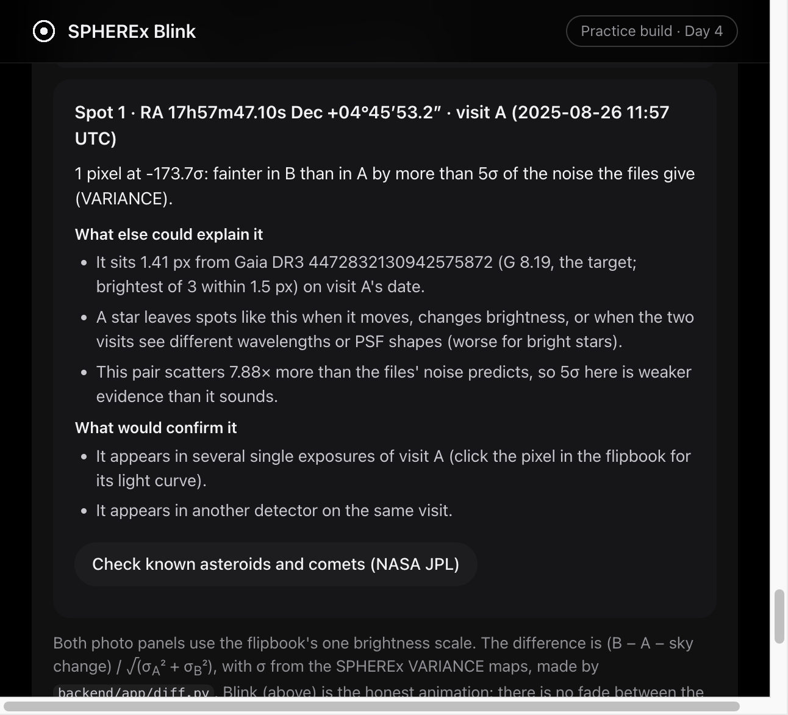
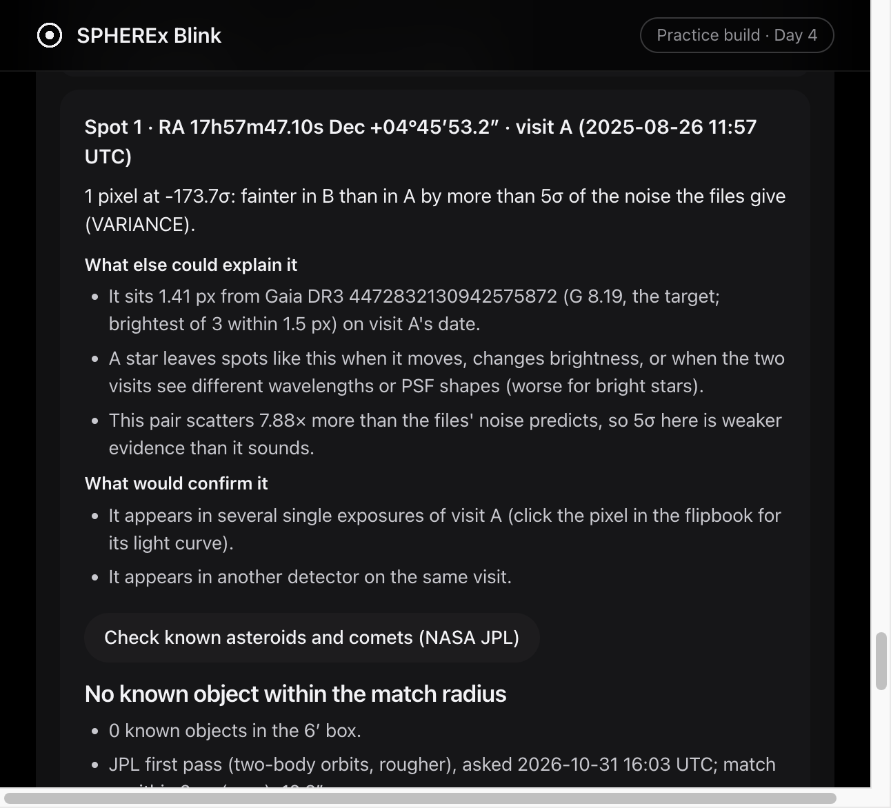
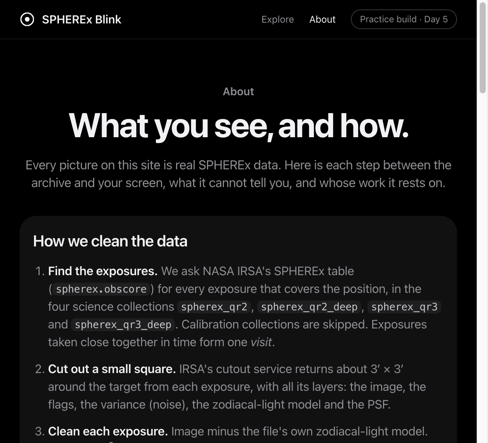

# Day 5 findings: proof panel, spots above 5σ, known-object check, About page (31 Oct 2026)

Every number here comes from the files in `frontend/frames/` and can be re-made:

```bash
python -m backend.app.proof frontend/frames/*/d* --online    # proof.json (--online adds IRSA's release dates)
python -m backend.app.spots frontend/frames/*/d*             # spots.json (offline)
```

Pixel conventions as before: SPHEREx pixels are 6.15″; pictures are north up, east left; PNG x grows to the west, y to the south.
"Ours" below means a limit we chose, not one from NASA or the plan.

---

## 1. Proof panel (`backend/app/proof.py`, `proof.json`, website `frontend/js/proof.js`)

**What it shows.** The target's measured shift from the first to the last visit against Gaia DR3's prediction, and the data it rests on: visits, exposures used of those taken, % flagged pixels, newest exposure, which data releases the exposures come from (asked at IRSA), and when the frames were made.

**The motion rule.** Measured with the centroid of the 5 × 5 pixels around Gaia's position, or the centre of the saturated core when the box is not fully usable (the same code as the C4 tests, now shared in `backend/app/measure.py`). It "agrees" when the two shifts differ by at most **0.5 px** (from HACKATHON_PLAN C4) and **30°** in direction (ours). Below **0.3 px** of expected motion (ours: about our measurement error) the panel says "too small to test" instead of passing.

| Target, detector | Verdict | Expected (Gaia) | Measured | Data |
|---|---|---|---|---|
| Barnard's Star, D2 | agrees | 1.67 px | 1.59 px (saturated-core centre); 0.18 px and 5.5° apart | 3 visits, 24 of 61 exposures; qr2 16 (released 2026-04-21), qr3 8 (2026-09-30) |
| Epsilon Indi B, D2 | agrees | 1.09 px | 0.99 px (centroid); 0.18 px and 8.0° apart | 5 visits, 39 of 92; qr2 31 (2026-06-08), qr3 8 (2026-10-29) |
| R Draconis, D2 | too small to test | 0.00 px | 0.22 px | 3 visits, 24 of 89; qr2 24 (2026-08-04) |
| RW Aurigae, D2 | too small to test | 0.00 px | 0.07 px | 3 visits, 24 of 55; qr2 16 (2026-04-14), qr3 8 (2026-10-19) |
| WISE 0855, D2 and D6 | nothing to compare with | — | — | not in Gaia DR3 (no star within 3″); its motion is checked in DAY4_FINDINGS §3 instead |

These are the same numbers as the C4 acceptance tests (DAY4_FINDINGS §3), now on the website. The release dates are IRSA's `release_date` per exposure, grouped by collection.

---

## 2. Spots above 5σ (`backend/app/spots.py`, `spots.json`, website `frontend/js/spots.js`)

**What a spot is.** A group of touching pixels (8 neighbours) with z ≥ +5 or z ≤ −5 in the difference of a visit pair. Up to 10 per pair, strongest first, numbered on the difference panel. Each has: size, peak σ, position, the Gaia star behind it, possible-artifact flags, and three short texts: why it was listed, what else could explain it, what would confirm it. The text never says "new object".

**Artifact flags** (all ours): long and thin (axis ratio ≥ 3 with ≥ 4 pixels), very large (≥ 20 pixels; SPHEREx's PSF is about one pixel), next to flagged or no-value pixels, touches the frame edge.

**Which Gaia star.** The brightest Gaia star within 1.5 px (ours), otherwise the nearest. A first version took the nearest only, and labelled Barnard's −173.7σ spot with a G 20.59 star 0.58 px away; Barnard's Star itself (G 8.19) was 1.41 px away. A G 20.6 star cannot make a −174σ change, so the rule was changed the same day.

| Target, detector (default pair) | Spots | With a flag | Near a Gaia star |
|---|---|---|---|
| Barnard's Star, D2 (visit 1 → 3) | 9 | 5 | 7 |
| Epsilon Indi B, D2 (2 → 4) | 6 | 2 | 6 |
| R Draconis, D2 (1 → 2) | 4 | 4 | 3 |
| RW Aurigae, D2 (1 → 3) | 24 (10 shown) | 4 of 10 | 10 of 10 |
| WISE 0855, D2 (2 → 3) | 0 | — | — |
| WISE 0855, D6 (2 → 3) | 2 | 1 (frame edge, −8.3σ) | 1 (+5.2σ, 1 px, the G 16.31 Gaia star at 0.61 px) |



Barnard's two biggest spots (222 and 194 pixels) are mostly the glow around the bright star. Their "Gaia star" is only the brightest one near the middle of the patch and means little; they are flagged "very large".

**SPHEREx's position.** Each exposure header has the spacecraft's geocentric position and velocity (`X_SC` … `VZ_SC`, km and km/s, `XYZ_SC_SYSTEM = 'GEOCENTER'`). We assume the axes are ICRF; not confirmed in the Explanatory Supplement yet. All 21 visits have it; distances from Earth's centre are 6,500–7,500 km (a test checks this range).

---

## 3. Known-object check (`backend/app/known_objects.py`, `/api/known-objects`)

**What it does.** Asks NASA JPL's [Small-Body Identification API](https://ssd-api.jpl.nasa.gov/doc/sb_ident.html) (v1.1) which known asteroids and comets were within a 6′ × 6′ box (ours) around the spot at the time of the exposure nearest the visit's mean time, seen from SPHEREx (not Earth's centre). Three answers only:
- **match:** a known object within 2 px = 12.3″ (ours);
- **no match:** none within 2 px. The website adds "No match does not make the spot a new object";
- **unavailable:** JPL did not answer, or the spacecraft position is missing. Not cached, so it is asked again next time.

**What JPL accepted and refused (31 Oct 2026).**
- The observer must be given as SPHEREx's own position and velocity (`xobs`); JPL refuses the geocentre (MPC code 500).
- The time worked as a Julian date; the `YYYY-MM-DD_hh:mm:ss` form gave HTTP 400.
- RA/Dec with decimal seconds failed; whole seconds work. So the box centre is rounded (up to 7.5″ in RA at the equator, 0.5″ in Dec), and distances are corrected back to the spot.
- **The accurate second pass failed for every request**, including the example in JPL's own documentation (HTTP 500 "unexpected error" or 400 with no message). The first pass (two-body orbits, rougher) answered, slowly (15–40 s). The site tries the second pass first and labels the first-pass fallback.

**Test on a real asteroid (Ceres).** JPL Horizons puts Ceres at RA 93.17311°, Dec +22.56610° (geocentric) at 2026-08-21 17:17 UTC (Barnard's third visit). A test spot 6″ east and 4″ north of that (7.2″ away), seen from SPHEREx at that visit: JPL's first pass answered **match, 1 Ceres, 10.1″ away**, with its own error estimate 13.2″. So the check finds a known object where one is. `backend/tests/test_network.py` repeats this and skips if JPL is down.

**Not verified: the sign of JPL's offsets.** We assume JPL's "distance from centre" is east- and north-positive. In the Ceres test the rounding correction was under 0.3″, so the test cannot tell. Open item 2.

**From the website.** Barnard's spot 1, visit 1 (2025-08-26): "No known object within the match radius", 0 known objects in the box, first pass (second pass: HTTP 500), 40 s. The card also says the visit's add-up spans 37.6 h, so an object faster than 0.33″/h moves more than the match radius during it. For WISE 0855 D6 visits 2 and 3 the spans are 785.58 h and 477.56 h (the add-ups take every exposure), which makes a match there almost meaningless; the card says so.



---

## 4. Visit picker and About page

- **+/− buttons** next to the Before and After menus step to the previous or next visit (`stepPair()` in `diffview.js`); a button is disabled when it cannot move, and A always stays an earlier visit than B.
- **About page** (`frontend/about.html`, linked from the header): the nine cleaning steps with their code files, eight limitations, credits. Every statement was checked against the code. That check found two errors, both fixed: WISE 0855 at D6 adds up all exposures of a visit (up to 21), not 8; and `scipy` was used by `spots.py` but missing from `requirements.txt` (it was only installed as a `reproject` dependency).



---

## 5. Tests and checks

- 79 backend tests passed (4 network tests skipped); 41 website tests passed.
- New: `backend/tests/test_day5.py` (proof verdicts and counts, release dates for every exposure, spots match the difference maps, spacecraft position for every visit, the WISE 0855 D6 spot next to its Gaia star, JPL whole-second text, the distance correction, and the endpoint never inventing an answer when JPL is down) and `frontend/tests/day5.test.js` (proof texts, spot lines, the three JPL outcomes, the +/− stepping).
- In the browser (API on port 8011): Barnard's Star proof panel, spot list with 9 numbered marks, spot detail card, JPL button, About page.

---

## 6. Not done / open

1. **Spectrum panel** (brightness against wavelength per visit, across detectors): needs frames for D1, D3–D6, which are not prepared.
2. **JPL offset sign:** test with a spot whose rounding offset is several arcseconds, or compare with Horizons for a known asteroid away from the box centre.
3. **JPL second pass:** try again; if it still fails, ask JPL (the error text says to notify the webmaster).
4. **Spacecraft axes:** confirm `XYZ_SC_SYSTEM = 'GEOCENTER'` means ICRF axes (Explanatory Supplement).
5. **Spot "Gaia star" for huge spots** (Barnard's 222 and 194 pixels): the centre of a big patch is not where its cause is. They are flagged; a better rule would look at the peak, not the centre.
6. Still open from Day 4: AAVSO comparison, field-star floor in other frames, WISE 0855 in D1/D3/D5, the 520.6 mJy D6 exposure, RW Aur's spread within 2 hours.
