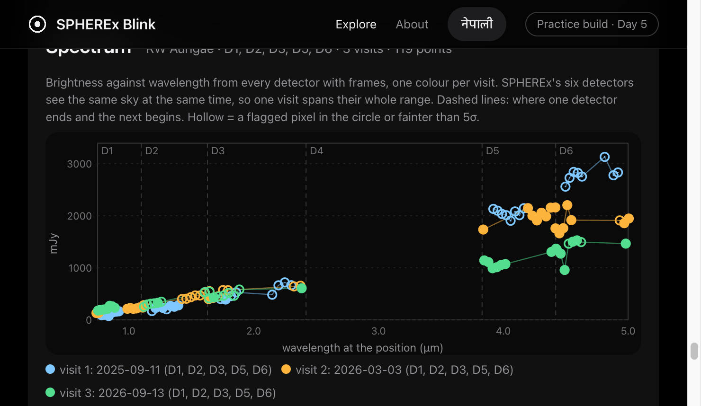
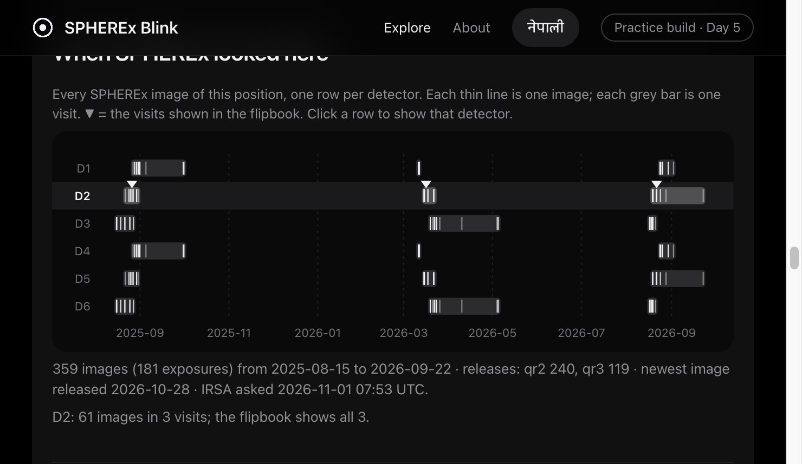
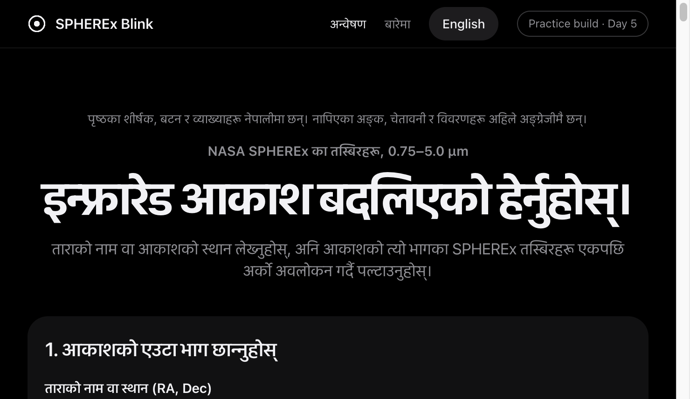

# Day 6 findings (1 Nov 2026)

What was built and checked today, and what it showed. Practice build, not the submission.

## 1. Built

| Feature | Where | Notes |
|---|---|---|
| Coverage timeline | `backend/app/coverage.py`, `frontend/js/timeline.js` | Every SPHEREx image of the position, one row per detector, visits grouped with the archive's rule; ▼ marks the flipbook's visits; click a row to switch detector. Saved as `frames/<target>/coverage.json` so it works without the API. |
| Flipbook GIF | `backend/app/gif.py` | The visit PNGs as the site shows them, enlarged with whole pixels (no smoothing), caption with target, detector, visit, date and credit. |
| Links to the original files | `backend/app/originals.py`, `frontend/js/files.js` | For every exposure added up: data release, IRSA DataLink address, and the full Level 2 FITS file. All 17 prepared folders resolve, 0 missing. One file URL checked: HTTP 206, `application/fits`. |
| Nepali toggle | `frontend/js/i18n.js` | 66 tagged elements (65 texts). Measurements, warnings and notes from the data files stay English; the Nepali page says so. **Kripas: please read the Nepali once.** |
| Planet X explainer | `frontend/js/planetx.js`, About page | Geometry only: Earth's orbit chord over distance plus Kepler. At 500 AU: about 1.2 px per day, 17 px in a 2-week visit, 14.7′ between visits half a year apart; a Neptune twin would be V ≈ 20. Conclusion: it would not stay in a 3′ square. |
| Phone layout | `frontend/css/style.css` | At 390 px: no sideways overflow; the 640-unit charts keep 560 px and scroll sideways (were shrunk to half, 5.5 px labels); IRSA links 31 px tall. |
| Browser cache | `backend/app/main.py` | Static files now sent with `Cache-Control: no-cache` (ETag revalidation). The timeline first "did not appear" because the browser ran a cached `app.js`. |

## 2. Fixed

- **Huge spots named a faint star.** Barnard D2 spots of 88–222 px at 60–99σ were labelled with the Gaia star nearest their centre (G 18.3–20.7). For spots of 20 px or more the label is now the brightest Gaia star inside the spot (G 13.6 or 16.7 here), "inside" in the list.
- **"a ? px circle"** in the spectrum warnings when no detector had points (Barnard): the aperture warning now only appears when there are points.

## 3. Checked

- **The 520.6 mJy WISE 0855 D6 exposure** (2025W46_1A_0076_2): one pixel next to the target reads 618 MJy/sr against a 0.5 MJy/sr background; FLAGS = TRANSIENT + SUR_ERROR + NONFUNC + PERSIST + SOURCE. A detector defect in that exposure, not WISE 0855. The other 7 pixels in the circle read 0.4–0.9. The point stays, hollow and off the chart's range.
- **JPL's offset sign**: `scripts/check_jpl_offsets.py` asks Horizons where Ceres is, then sends Small-Body Identification a box moved 60″ east and 40″ north of it. JPL gives Ceres at −55.7″, −36.2″; JPL's own RA/Dec for Ceres give −59.1″, −36.0″. So offsets are object minus centre, east and north positive, as `known_objects.py` assumed. The 3.4″ RA difference is under the 12.3″ match radius; not explained.

## 4. New data

| Target | Detectors | Spectrum |
|---|---|---|
| WISE 0855 | D2, **D5**, D6 | 3 visits, D2+D5+D6 each |
| RW Aur | **D1, D3, D4, D5, D6**, D2 | 3 visits, 119 points in D1, D2, D3, D5, D6. D4: no points (saturated core reaches 6.2 px). |

RW Aur at 4–5 µm (D6) reads about 2,800, 2,000 and 1,500 mJy in Sep 2025, Mar 2026 and Sep 2026, while 1–2 µm stays near 100–600 mJy. The light curves' same-wavelength rule (wavelengths within half a bandwidth, both ≥ 5σ, no flagged pixel in either circle) gives, Mar 2026 → Sep 2026:

| Detector | Clean pairs | Median ratio (range) | Largest wavelength gap |
|---|---|---|---|
| D5 (≈ 4.1 µm) | 3 | 0.633 (0.606–0.658) | 0.008 µm |
| D6 (≈ 4.7 µm) | 5 | 0.770 (0.544–0.789) | 0.012 µm |

So RW Aur got fainter at 4–5 µm between those two visits, measured at the same wavelengths in the same detector. Sep 2025 can only be compared using exposures with flagged pixels (ratios 0.50 in D5, 0.54 and 0.70 in D6), so that part is less certain. Not checked against other data (AAVSO was unreachable, and AAVSO is visible light anyway). The circle has no aperture correction, but a ratio in one detector at one wavelength mostly cancels that.

## 5. Tests

128 backend (pytest) and 57 frontend (node --test) pass. New: `test_coverage.py`, `test_day6.py` (GIF frames, originals match `exposures.fits` for all 17 folders), `timeline.test.js`, `files.test.js`, `i18n.test.js`, `planetx.test.js`.

## 6. Still open

- RW Aur 4–5 µm drop: compare with WISE/NEOWISE history or the literature before using it in the pitch.
- AAVSO for RW Aur / R Dra (unreachable 31 Oct).
- Real phone check after a deploy; the 30-second video; rehearsal from an empty repo (7–8 Nov).
