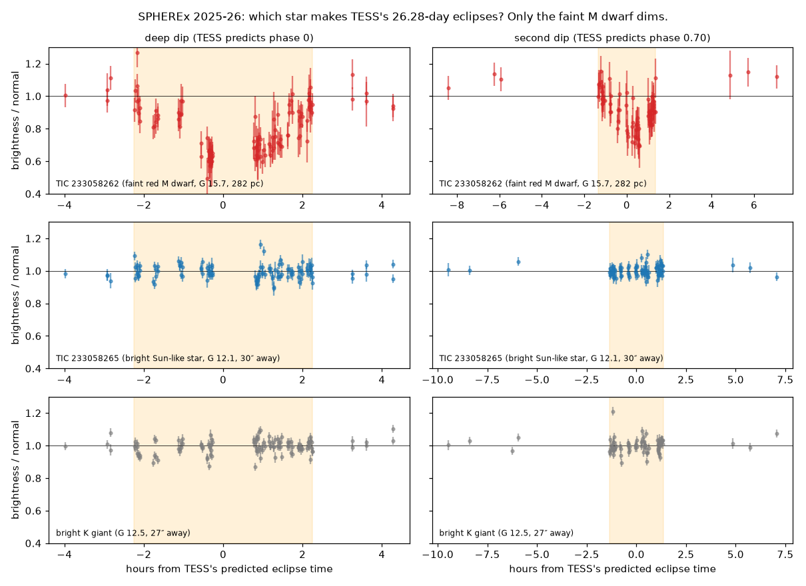

# Eclipse mode findings (12 Nov 2026)

What the eclipse-mode search found in the SPHEREx deep field, and how sure we are. Practice build, not the submission. Say "we identified and characterised", not "we discovered".

## 1. In one sentence

Using SPHEREx deep-field photos from 2025–26 lined up on TESS's eclipse timetable, we showed that the 26.28-day eclipses listed in the TESS eclipsing-binary catalogue under both TIC 233058262 and its bright neighbour TIC 233058265 (29″ away) come only from the faint red star TIC 233058262. It is a likely pair of M dwarfs 282 pc away in an eccentric orbit (second dip at phase 0.70, e ≈ 0.4). SPHEREx detects both dips (about 31% and 18% deep) and gives the period as 26.27818 ± 0.0002 days, about 10× more precise than the catalogue. We found no published study of it.

## 2. Main finding: TIC 233058262

**The puzzle.** TESS-EBs v1.0 (Prša et al. 2022) lists the same 26.28-day eclipse signal under two stars 29.3″ apart, TIC 233058262 and TIC 233058265. TESS's 21″ pixels blur them together; SPHEREx's 6.15″ pixels separate them.

**The test.** Each star near the binary is measured on the same SPHEREx exposures (2 px circle, sky ring 5–8 px), normalised per detector, and folded on the TESS ephemeris. We used 465 exposures from 2025–26, 122 of them during predicted deep dips.

| Star | Gaia DR3 | Dims during the deep dip? |
|---|---|---|
| Faint M dwarf TIC 233058262 (G 15.7) | 1439929468642754944 | **Yes: 31.0% ± 4.0%** |
| Bright star TIC 233058265 (G 12.1, 29″ away) | 1439929636145409920 | No: −0.1% ± 0.8% |
| Bright K giant (G 12.5, 27″ away) | 1439929468642755584 | No: 0.5% ± 0.8% |
| Bright star at the off-target dark spot in the difference image (G 12.8) | | No: −1.2% ± 0.9% |

The dark spot in the difference image is leftover light from a bright star that did not subtract perfectly, not a second variable.

**What SPHEREx adds:**

- **Second dip detected:** 18% ± 2% deep at phase 0.703; TESS predicts 0.701.
- **Eccentric orbit:** a second dip at 0.70 instead of 0.50, plus dips of different lengths, gives e ≈ 0.4. This is a rough estimate from the e cos ω and e sin ω approximations, not an orbit fit.
- **Better period:** 26.27818 ± 0.0002 d, against the catalogue's 26.2781 ± 0.002 d. TESS's timetable had drifted by about ±4 hours by 2026; SPHEREx pins the eclipse to about ±20 minutes.
- **Type of star:** Gaia colour (BP−RP 2.05) and absolute G 8.43 at 282 pc match two early-M dwarfs. A single M dwarf of that colour would be about 0.3 mag fainter.
- **Not a known variable:** no VSX entry within 2′, and no publication found. The star appears on TESS Guest Investigator target lists (Prša programmes, G07071 eclipse-timing study), so it was targeted, not studied.

**Why it matters.** Long-period M-dwarf eclipsing binaries are rare, and they are the clean test of the M-dwarf radius-inflation problem ("M dwarfs look too big"), because at long periods tides barely spin the stars up. See [six long-period low-mass binaries (2025)](https://iopscience.iop.org/article/10.3847/1538-3881/ae04ed) and [NGTS-EB-7 (2025)](https://doi.org/10.1093/mnras/stae2799). The [2025 TESS M-dwarf eclipsing-binary catalogue](https://arxiv.org/html/2508.13941) focuses on short periods and does not include this star.

## 3. Limits

- TESS observed this field again in later sectors (40, 41, 56, 84 and more). The TESS-EBs team may already know which star is real and simply not have published it.
- "Two M dwarfs" comes from Gaia colour and brightness, not a spectrum.
- SPHEREx dips are shallower than TESS's (31% vs 42%, 18% vs 30%). Possible causes are our averaging, or TESS over-correcting for the bright neighbour. Not explained.
- The fold has reduced χ² ≈ 10, so the quoted errors are statistical only.

## 4. Other results from this search

- **The two original binaries.** The secondary dip deepens toward the infrared: TIC 219900027 from 5.9% to 13.6% (4.3σ), TIC 233208885 from 25.4% to 34.7% (3.1σ). Rough temperature ratios are 0.71–0.75 and 0.89–0.91.
- **TIC 233233639.** The catalogue lists no second dip; SPHEREx finds one (0.918 against 0.861 at the main dip, 7σ). Odd and even dips agree in all 6 detectors (χ² 7.1), so TESS's period is right. This is a near-contact pair; its timing changes with the fitting method by ±10 minutes, so no timing claim. The pipeline baseline fails here (null test 4.7%), so raw normalised brightness was used.
- **Correction for TIC 233208885.** Fitting several ways puts the dip 3.8 to 7.0 minutes early, so the period is about as precise as TESS's, not 3.6× better.
- **Ruled out:** no new variable stars in the fields; one G 16.7 star repeating every 0.2469 d (half the binary's period) is the binary's light leaking into its circle; a single spike was an unflagged cosmic ray (absent in the partner detector and in exposures ±2 min away); a 1.4% offset in a corner star is a systematic. No third-star signal.
- **Gaia scan of all 74 usable binaries:** 27 have a neighbour within three TESS pixels bright enough to fake the dips. TIC 233058262 was the strongest case; the other 26 could get the same test.

## 5. Research gaps this fills

1. **SPHEREx as an eclipse tool.** Published SPHEREx stellar work ([novae and FU Orionis outbursts](https://iopscience.iop.org/article/10.3847/2041-8213/ae4aa9), [Wolf–Rayet stars](https://academic.oup.com/mnras/article/553/1/stag1822/8836705), [the UPK 13 binary](https://arxiv.org/html/2606.18971)) uses single spectra. The UPK 13 paper could only use SPHEREx as an average spectrum because its photos mostly missed the eclipse. Timing deep-field photos to a TESS ephemeris is not shown anywhere we found.
2. **Which star really dims.** Blending under TESS's 21″ pixels is common, and checking the source should be routine ([Higgins & Bell 2023](https://iopscience.iop.org/article/10.3847/1538-3881/acb20c/pdf); [TESS Ten Thousand catalogue](https://iopscience.iop.org/article/10.3847/1538-4365/ade2d8/meta)). SPHEREx's 6″ pixels can do it across the whole deep field.

## 6. Files

The scripts and outputs are in `scratch/`, which is git-ignored. Move them into `scripts/` before relying on them from a clean checkout.

| File | What it does |
|---|---|
| `scratch/which_star.py` | Measures the three stars on the same exposures, folds them on TESS's clock, and reports depth, timing and per-detector depth. Cache only. |
| `scratch/odd_even.py` | Odd-vs-even dip test (TIC 233233639). |
| `scratch/hunt.py`, `hunt2.py`, `hunt3.py` | Field-star variability, early-vs-late halves, spikes, corner star, period refinement. |
| `scratch/hunt_out/tic233058262_which.json` | Depths and timing per star. |
| `scratch/hunt_out/blend_scan.json` | Gaia neighbour scan of the 74 binaries. |
| `scratch/eclipse_new/tic233058262/`, `tic233233639/` | Full eclipse builds for the two new binaries (not on the website). |

## 7. Still open

- Follow-up (13 Nov 2026): the same test on all 11 unanswered TESS-EBs duplicate pairs, using SPHEREx DR1, identified
  five more eclipsing stars. See `SPHEREX_BLEND_SURVEY.md`.
- Run `which_star.py` on the other 26 binaries with a bright neighbour.
- Check TESS sectors 40, 41, 56 and 84 for TIC 233058262 (centroid shift or per-pixel light curve) to confirm independently.
- Explain the shallower SPHEREx depths.
- A spectrum would confirm the two-M-dwarf reading.
- Decide whether TIC 233058262 goes on the eclipse page.
