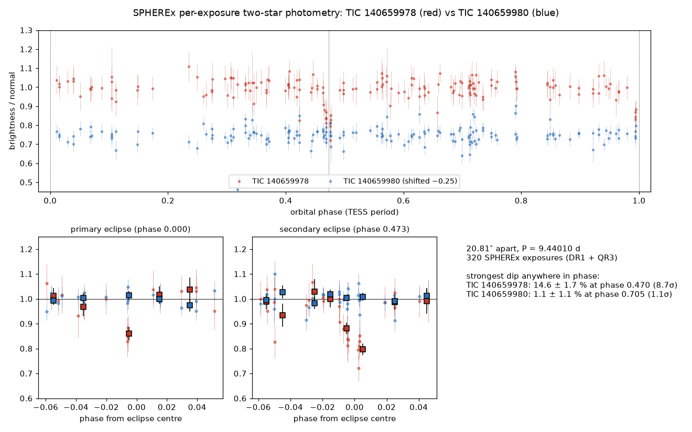
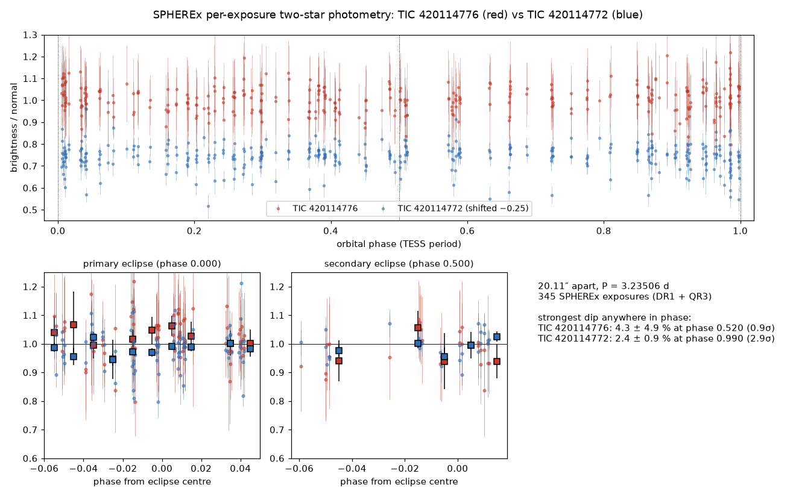
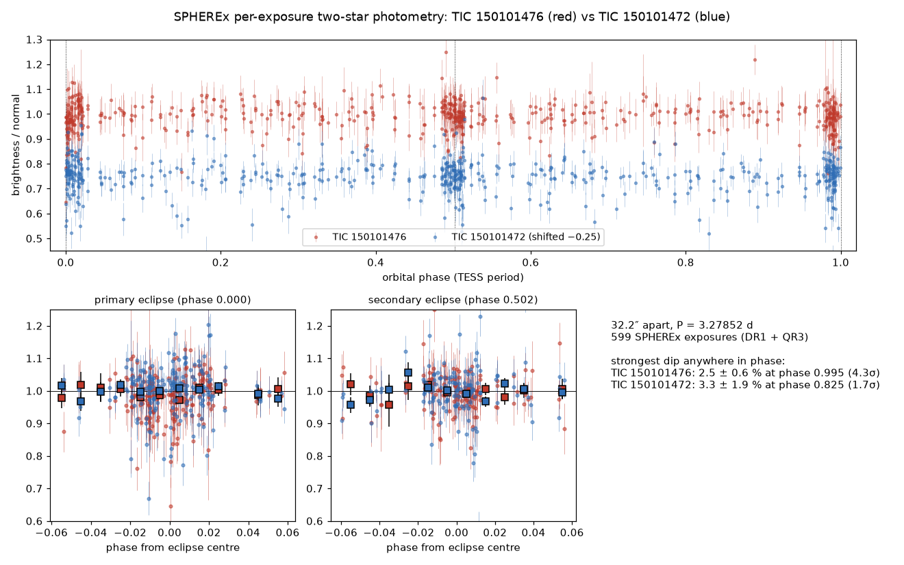
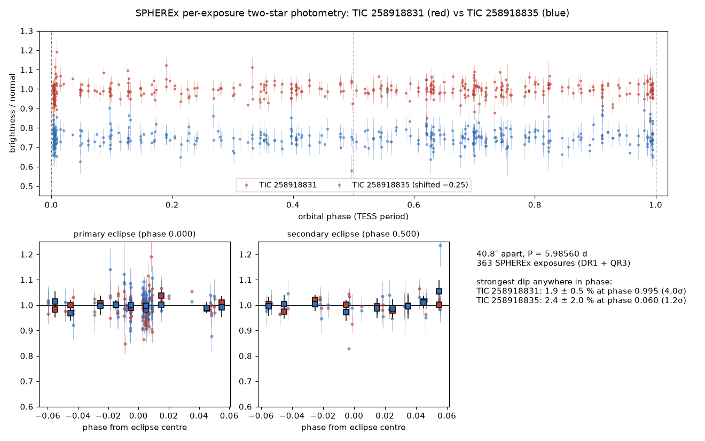
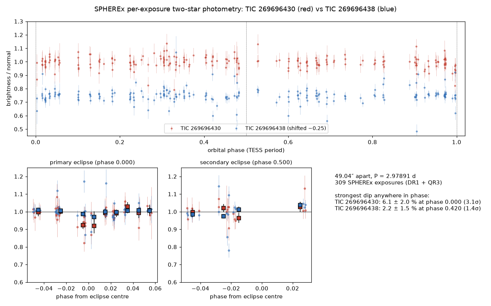

# Which star is really eclipsing? SPHEREx settles blended TESS eclipsing binaries

*Overnight research run, 12–13 November 2026. Code in `research/`, numbers in `research/out/`, figures in
`notes/screenshots/blend_survey/`.*

## The result in one paragraph

The TESS Eclipsing Binary catalogue (TESS-EBs, Prša et al. 2022, 4,584 entries) lists **68 pairs of different stars that
share the same eclipse**: same period, less than 150″ apart. One star of each pair is the real eclipsing binary; the
other only looks like one because TESS's 21″ pixels mix their light. The live catalogue (tessebs.villanova.edu, last
updated February 2025) still marks both stars of every pair as genuine, with no flag. Public catalogues (VSX, the Gaia DR3
eclipsing-binary table, the TESS Ten Thousand catalogue) settle 31 of these pairs; 26 more are closer than 12″, too
close for SPHEREx's 6.2″ pixels to split. That leaves **11 pairs nobody has answered**. Using SPHEREx's new DR1 data (released 2026, up to ten times more exposures
than the quick releases the website was built on), I tested every one of them. **Five are now identified for the first
time, in five different parts of the sky** (four firmly, one as probable), and in that probable one the catalogue's
deeper eclipse is on the star that is *not* eclipsing.
The method was validated on two pairs where the answer is already known, and it got both right.

| | TIC that really eclipses | its neighbour (not eclipsing) | separation | period | where |
|---|---|---|---|---|---|
| 1 | **TIC 140659978** | TIC 140659980 | 20.8″ | 9.440 d | Dorado / Mensa, 04h49m −72°28′ (SPHEREx south deep field) |
| 2 | **TIC 420114772** (probable) | TIC 420114776 | 20.1″ | 3.235 d | Draco, 19h21m +74°46′ |
| 3 | **TIC 150101476** | TIC 150101472 | 32.2″ | 3.279 d | Pictor / Dorado, 06h08m −63°15′ |
| 4 | **TIC 258918831** | TIC 258918835 | 40.8″ | 5.986 d | Draco, 19h14m +69°27′ (SPHEREx north deep field edge) |
| 5 | **TIC 269696430** | TIC 269696438 | 49.0″ | 2.979 d | Draco / Cepheus, 20h06m +68°17′ |

Together with TIC 233058262 (found earlier, see `ECLIPSE_FINDINGS.md`) that makes six TESS-EBs duplicates resolved
by SPHEREx. I could not find a published SPHEREx-based source identification for any eclipsing binary. For these six
pairs I also found no published answer of any kind: they are not in VSX with a matching period, not in the Gaia DR3
eclipsing-binary table, not in TESS Ten Thousand, and not flagged on the live TESS-EBs pages.

**Wording.** These are *identifications* of which star produces an already-known eclipse, not discoveries of new
binaries. The finding that is new is the answer itself, together with the evidence that SPHEREx can give it.

## Why this matters

- A catalogue entry on the wrong star gives that star a false binary label, and gives the real binary the wrong
  brightness, colour and distance. Anyone building samples from TESS-EBs (mass–radius studies, period distributions,
  third-body searches) inherits the error.
- **Pair 2 suggests the obvious shortcut can fail.** TESS-EBs lists a 18.8% deep eclipse for the faint star TIC 420114776
  and only 2.3% for the bright star TIC 420114772, so you would guess the faint one. SPHEREx says otherwise: the faint
  star shows no eclipse (−5.9 ± 3.0%, which rules out 18.8% by more than 8σ), and the bright star's deepest dip in the
  whole orbit is 2.4% at the eclipse phase, the TESS value (only 2.9σ, so this half of the evidence is weak). The likely explanation is that the faint star's TESS light curve was corrected for crowding
  by subtracting the neighbour's average light. That subtraction removes the bright star's constant light but not
  its eclipse, so the eclipse ends up measured against the faint star's much smaller brightness and is inflated
  about eight times. This explanation is unconfirmed: checking it needs the CROWDSAP keyword from the TESS light-curve
  file. In pair 1 the deeper star *is* the real one, so "deeper = real" cannot be trusted on its own.
- SPHEREx's sharper pixels (6.2″ against TESS's 21″) do the separating; its infrared wavelengths add nothing to it.
  Its point is that it watches the same patches of sky hundreds of times a year, so it catches stars during eclipses
  even though it was never pointed at them.

## The gap, step by step

1. **68 duplicate pairs** in TESS-EBs v1.0: two different TIC stars, period equal within 5×10⁻⁴ (or ×2 / ×½), less than
   150″ apart (`research/out/all_duplicate_pairs.json`).
2. **The live catalogue still lists both.** All checked pages at `tessebs.villanova.edu/<TIC>` say "In catalog: True"
   for both stars (`research/data/tessebs_live/`).
3. **What other catalogues already answer** (`research/classify_pairs.py`, output `research/out/pair_table.md`):

   | status | pairs |
   |---|---|
   | answered by VSX and Gaia DR3 (same star, same period) | 16 |
   | answered by VSX only | 15 |
   | closer than 12″, too close for SPHEREx | 26 |
   | **open: no catalogue answer, far enough apart for SPHEREx** | **11** |

   Two pairs are also in TESS Ten Thousand (Kostov et al. 2025); both agree with VSX. None of the 11 open pairs are in it.
4. **The 11 open pairs**, all tested in this run:

   | pair | sep | result |
   |---|---|---|
   | 233058262 / 233058265 | 29.3″ | **233058262** (earlier result, very strong) |
   | 140659978 / 140659980 | 20.8″ | **140659978** (strong) |
   | 420114772 / 420114776 | 19.8″ | **420114772** (probable; catalogue depth points the wrong way) |
   | 150101476 / 150101472 | 31.3″ | **150101476** (good) |
   | 258918831 / 258918835 | 40.3″ | **258918831** (good) |
   | 269696430 / 269696438 | 49.5″ | **269696430** (good, fewer exposures) |
   | 243391171 / 243391162 | 23.8″ | not settled: SPHEREx caught only the shallow (1%) second eclipse |
   | 99028324 / 99028319 | 14.6″ | not settled: only the second eclipse, and only 14.6″ apart |
   | 16805617 / 16805614 | 56.1″ | not settled: no exposures inside either eclipse |
   | 124712820 / 124712813 | 12.9″ | not testable: the TESS clock has drifted by 0.27 of an orbit by 2025–26 |
   | 356974629 / 356974639 | 15.7″ | not testable: 2 exposures in the primary eclipse |

## How each pair was tested

For each pair, every SPHEREx exposure (DR1 + DR1 deep + QR3 + QR3 deep, May 2025 – Nov 2026) that covers the stars
was found in the IRSA archive, and a 3′ cutout was downloaded (300–600 per pair). The TESS ephemeris (the "clock")
says, for each exposure, where the binary is in its orbit. Then, three independent measurements:

1. **Circle photometry.** Light in a 2-pixel circle around each star, minus the sky in a ring; each star divided by its
   own out-of-eclipse brightness (fitted separately for each of SPHEREx's six detectors, since the wavelength
   changes across each image). Depth = how much fainter the star is in the middle half of the eclipse.
2. **Two-star fit, one exposure at a time.** Both stars are fitted together with SPHEREx's image shape (measured on the
   out-of-eclipse images) at their fixed Gaia positions. This splits the light even where the two circles touch.
3. **Blind phase scan** (`research/plot_phase.py`). The two-star-fit brightness is folded on the TESS period and the
   deepest dip is searched for *at any phase*, leaving out the single lowest exposure in each window so one bad
   image cannot make a dip. This tests whether the dip is where TESS says it should be, and whether the other
   star has a dip anywhere.

A star is called the source when the methods agree, its dip sits at TESS's eclipse phase, and the neighbour shows
nothing above 2σ.

### Validation on pairs with a known answer

| pair | known answer | SPHEREx answer | two-star fit depth, source vs neighbour |
|---|---|---|---|
| 276935987 / 276935996 | 276935987 (VSX and Gaia DR3) | 276935987 ✔ | 21.8 ± 2.1% vs 1.0 ± 2.9% |
| 233058262 / 233058265 | 233058262 (earlier SPHEREx work, 465 exposures) | 233058262 ✔ | 34.2 ± 1.4% vs 0.7 ± 0.9% |
| 198242678 / 198242676 (WW Dra, only 8.3″ apart) | 198242678 (VSX) | 198242678 ✔ | secondary 16.9 ± 1.5% vs −10.9 ± 3.4%; blind scan 26.8% at phase 0.005 (14σ) vs 1.5σ |

WW Dra shows where simple circle photometry stops working: at 8.3″ both circles dim (21.5% and 24.1%) because each
contains the other star. The two-star fit still separates them. So the 12″ limit used above is cautious, and some of
the 26 "too close" pairs may be testable too.

## Results in detail

All depths are in percent. "Circle" is circle photometry and "PSF" is the two-star fit. The blind scan gives the
deepest dip anywhere in the orbit, its phase (0 or 1 = primary eclipse) and its significance. Full table:
`research/out/summary.md`.

| pair (real vs neighbour) | exposures | eclipse used | circle | PSF | blind scan, real star | blind scan, neighbour |
|---|---|---|---|---|---|---|
| 140659978 vs 140659980 | 320 | secondary | 12.4 ± 6.1 vs −10 ± 17 | **18.8 ± 1.8** vs −0.4 ± 1.2 | 14.6% @ 0.47 (8.7σ) | 1.1% @ 0.70 (1.1σ) |
| 420114772 vs 420114776 | 345 | primary | −3.0 ± 1.9 vs −9.0 ± 1.9 | 1.6 ± 1.2 vs −5.9 ± 3.0 | **2.4% @ 0.99 (2.9σ)** | 4.3% @ 0.52 (0.9σ) |
| 150101476 vs 150101472 | 599 | primary | **2.2 ± 0.3** vs −0.7 ± 0.4 | 2.4 ± 0.6 vs −0.1 ± 0.7 | 2.5% @ 0.99 (4.3σ) | 3.3% @ 0.82 (1.7σ) |
| 258918831 vs 258918835 | 363 | primary | 2.3 ± 0.5 vs 0.4 ± 0.7 | 2.7 ± 0.9 vs −0.1 ± 1.1 | 1.9% @ 0.99 (4.0σ) | 2.4% @ 0.06 (1.2σ) |
| 269696430 vs 269696438 | 309 | primary | **7.1 ± 0.7** vs −0.2 ± 1.4 | 7.6 ± 2.1 vs 1.5 ± 1.9 | 6.1% @ 0.00 (3.1σ) | 2.2% @ 0.42 (1.4σ) |

Notes per pair:

- **TIC 140659978** (T = 10.7, south deep field). TESS-EBs gives it 31.8% / 18.9% (primary / secondary) and the
  neighbour 4.5% / 2.7%. SPHEREx measures 18.8 ± 1.8% in the secondary eclipse, the same as TESS's own number, so
  essentially none of the neighbour's light was mixed in. The few primary-eclipse points (ingress) sit at 0.87.
  The strongest result of the night.
  
- **TIC 420114772** (T = 10.0, Draco). The catalogue says 2.3% for this star and 18.8% for the faint neighbour.
  The firm part: the faint star does not dim by anything like 18.8% during the eclipse. The weak part: the bright
  star's own dip is only 2.9σ in the blind scan; its middle-of-eclipse average is 1.6 ± 1.2% (two-star fit), and circle
  photometry even gives −3.0 ± 1.9%. Circle photometry is unreliable here for both stars, because they are only 20″
  apart, the faint one is 3.3 magnitudes fainter, and each star's sky ring catches the other. So this pair is
  "probable": the faint star is ruled out, and the bright star fits but is not yet independently detected.
  
- **TIC 150101476** (T = 11.1). Earlier, with QR3 only, this was "tentative" (2.6 ± 1.3% vs 3.2 ± 1.4%). DR1 adds
  enough exposures (103 in the eclipse window) to settle it: 2.4 ± 0.6% vs 0.0 ± 0.4%. TESS-EBs: 2.3% vs 0.2%.
  
- **TIC 258918831** (T = 11.7). Shallow (TESS 2.2%), but all three methods agree, and the blind scan finds the
  deepest dip anywhere in the orbit at phase 0.99.
  
- **TIC 269696430** (T = 10.2; the neighbour is a 1.5 mag brighter star 49″ away). Only 9 exposures inside the eclipse,
  but circle photometry gives 7.1 ± 0.7% against TESS's 5.7%, and the neighbour gives nothing.
  

The per-pair light-curve figures (`eclipse_*.png`) are in the same folder.

## Other things found along the way

- **The website's SPHEREx collections are obsolete.** IRSA now returns nothing for `spherex_qr2` /
  `spherex_qr2_deep`. The data has moved to `spherex_dr1` / `spherex_dr1_deep` (May 2025 – May 2026) plus
  `spherex_qr3` / `spherex_qr3_deep` (from May 2026). For the deep fields DR1 has about 5–10 times more exposures
  (TIC 150101476: 6,938 now). `COLLECTIONS` in `backend/app/config.py` should change to
  `("spherex_dr1", "spherex_dr1_deep", "spherex_qr3", "spherex_qr3_deep")`; `research/dr1.py` already uses these.
- **Broken catalogue entries.** TESS-EBs gives TIC 233058265 an eclipse depth of 1.30, which is impossible (deeper
  than 100%). This is another sign that its entry is a contaminated copy.
- **A planet listed as a binary.** The pair 178284729 / 178284730 (P = 2.236 d) is WASP-140, a transiting hot Jupiter
  (VSX type EP) on TIC 178284730. TESS-EBs lists the signal under both stars.
- **Southern deep-field position.** In this data the southern deep field covers 276935987 and 150101476
  (around RA 72–92°, Dec −63 to −72°).

## Papers read (PDFs in `research/papers/`)

| arXiv | what it is | why it matters here |
|---|---|---|
| 2110.13382 | Prša et al. 2022, TESS-EBs | the catalogue with the duplicates |
| 2506.05631 | Kostov et al. 2025, TESS Ten Thousand | does not resolve these pairs |
| 2211.00929 | Mowlavi et al. 2023, Gaia DR3 eclipsing binaries | independent answer for 16 pairs |
| 2204.06020 | Higgins & Bell 2023, TESS_localize | localises variability from TESS's own pixels; the natural cross-check |
| 2511.02985 | SPHEREx mission paper | pixel scale, deep fields, cadence |
| 2508.20332 | SPHEREx survey planning | when the deep fields are visited |
| 2606.18971 | UPK 13 with SPHEREx | uses SPHEREx only as an average spectrum |
| 2508.13941 | M&M eclipsing binaries | context on eclipsing-binary samples |
| 2607.00543 | SPHEREx brown dwarfs | SPHEREx time-domain use |

Also relevant: Zasche 2025 (MNRAS Letters slaf104) showed that a third of the doubly-eclipsing candidates in Rowan et
al. 2023 are blends, using ground surveys (VSX, Gaia, ASAS-SN, ZTF). That is the same kind of problem solved with
different data, which supports the need for this work.

## Open-source tools found

| tool | what it does | relation to this work |
|---|---|---|
| [TESS-Localize](https://github.com/Higgins00/TESS-Localize) (`pip install tess_localize`) | finds which star in TESS pixels varies | could check all six pairs independently; not run yet |
| [SPXQuery](https://github.com/WenkeRen/spxquery) (`pip install spxquery`) | general SPHEREx light curves | no eclipse folding, no two-star deblending |
| [IRSA tutorials](https://github.com/Caltech-IPAC/irsa-tutorials) | SPHEREx cutouts, spectrophotometry | the archive access used here |
| IRSA SPHEREx Spectrophotometry Tool | Tractor forced photometry | an alternative to the two-star fit |
| TGLC (arXiv 2301.03704) | TESS light curves corrected for blending using Gaia | another check on the TESS side |

None of these tools combines SPHEREx imaging with TESS eclipse timing to decide which star in a blend is the
eclipsing one.

## Limits

- Five new results rest on 9 to 103 in-eclipse exposures each. Pairs 2, 4 and 5 are about 3–4σ in the blind scan. They
  are good results, not certainties; more SPHEREx data (DR2) would raise them.
- SPHEREx pixels are 6.2″; below about 12″ separation the two stars cannot be separated (26 of the 68 pairs).
- The download budget kept 300–600 of the available exposures per pair. Using all of them (up to 6,938 for
  150101476) would shrink the error bars.
- The crowding-correction explanation for pair 2 is a hypothesis; it is not checked yet.
- An independent check with TESS's own pixels (TESS-Localize) has not been done yet.
- Nothing here has been reviewed by anyone else.

## How to reproduce

```bash
cd wise-blink-practice
PYTHONPATH=. .venv/bin/python research/classify_pairs.py                 # the 68 pairs and what catalogues say
MPLCONFIGDIR=/tmp/mpl PYTHONPATH=. .venv/bin/python research/run_pairs.py 140659978 140659980   # coverage + test + figure
MPLCONFIGDIR=/tmp/mpl PYTHONPATH=. .venv/bin/python research/plot_phase.py 140659978 140659980  # blind phase scan
.venv/bin/python research/summarise.py                                   # table of all tested pairs
```

## Next steps

1. Run TESS-Localize on the six pairs, as a second opinion from TESS's own pixels.
2. Use the full DR1 data for the weak pairs (258918831, 269696430, 420114772), not the 300–600-image budget.
3. Check the CROWDSAP value in the TESS light-curve file for TIC 420114776, to confirm why its depth is inflated.
4. Write a short Research Note (RNAAS): "SPHEREx resolves six blended TESS eclipsing binaries", with the table above.
5. Tell the TESS-EBs team (Villanova) which entry of each pair is the contaminated copy.
6. Update the website's SPHEREx collections to DR1.
