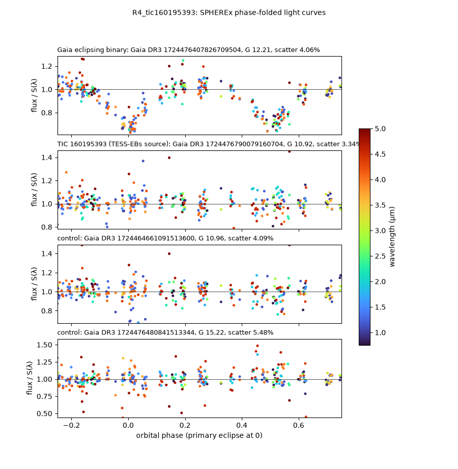
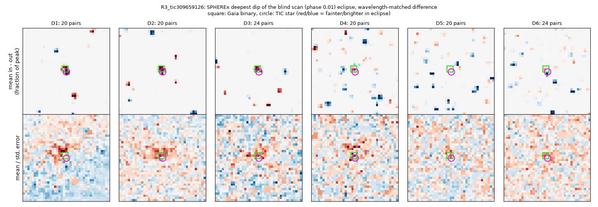

# Which star is eclipsing? Correcting TESS eclipsing-binary attributions with Gaia DR3 and SPHEREx

*SPHEREx TimeLens research investigation, 13 November 2026. All numbers come from files in `research/` (see
`REPRODUCIBILITY.md`); nothing here was committed to the repository.*

## Summary

TESS has 21″ pixels, so the light of several stars is mixed in each light curve. The TESS eclipsing-binary
catalogue (TESS-EBs; Prša et al. 2022) names one star per eclipse signal: the TESS target. We cross-matched all
4,582 TESS-EBs entries with the Gaia DR3 eclipsing-binary table (Mowlavi et al. 2023) and found that for **278 of
the 1,543 entries that have a period-matched Gaia eclipsing binary within 63″, that binary is a different star**
(about two such matches are expected by chance). In **265** of them the Gaia binary is not in TESS-EBs at all. The
TESS depths are what dilution of the Gaia binary's eclipse by the brighter TESS target predicts (242 of 245 are
physically possible), and the rate rises from 8–9% at galactic latitudes above 30° to 30% within 5° of the plane.

We then tested five of these entries, in five different kinds of sky region never used by the project before, with
SPHEREx images (6.2″ pixels, 0.75–5 µm, 335–705 exposures per region, April 2025 – October 2026). In **all five**,
SPHEREx sees the eclipses on the Gaia binary and not on the star TESS-EBs names, with four independent lines of
evidence where the field allows: forced PSF photometry of every star, an empirical false-alarm test, the binary's own
periodogram (no TESS information), and the position of the light that disappears in eclipse. Along the way, the
same data show that the variable-star catalogue VSX places ASAS J051801-6041.4 on the wrong star (R3), that
SIMBAD's "eclipsing binary" label on TIC 31511621 most likely copies the TESS-EBs error (R5), and that TESS-EBs
labels the shallower eclipse as primary for at least one entry (R2).

The binaries themselves are known (OGLE, ASAS-SN, Gaia), and finding the true source of a blended eclipse by
catalogue cross-matching is an established technique (Coughlin et al. 2014; Zasche 2024, 2025). What is new is
*which TESS-EBs entries belong to them*,
their first infrared eclipse depths, and the catalogue-wide statistics. We classify the five individual corrections
as **D (potentially novel, strong evidence)** for four regions and **C (candidate)** for the crowded LMC region, and
the 265-entry list as **C** (statistical, 5 of 5 tested cases confirmed). No new variable star was found; two
candidates from the blind search were rejected.

## 1. Project background

SPHEREx TimeLens (this repository) shows SPHEREx images of one patch of sky taken at different times (Blink
Flipbook) and, in Eclipse Mode, folds them on the TESS-EBs ephemeris of an eclipsing binary so that in-eclipse and
out-of-eclipse frames can be compared (`backend/app/eclipses.py`, `eclipse_depth.py`, `frontend/eclipse.html`). An
earlier overnight survey (`notes/SPHEREX_BLEND_SURVEY.md`, not counted as new here) used it to resolve duplicate
TESS-EBs pairs — the same eclipse listed under two neighbouring TIC stars.

## 2. Scientific motivation

A wrong host star propagates: eclipse depths, radii and temperatures derived from TESS light curves assume the
named star, and follow-up spectroscopy is pointed at it. For planet candidates this problem is handled routinely
(centroid tests, Gaia photometry); for the eclipsing-binary catalogue it is handled only by a centroid test inside a
validation score (Prša et al. 2022), and the published catalogue lists one star per signal with no "true source"
column. SPHEREx resolves stars 3.4 times finer than TESS and observes the ecliptic poles hundreds of times, which is
exactly where TESS-EBs is densest.

## 3. Literature (summary; details and DOIs in `LITERATURE_REVIEW.md`)

- **TESS-EBs** — Prša et al. 2022, ApJS 258, 16 (doi:10.3847/1538-4365/ac324a): 4,584 EBs from 2-min data,
  Sectors 1–26; a centroid-motion test contributes to a validation score; "the large number of signals that are off
  target". The v1.0 table (the one the website uses) has no true-source or validation column.
- **Gaia DR3 eclipsing binaries** — Mowlavi et al. 2023, A&A 674, A16: 2.18 million candidates with periods.
- **Wrong-source eclipsing binaries found by catalogue cross-checks (closest precedents)** — Coughlin et al. 2014,
  AJ 147, 119 (685 Kepler false positives by ephemeris matching); Zasche 2024, A&A 688, A41 (¼ of OGLE
  doubly-eclipsing candidates are blends); Zasche 2025, MNRAS 544, L174 (⅓ of the Rowan et al. 2023 TESS/ASAS-SN
  doubly-eclipsing candidates are two separate binaries, typically tens of arcseconds apart, found with VSX + Gaia
  within 200″). None of our 278 entries is in Zasche's list. **Our catalogue method is therefore an application of
  an established idea to a catalogue where it had not been applied, not a new idea.**
- **Wrong-star identification for planet candidates** — Panahi et al. 2022, A&A, doi:10.1051/0004-6361/202244207
  (Gaia photometry: ~5% of TOIs are background EBs); Mistry et al. 2024, MNRAS 527, 4018 (centroid-based source
  probabilities; 293 of 2,365 candidates most likely on a neighbour).
- **SPHEREx time-domain work** — transients (Karambelkar et al. 2026), phase-grouped AGB spectra on OGLE periods
  (Huang et al. 2026), a disk-eclipsing binary with SPHEREx used only out of eclipse (Lin et al. 2026). No published
  SPHEREx eclipse light curve was found.
- **TESS Ten Thousand catalogue** — arXiv:2506.05631: FFI EBs; blending from 21″ pixels; contaminated light curves
  in the Kepler field traced to brighter neighbours.
- **Crossmatching TESS-EBs with Kepler** — Banerjee & Prša 2025, RNAAS 9, 152 (doi:10.3847/2515-5172/ade853):
  21 Kepler EBs missing from TESS-EBs; one candidate shown to be a copy of its neighbour's signal.
- **Catalogues used as ground truth** — OGLE-IV LMC eclipsing binaries (Pawlak et al. 2016, AcA 66, 421); ASAS-SN
  variables (Jayasinghe et al. 2018–2021); VSX (Watson et al. 2006); MACHO LMC long-period variables (Fraser et al.
  2008, AJ 136, 1242).
- **Methods** — forced PSF photometry (Stetson 1987; Lang, Hogg & Schlegel 2016); undersampled PSFs (Anderson &
  King 2000); ensemble photometry (Honeycutt 1992); difference-image centroids (Bryson et al. 2013, PASP 125, 889);
  Lomb–Scargle (Lomb 1976; Scargle 1982; VanderPlas 2018); dilution (Stassun et al. 2019 TIC-8 for G→T).

**Not found in the papers checked:** a catalogue-wide reassignment of TESS-EBs entries to specific Gaia DR3
eclipsing binaries on neighbouring stars, or any SPHEREx eclipse measurement. This is not proof that nobody has done
it (see §11).

## 4. Hypotheses (22, scored)

The full scored table is `experimental_results/hypotheses.md` (weights: novelty 25%, significance 20%, data 15%,
feasibility 15%, validation 15%, pipeline fit 10%). Top five:

| # | Hypothesis | Score | Outcome |
|---|---|---|---|
| H1 | Some TESS-EBs entries put the eclipse on the wrong star (period-matched Gaia EB on a neighbour) | 88 | supported: 278/1,543 (265 not in TESS-EBs) |
| H2 | SPHEREx can show star by star which one eclipses | 85 | supported in 5/5 regions |
| H5 | Catalogue conflicts (VSX vs Gaia; SIMBAD/MACHO vs OGLE) can be settled with SPHEREx | 78 | settled in R3 and R5 |
| H3 | TESS depths match dilution of the Gaia binary's eclipse | 77 | supported (242/245) |
| H4 | The rate rises in crowded fields and for shallow TESS depths | 77 | supported (p = 2 × 10⁻¹⁵) |

H1 was scored before Zasche (2024, 2025) and Coughlin et al. (2014) were found; with its novelty lowered from 4 to 3
it scores 83 and ranks just below H2. The research question combines both, so the choice is unchanged.

Rejected along the way: wavelength-dependent PSF within a detector (H11, no gain), the R1 eclipse-timing offset,
an apparent "infrared depth reversal" in R2 (explained by a primary/secondary label swap, H7), two uncatalogued
periodicities from the blind search, and a 4% "dip" in a bright R4 control star (systematic).

## 5. Ranked research gaps

1. **Which star produces each TESS-EBs signal** (Type 3 relationship + Type 4 method). Known: blends exist; TESS-EBs
   used a centroid test. Unknown: which specific entries, and which star is the real source. Missing: a
   catalogue-level, star-level reassignment with an independent check. Our data: Gaia DR3 EBs + SPHEREx resolution.
   Success: a list of entries with a named true source, verified directly for a sample. **Selected.**
2. **Infrared eclipse depths of these binaries** (Type 2). Known: optical depths (OGLE I, ASAS-SN V, Gaia G).
   Unknown: 0.75–5 µm depths. SPHEREx gives them as a by-product.
3. **Ephemeris drift since TESS** (Type 2). TESS-EBs clocks are 1–4 years old; SPHEREx timings test them.
4. **Primary/secondary labels in TESS-EBs** (Type 4). 222 entries have the primary at phase ≈ 0.5 of the catalogue
   epoch; for diluted signals the labels can be swapped.
5. **Uncatalogued variables in the SPHEREx deep fields** (Type 1). Blind search of every Gaia star in each field.

## 6. Selected research question

> For TESS-EBs entries whose period-matched Gaia DR3 eclipsing binary is a different star, does SPHEREx show the
> eclipse on the Gaia binary, and how common are such misattributions?

## 7. Five sky regions

Full details: `FIVE_TARGET_SELECTION.md` and `five_target_catalog.csv`.

| | TIC (TESS-EBs) | Environment | Gaia DR3 eclipsing binary (known as) | sep. | exposures / Gaia stars fitted |
|---|---|---|---|---|---|
| R1 | 179637488 = LH 47-237 (blue supergiant) | LMC, LH 47 OB association, crowded and nebular | 4658741684445417856 = OGLE-LMC-ECL-13800 | 12.6″ | 558 / 134 |
| R2 | 349156098 | sparse field near the south ecliptic pole | 5282506656766565376 = ASASSN-V J071248.16-644303.5 | 40.6″ | 335 / 10 |
| R3 | 309659126 = TYC 8878-311-1 | deep coverage, south; VSX vs Gaia conflict | 4761080447161537664 = UCAC4 147-005376 | 7.4″ | 651 / 5 |
| R4 | 160195393 = TYC 4651-1759-1 | north celestial polar cap | 1724476407826709504 = ASASSN-V J171505.23+851208.0 | 41.0″ | 347 / 8 |
| R5 | 31511621 (SIMBAD: MACHO 71.12422.12 "EclBin") | south ecliptic pole deep field, LMC edge; TESS clock lost | 4659556972307750528 = OGLE-LMC-ECL-39123 | 18.3″ | 705 / 30 |

## 8. Methodology

1. **Catalogue cross-match** (`tessebs_gaia_xmatch.py`): every TESS-EBs entry against `gaiadr3.vari_eclipsing_binary`
   within 63″ (3 TESS pixels); period match P_Gaia/P_TESS ∈ {½, 1, 2} within 0.2%; same star if < 4″. Chance
   coincidences estimated from the period distribution (~2 expected).
2. **Dilution check** (`dilution_check.py`): minimum undiluted depth d·(1 + F_TIC/F_EB) from Gaia G → TESS T
   (Stassun et al. 2019); physically possible if < 1.
3. **SPHEREx data** (`field_psf.py`): DR1 + QR3 cutouts (IRSA), chosen by orbital phase (in primary, in secondary,
   outside; spread in time and wavelength) with the TESS-EBs clock (OGLE clock for R5). Every Gaia DR3 star with
   G ≤ 16.5 in a 4–5′ box is fitted simultaneously in every exposure with a pixel-integrated PSF (core + wing, shape
   fitted per detector) plus a sky constant; positions fixed at Gaia (proper motion applied).
4. **Light curves** (`field_analysis.py`): each star normalised by its own out-of-eclipse spectrum S(λ) per
   detector; ensemble correction from constant reference stars; eclipse depth from the central half of each
   eclipse; jitter (extra scatter) added to the errors; blind phase scan; variability statistics (χ², von Neumann η,
   Lomb–Scargle with Bonferroni-corrected false-alarm probability).
5. **Validation**: empirical false-alarm probability against 1,000 random eclipse-free phases (`significance.py`);
   eclipse timing with 1,000 bootstrap resamples (`eclipse_timing.py`); wavelength-matched difference images and a
   free-position PSF fit to them — the *difference-image centroid* (`make_figures.py`); control stars of similar
   brightness; catalogue checks (VSX, OGLE, SIMBAD, Gaia variability tables).

## 9. Results

### 9.1 Catalogue level (Type 3)

| quantity | value | source |
|---|---|---|
| TESS-EBs entries cross-matched | 4,582 | `out/tessebs_gaia_xmatch.json` |
| period-matched Gaia EB on the same star (< 4″) | 1,265 | |
| period-matched Gaia EB on a different star | **278** (13 are known duplicates; **265** with the real source absent from TESS-EBs) | |
| no period-matched Gaia EB within 63″ | 3,039 | |
| expected chance matches | ~2 | |
| physically possible by dilution | 242 / 245 (98.8%) | `out/dilution_check.json` |
| implied undiluted depth (median) vs correctly attributed entries | 15.7% vs 16.5% (KS D = 0.095) | |
| measured TESS depth (median), misattributed vs correct | 1.0% vs 16.5% (Mann–Whitney p = 1.6 × 10⁻⁸¹) | |
| TIC star brighter than the Gaia binary | 88% | |
| fraction on another star: \|b\| < 5° → \|b\| > 30° | 30% → 8–9% (χ² p = 2 × 10⁻¹⁵) | `out/misattribution_trends.txt` |
| fraction on another star: TESS depth < 1% / > 30% | 96% (123/128) / 4% (selection-biased, see §11) | |
| lower limit among all 801 TESS-EBs entries shallower than 1% | 15% (123) | |

### 9.2 The five regions (forced PSF photometry, `field_analysis.py`)

Eclipse depths (fraction of the star's light) in the central half of each eclipse, errors include jitter:

| | Gaia binary: primary | Gaia binary: secondary | TIC star: primary | TIC star: secondary |
|---|---|---|---|---|
| R1 | 11.4 ± 2.3% | 8.9 ± 1.6% | −2.2 ± 2.3% | −0.2 ± 1.9% |
| R2 | 20.9 ± 2.9% (catalogue "primary") | 42–56% at phase 0.48 (see below) | −2.0 ± 1.4% | +0.3 ± 1.9% at 0.48 |
| R3 | 21.4 ± 0.9% | 16.1 ± 1.1% | −0.4 ± 0.8% | +0.3 ± 1.0% |
| R4 | 30.5 ± 0.8% | 27.6 ± 1.0% | −1.4 ± 1.0% | −0.4 ± 1.3% |
| R5 (OGLE clock) | 32.2 ± 2.7% | 14.8 ± 3.7% | +0.2 ± 0.5% | +0.6 ± 0.6% |

### 9.3 Independent checks

| | empirical test, Gaia binary (z; FAP) | empirical test, TIC star | binary's own periodogram (no TESS input) | difference-image centroid | eclipse timing vs clock |
|---|---|---|---|---|---|
| R1 | 2.6 and 2.1; < 0.001 both | 0.2, 0.5 | 1.64856 d = P/2 (FAP 5 × 10⁻⁹) | not usable (crowded, nebular) | +33 ± 49, +2 ± 67 min (n.s.) |
| R2 | 6.3 and 11.1; < 0.001 | −0.7, 0.5 | 0.60085 d = P/2 (FAP 9 × 10⁻²⁴); top of field | 0.02 px from binary; TIC star excluded at 3.9σ | −24 ± 8, −18 ± 4 min |
| R3 | 7.0 and 5.5; < 0.001 | 0.0, 0.8 | 0.12414 d = P/2 (FAP 2 × 10⁻⁶⁹); top | 0.17 ± 0.09 px from binary; TIC star at **15σ** | −0.4 ± 1.2, −0.8 ± 1.9 min |
| R4 | 18.2 and 16.6; < 0.001 | −0.6, 0.3 | 0.28644 d = P/2 (FAP 8 × 10⁻⁹⁷); top | 0.03 px from binary; TIC star at 4.0σ | −0.9 ± 2.2, −0.1 ± 2.4 min |
| R5 | 11.5 and 5.2; < 0.001 | 0.0, 0.7 | 1.3144 d = P/2 (FAP 4 × 10⁻¹²); top | not usable (binary G 16.2 is 4 mag fainter than the TIC star; no residual detected) | +61 ± 24, +74 ± 40 min vs OGLE (see §9.4) |

Control stars (two per region, similar brightness): all within |z| < 2 except one bright R4 star at the field edge
(4.4%, z = 3.2 at phase 0.5 only), traced to visit-correlated scatter (single exposures 0.60–1.16) — this sets the
realistic false-signal level and is why we require both eclipses plus an independent clock or periodogram.

Figures per region in `experimental_results/<run>/`: `fold.png`, `difference.png`, `flipbook.gif`.

### 9.4 Region notes

- **R1 (LMC, LH 47).** The Gaia binary is OGLE-LMC-ECL-13800 (P 3.2969676 d) 2 pixels from the supergiant
  LH 47-237 that TESS-EBs names. Both eclipses are seen on the binary only, and its own periodogram finds half the
  OGLE period without any clock. The evidence is weaker than elsewhere (z 2.1–2.6, the PSF wing hits its bound in
  the nebular light, the difference-image centroid fails) → **C**.
- **R2.** Clean isolated field; the TESS depth (0.22%) matches a 21–50% eclipse diluted by a star 5.3 mag brighter.
  SPHEREx sees two eclipses: 21% at the TESS-EBs "primary" and 42–56% half a period later. The ASAS-SN epoch of the
  deepest V-band minimum falls on the deeper SPHEREx eclipse (TESS phase −0.486), so TESS-EBs labels the shallower
  eclipse as primary (its polyfit puts the primary at prim_pos = 0.499 of its own epoch). Both eclipses arrive
  18–24 min early (2.6σ), consistent with a period ~7 × 10⁻⁶ d shorter than TESS-EBs' — noted, not claimed. → **D**.
- **R3.** The binary is only 1.26 pixels from the TIC star; ASAS (15″ pixels) and TESS cannot separate them and VSX
  places ASAS J051801-6041.4 on the TIC star TYC 8878-311-1. SPHEREx puts all the variability on UCAC4 147-005376,
  with the position of the missing light 15σ away from the TIC star. → **D** (corrects TESS-EBs and VSX).
- **R4.** Northern field; deep (30%/28%) eclipses on the binary, none on the TIC star; eclipses on time to ±2 min.
  → **D**.
- **R5.** TESS-EBs has only two sectors (11, 12) for this entry and its period carries a ±0.00048 d error; by 2026
  the TESS clock is 0.24 in phase off. On the OGLE clock, SPHEREx (705 exposures) sees both eclipses of
  OGLE-LMC-ECL-39123 (32% and 15%, empirical z 11.5 and 5.2) and nothing on the TIC star (z 0.0 and 0.7).
  *Timing:* both SPHEREx eclipses arrive later than the OGLE-IV ephemeris predicts (+61 ± 24 and +74 ± 40 min), and
  the TESS-EBs 2019 primary epoch is also late on the OGLE clock (+139 min at cycle 609; TESS epoch error ±19 min,
  model-position error not given). A wrong OGLE period would make the offset grow linearly with time, which these
  three numbers do not do cleanly; a third body, apsidal motion, or an offset OGLE epoch could. Recorded as a
  **candidate (C)** needing the OGLE photometry itself; not claimed. SIMBAD types the TIC star "EclBin" (MACHO 71.12422.12); the only eclipsing-binary paper in
  its SIMBAD bibliography is TESS-EBs, while MACHO lists it only as a long-period-variable candidate (Fraser et al.
  2008) → the label most likely propagates the TESS-EBs error. → **D**.

### 9.5 Blind variability search (Type 1) — no new variable

In R2–R5 the most significant periodic star in the whole field is the Gaia binary (at P/2). In R1, 8 other stars
are significant (Bonferroni FAP < 10⁻³): 6 are catalogued variables recovered at their period or a harmonic (Gaia/VSX
eclipsing binaries at 7.1974 d and 0.87129 d seen at P/2, two semi-regular variables, a Be/S Dor star, and an
eclipsing binary seen only as a trend), one is 8.5″ from catalogued variables (a slow trend, most likely their
light), and one is uncatalogued. Slow trends at the 300-day search limit (R1, R2 5282509302466396928, and the R3 TIC
star at 12%) were not interpreted: with 1.5 years of data and visit-to-visit calibration changes they cannot be
separated from systematics. Two uncatalogued periodicities were **rejected**: 1724476686999945344 (R4, 0.115 d) appears only in the second half of the data; 4658741753164873472
(R1, 0.155 d, an LMC B star with T_eff ≈ 21,000 K) has its signal confined to detector D4 (2.4–3.8 µm), which a
stellar pulsation cannot do (`experimental_results/blind_variability.txt`).

## 10. Algorithm improvements (details: `CODE_CHANGES.md`)

No application file was changed. In `research/`: all-star forced PSF photometry (validated against the overnight
two-star method), a pixel-integrated core + wing PSF (co-add χ² halved, detection 11.4σ → 14.1σ), an ensemble
reference-star bug found and fixed (an eclipsing binary was being used as a reference in sparse fields, creating
spurious brightenings of other stars), jitter-weighted significance tests, an external-ephemeris option, a
difference-image centroid, and a wavelength-dependent PSF that was tested and **rejected**.

## 11. Limitations

- **Selection biases in the catalogue statistics.** Gaia DR3 detects deep eclipses more easily, so shallow eclipses
  on the TIC star itself are under-represented among "same star" matches; the 96% figure for < 1% depths is
  conditional, and only the 15% lower limit is unconditional. The 3,039 entries with no Gaia match are untested.
- **Only 5 of 265 verified directly**, chosen for SPHEREx coverage and a working clock (polar fields, ≥ 7″
  separations), not at random; the confirmation rate (5/5) does not transfer to crowded low-latitude fields.
- **Not every entry in the 265 is wrong.** A TIC star could host its own eclipse at the same period (e.g. a
  hierarchical system); our tests exclude that only for the five regions.
- **SPHEREx systematics:** visit-correlated scatter (one control star at 3σ), nebular light in D4 (R1), field-edge
  stars; the difference-image centroid fails in crowded nebular fields.
- **Depth definition:** depths are the mean over the central half of each eclipse (as in Eclipse Mode), not the
  depth at minimum, so for V-shaped eclipses they are lower than the true minimum depth. This does not affect the
  attribution test (the TIC star shows no dimming at all).
- **Pixel flags:** the reused application code resamples images bilinearly but the bad-pixel mask by nearest
  neighbour, so flagged values can leak into "good" pixels (found by the pipeline audit). This adds random scatter,
  absorbed in the jitter term; it is not tied to orbital phase.
- **Infrared depths are not yet a physical result:** too few exposures per wavelength bin for a temperature-ratio
  fit; absolute calibration and third light from neighbours below G = 16.5 are not modelled.
- **Timing offsets** (R2 −18 to −24 min; R5 +61 ± 24 and +74 ± 40 min vs OGLE) are 1.8–2.6σ each. The OGLE
  period and epoch errors are not published in the table we used; we assumed 5 × 10⁻⁶ d and 0.002 d.
- **Slow trends** (periods at the 300-day search limit, e.g. 12% on the R3 TIC star) are not interpreted; they do
  not mimic eclipses: they add scatter (absorbed in the jitter term) but are not tied to orbital phase, which the
  random-phase false-alarm test checks directly.
- **Literature completeness:** we checked the papers listed in `LITERATURE_REVIEW.md` and web searches; a
  catalogue-wide reassignment could exist in a paper we did not find (e.g. later TESS-EBs releases, TTT, IJspeert et
  al., Kostov et al. EB vetting).

## 12. Classification of results

| result | class |
|---|---|
| Identities and periods of the five binaries (OGLE, ASAS-SN, Gaia) | A |
| Blind search recovering 7 known variables in R1 | A |
| SPHEREx 0.75–5 µm eclipse depths of the five binaries; 2025–26 eclipse timings | B |
| TESS-EBs period of TIC 31511621 imprecise (SPHEREx eclipses 0.24 in phase from the TESS clock, on the OGLE clock) | B |
| TESS-EBs primary/secondary labels swapped for TIC 349156098 (ASAS-SN epoch + SPHEREx depths) | B |
| TESS-EBs signal of TIC 179637488 belongs to OGLE-LMC-ECL-13800 | C |
| OGLE-LMC-ECL-39123 eclipses late relative to the OGLE-IV ephemeris (SPHEREx 2025–26 and TESS 2019) | C |
| 265 TESS-EBs entries whose eclipse is matched to a specific neighbouring Gaia DR3 binary absent from TESS-EBs; trends with latitude and depth | C (5/5 tested confirmed) |
| TESS-EBs signals of TIC 349156098, 309659126, 160195393, 31511621 belong to the neighbouring Gaia binaries; VSX position of ASAS J051801-6041.4 wrong; SIMBAD "EclBin" for TIC 31511621 inherited | D (potentially novel; independent review needed) |
| New variable stars | none (two candidates rejected) |

We do not call any of this a discovery: the stars were known, and the attributions are corrections that need
independent review.

## 13. References

Anderson, J. & King, I. R. 2000, PASP 112, 1360 · Banerjee, A. & Prša, A. 2025, RNAAS 9, 152 · Bryson, S. T. et al.
2013, PASP 125, 889 · Coughlin, J. L. et al. 2014, AJ 147, 119 · Huang, C. D. et al. 2026, arXiv:2609.30551 ·
Karambelkar, V. et al. 2026, arXiv:2602.07129 · Lin, J. et al. 2026, arXiv:2606.18971 · Zasche, P. 2024, A&A 688, A41 ·
Zasche, P. 2025, MNRAS 544, L174 (arXiv:2608.25387) · Doré, O. et al. 2014,
arXiv:1412.4872 · Fraser, O. J. et al. 2008, AJ 136, 1242 · Honeycutt, R. K. 1992, PASP 104, 435 · Jayasinghe, T.
et al. 2018, MNRAS 477, 3145 · Lang, D., Hogg, D. W. & Schlegel, D. J. 2016, AJ 151, 36 · Lomb, N. R. 1976, Ap&SS
39, 447 · Mistry, P. et al. 2024, MNRAS 527, 4018 · Mowlavi, N. et al. 2023, A&A 674, A16 · Oey, M. S. & Massey, P.
1995, ApJ 452, 210 · Panahi, A. et al. 2022, A&A, doi:10.1051/0004-6361/202244207 · Pawlak, M. et al. 2016, AcA 66, 421 · Prša, A. et al.
2022, ApJS 258, 16 · Scargle, J. D. 1982, ApJ 263, 835 · Stassun, K. G. et al. 2019, AJ 158, 138 · Stetson, P. B.
1987, PASP 99, 191 · VanderPlas, J. T. 2018, ApJS 236, 16 · Watson, C. L. et al. 2006, SASS 25, 47 ·
Broeg, C., Fernández, M. & Neuhäuser, R. 2005, AN 326, 134 · Gregory, P. C. 2005, ApJ 631, 1198 ·
TESS Ten Thousand catalogue, arXiv:2506.05631 · Crossmatching the TESS EB catalog with Kepler, RNAAS 2025,
doi:10.3847/2515-5172/ade853.
