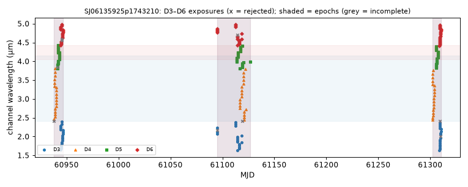

# Archive coverage of the sample

What SPHEREx actually holds for the 86 analysed targets, from the individual Level 2 exposures read from DR1 and QR3
(13 Nov 2026). Per-target visit tables and figures: `OBSERVATION_TIMELINES/NAME.csv`, `NAME.png`, index in
`OBSERVATION_TIMELINES/index.csv` and `INDEX.md`. Tables below: `scripts/coverage_summary.py`
(→ `OBSERVATION_TIMELINES/coverage_summary.json`); per-target counts are in `CANDIDATE_CATALOG.csv`.

## 1. How the archive was queried

* Discovery: IRSA SIA2 on `spherex_dr1`, `spherex_dr1_deep`, `spherex_qr3`, `spherex_qr3_deep` (QR2 is superseded
  and returns nothing; it was queried only as a negative control, `DATA_RELEASE_AND_ACCESS_AUDIT.md` §1).
  Duplicates are removed by S3 key.
* Every returned D3–D6 exposure (1.6–5.0 µm) is opened from the public S3 mirror with HTTP range reads; the exposure is
  kept only if the target lies ≥ 4 px inside the detector (the SIA2 footprint test is approximate).
* Each exposure contributes one photometric point at its own central wavelength (CWAVE) and bandwidth (CBAND), with its
  own MJD-AVG. No exposures are merged before the temporal grouping.

## 2. Coverage by role

| Role | Targets | Exposures read (median, range) | Visits per target | Targets with ≥ 2 passes in a visit | H2O sweep per visit, days (median, range) | CO2 sweep, days (median) | H2O complete epochs (0/1/2/3+) | CO2 complete epochs (0/1/2/3+) |
|---|---|---|---|---|---|---|---|---|
| VAR | 36 | 241 (152–339) | 2: 1, 3: 35 | 18 | 25.1 (0.0–56.3) | 7.9 | 2/0/11/23 | 0/1/11/24 |
| CTRL | 36 | 255 (218–338) | 3: 35, 4: 1 | 24 | 27.2 (3.5–50.7) | 8.6 | 7/6/4/19 | 2/3/6/25 |
| BGSTAR | 12 | 222 (210–274) | 3: 12 | 6 | 14.2 (6.8–47.2) | 5.8 | 0/2/5/5 | 0/0/1/11 |
| VALIDATION | 2 | 266 (252–280) | 3: 2 | 2 | 24.0 (12.2–49.1) | 16.6 | 0/0/0/2 | 0/0/0/2 |

"Complete epoch": the band core, blue and red continuum windows all have the minimum number of exposures within one
visit (or within one pass when a visit has two passes that are each complete). Visit rows by release: 178 DR1 only,
80 QR3 only, 6 straddling DR1 and QR3 (264 visit rows in total, including the two saturated pilot targets
Elias 29 and Elias 16 that are not in the catalogue).

## 3. What this means for the experiment

* **Independent epochs exist.** 34 of 36 variable protostars have ≥ 2 complete H2O epochs and 35 of 36 have ≥ 2
  complete CO2 epochs; most have three (Sep–Oct 2025 DR1, Mar–May 2026 DR1, Sep–Oct 2026 QR3). Intervals between
  consecutive epochs are ~6 months (or 3–6 weeks between two passes of one visit).
* **A spectrum is not instantaneous.** The 2.4–4.15 µm H2O window is swept in a median 25 days (up to 56 days);
  the CO2 window in about a week. Brightness drifts within a sweep are modelled (linear drift for H2O, same-day
  normalisation for CO2) and are a known limitation for faster variability.
* **Controls are less complete than variables** in H2O (7 of 36 CTRL have no complete H2O epoch, mostly because
  photometry in nebulous fields fails the per-exposure quality cuts), which reduces the H2O control sample.
* **No target lacks data entirely.** The limiting factor for the experiment is not archive coverage but photometric
  quality (nebulosity, crowding) and the information content of low-resolution spectra (R = 35 at the 3 µm H2O
  band, R = 112 at the 4.27 µm CO2 band; `docs_snapshot/spherex_intro.md`; see `SCIENTIFIC_LIMITATIONS.md`).

## 4. Example: the candidate SJ06135925p1743210 (IRAS 06110+1744)

| Visit | MJD | Release | Exposures D3/D4/D5/D6 | H2O sweep (core/blue/red exposures) | CO2 sweep (core/blue/red) |
|---|---|---|---|---|---|
| 0 | 60937.96 – 60946.65 (Oct 2025) | DR1 | 18/19/19/18 | 5.4 d (3/4/10), complete | 1.5 d (2/4/2), complete |
| 1 | 61095.18 – 61126.89 (Mar–Apr 2026) | DR1 | 18/19/20/18 | 13.2 d (3/4/13), complete | 5.4 d (1/5/3), complete |
| 2 | 61302.27 – 61310.21 (Oct 2026) | QR3 | 19/18/18/18 | 5.3 d (3/5/11), complete | 3.4 d (3/5/4), complete |

The three H2O spectra are each built within 5–13 days, separated by 5 and 7 months; one pass per visit.

