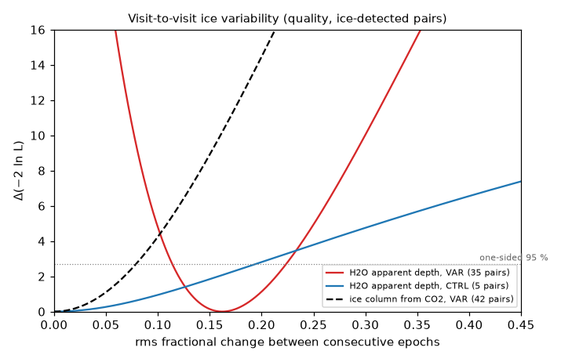
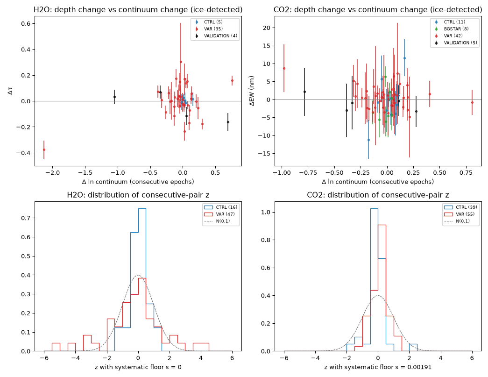
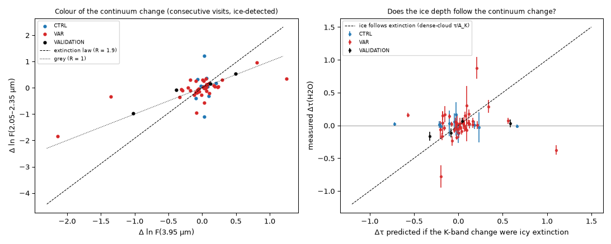
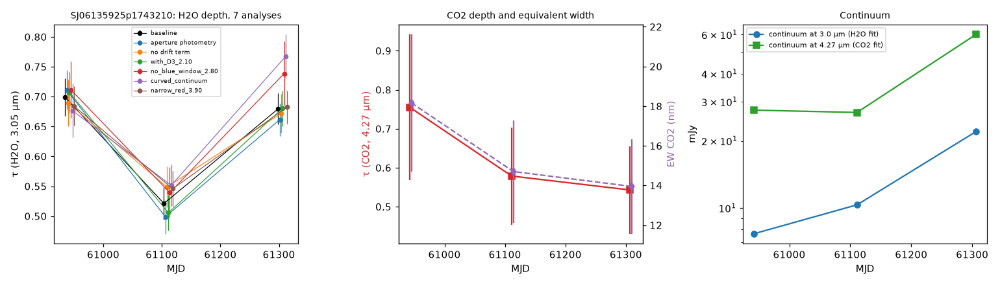
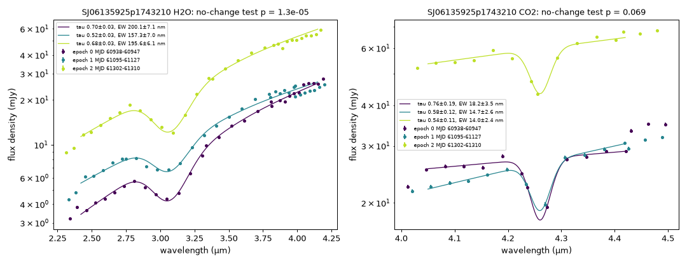
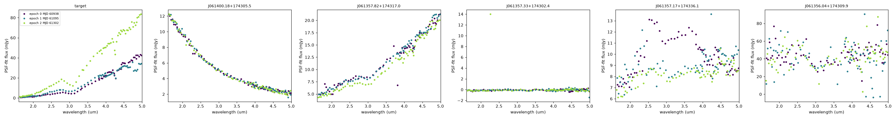
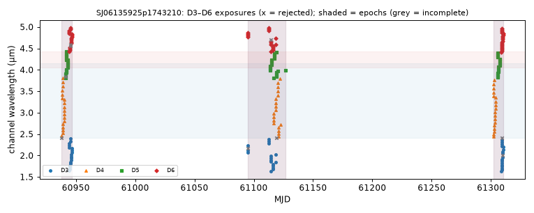

# SPHEREx TimeLens — Final discovery report

**Ice absorption of variable embedded protostars across independent SPHEREx visits (DR1 + QR3, Sep 2025 – Oct 2026)**
Research cut-off 13 Nov 2026. Work directory `research/discovery_2026/`; no production code changed; nothing committed.

## Executive summary

**Measured (with uncertainties, from public data):**

1. In 25 NEOWISE-variable embedded protostars with detected CO2 ice, the CO2 4.27 µm equivalent width changes between
   consecutive SPHEREx epochs (0.5–12 months apart) by less than **4.6 % rms** (95 % upper limit; maximum-likelihood
   value 0). Corrected for band saturation, the implied **ice-column change is < 8.0 % rms** (95 %).
2. In 21 variable protostars with detected H2O ice, the apparent 3 µm H2O optical depth varies by **16 % rms**
   (bootstrap 9–21 %; upper limit 22 %) — more than in non-variable controls (median |z| 1.03 vs 0.25,
   Mann–Whitney p = 0.019; p = 0.005 at matched continuum change; p = 0.0026 without the quality cut), and more than
   the CO2-allowed column change (Δχ² = 10.2, ≈ 3σ). Removing the 11 sample members that SIMBAD identifies as
   non-protostars changes these numbers only slightly (|z| 1.06 vs 0.25, p = 0.019; Δχ² = 10.1).
3. The large continuum changes of the ice-detected sources are **not extinction-like**: colour ratio
   Δln F(2.2 µm)/Δln F(3.95 µm) = 0.19–1.18 against 1.92 for extinction (7 pairs with ≥ 30 % change), and the H2O
   depth does not follow the K-band change (−0.15 ± 0.07 of the icy-extinction prediction, 33 pairs).
4. Merging all visits into one spectrum, as current SPHEREx ice surveys do, inflates the fit misfit of variable
   protostars in proportion to their variability (χ² ratio vs |Δln continuum|: Spearman ρ = 0.89, p = 6 × 10⁻⁸ for
   H2O) and biases individual depths by up to 18 % (H2O) and 10–13 % in the known variables EC 53 and V1647 Ori.
5. One protostar, **SJ06135925p1743210 = IRAS 06110+1744** (Gem OB1, Class I), shows a robust, reversible
   H2O depth change: τ = 0.699 ± 0.031 → 0.521 ± 0.027 → 0.680 ± 0.026 (Oct 2025 → Mar 2026 → Oct 2026;
   p = 1.3 × 10⁻⁵; z = −4.3, +4.2), stable against six alternative analyses, a leave-one-exposure-out jackknife,
   epoch-boundary changes and neighbour contamination. No other spectra of this object were found.

**Interpretation (not measurement):** ice columns in front of variable protostars are stable on 6-month timescales
(extending the single-object EC 53 and HH 100 IR results to a population), and the extra 3 µm depth variability is a
continuum-geometry effect (changing covering of the 3 µm-emitting region, scattered light, continuum shape) rather
than sublimation, freeze-out or extinction. For IRAS 06110+1744, a fixed ice column covering a varying fraction
(≈ 20 % uncovered in Mar 2026) of the 3 µm emitting region fits as well as a column change; sublimation and icy
extinction are disfavoured by the timing and colour.

**Hypotheses still open:** whether CO2 and H2O ice are co-spatial in these envelopes (assumed in item 1); what
structure changes the covering in IRAS 06110+1744.

**Classification (mission §20):** items 1–3 **Level 3 — new scientific measurement**; item 4 **Level 3**
(methodological measurement); item 5 **Level 4 — promising candidate**; the primary hypothesis that ice absorption
changes *with* luminosity changes **is not supported (Level 5)** — in its place there is a population upper limit.
No result reaches Level 1 or 2 without independent confirmation.

| Figure | File |
|---|---|
| Profile likelihoods: apparent H2O scatter vs CO2-allowed column change |  |
| Depth change vs continuum change; z distributions |  |
| Colour of continuum changes; depth vs icy-extinction prediction |  |
| Candidate: depths in 7 analyses, CO2, continua |  |
| Candidate: per-epoch spectra and joint fit |  |
| Candidate: neighbours in the same fits |  |
| Candidate: exposure timeline |  |

---

## Answers to the required questions (mission §21)

### 1. What exact scientific gap was selected?

Whether molecular-ice absorption (H2O 3.05 µm, CO2 4.27 µm) of variable embedded protostars changes between
independent SPHEREx visits, and whether any change is tied to the infrared brightness change (gap H1, score 85/100 in
`RESEARCH_GAP_MATRIX.md`; H2 response slope and H6 controls folded in; H10, the bias from merging visits, as the
secondary question).

### 2. Which published research established the existing knowledge?

* SPHEREx ice pipeline and surveys treat variability as contamination: Melnick et al. 2026
  ([arXiv:2603.22135](https://arxiv.org/abs/2603.22135); ~22 % of SPLICES targets flagged variable and excluded or
  reprocessed), Serna et al. 2026 ([arXiv:2610.38043](https://arxiv.org/abs/2610.38043); 20,292 YSOs, all valid
  measurements merged, Cycle 1 only), Hora et al. 2026 ([arXiv:2603.12390](https://arxiv.org/abs/2603.12390)),
  Roychowdhury et al. 2026 ([arXiv:2607.24934](https://arxiv.org/abs/2607.24934)); SPLICES
  ([arXiv:2501.17797](https://arxiv.org/abs/2501.17797)).
* Single-object ice-variability results: EC 53 shows no ice change across a ≥ 3× burst with JWST
  (EPISODE IV, [arXiv:2604.08769](https://arxiv.org/abs/2604.08769)); HH 100 IR unchanged over 7 yr while
  brightening (Graham 1998, [doi:10.1086/305021](https://doi.org/10.1086/305021)); HV Tau C τ 1.65 → 1.09 in
  2.3 yr without photometric change (Terada et al. 2007, [doi:10.1086/520951](https://doi.org/10.1086/520951)); PDS 453
  possible profile variation (Terada & Tokunaga 2017,
  [doi:10.3847/1538-4357/834/2/115](https://doi.org/10.3847/1538-4357/834/2/115)); V1647 Ori ice during and after
  outbursts (Aspin et al. 2008, 2009).
* Theory: bursts desorb ices that refreeze over 10³–10⁴ yr at envelope densities (Kim H. J. et al. 2012,
  [doi:10.1088/0004-637x/758/1/38](https://doi.org/10.1088/0004-637x/758/1/38); Vorobyov et al. 2013); CO2 profiles as
  fossil records (Kim J. et al. 2022, [arXiv:2207.05178](https://arxiv.org/abs/2207.05178)); ice band shape depends on
  absorption/scattering geometry ([A&A 2025](https://www.aanda.org/articles/aa/full_html/2025/04/aa54360-25/aa54360-25.html)).
* SPHEREx transients: Karambelkar et al. 2026, ApJL 1000, L8 ([doi:10.3847/2041-8213/ae4aa9](https://doi.org/10.3847/2041-8213/ae4aa9)).

Full list and search log: `LITERATURE_REVIEW.md` (R1–R21, §11).

### 3. What was previously unanswered?

No population measurement of how much protostellar ice absorption changes between epochs existed; ice variability
evidence consisted of a handful of single objects with conflicting results, and SPHEREx ice papers merge visits
without quantifying what that does to variable sources.

### 4. Why is this gap important?

Episodic accretion is expected to reprocess ices (sublimation, re-freezing, crystallisation), which matters for the
inheritance of volatiles by planet-forming disks. Whether single-epoch ice measurements of variable protostars are
representative — and whether ice variability can be used as a burst diagnostic — depends on how much ice absorption
actually changes and why.

### 5. Why was the existing TimeLens project suitable?

TimeLens already reads individual SPHEREx Level 2 exposures with their own timestamps, wavelengths and flags
(`backend/app/flags.py` reused), does forced ePSF photometry, and treats spectra as time series rather than static
spectra — exactly what an epoch-resolved ice measurement needs. The research scripts extend these methods in
`scripts/` without touching the application.

### 6. What actual observations were retrieved?

SPHEREx Level 2 spectral images (file VERSION 7.0.5) from DR1 (`spherex_dr1`, survey visits May 2025 – May 2026) and
QR3 (`spherex_qr3`, from May 2026), found with IRSA SIA2 and read from the public S3 mirror by HTTP range requests:
**21,686 D3–D6 exposures found, 21,458 read, 21,152 valid photometric points** for 86 targets (15 × 21 pixel stamps,
132 MB). Calibration: `cal-swcs-v5`, `cal-sapm-v3`, `cal-epsf-v1/v2` (SHA-256 in `REPRODUCIBILITY.md`). Exact S3 key,
MJD and version of every exposure: `data/stamps/NAME.json`, `EXPERIMENTAL_RESULTS/photometry/NAME.csv`.

### 7. How many independent epochs or usable measurements were available?

Most targets have three visits (Sep–Oct 2025, Mar–May 2026, Sep–Oct 2026); 50 of 86 targets have two passes in one
visit.
Complete H2O epochs: 34 of 36 variables have ≥ 2 (23 have ≥ 3); CO2: 35 of 36 have ≥ 2. The H2O window is swept in a
median 25 days per visit, CO2 in ~8 days (`ARCHIVE_COVERAGE.md`). Quality selection: 103 target-bands; population
statistics on 35 (H2O) and 42 (CO2) consecutive pairs of ice-detected variables.

### 8. Which sources or regions were investigated?

36 variable and 36 non-variable embedded protostars drawn reproducibly from SPLICES v8.6 (NEOWISE `w2var_class`,
seed 20261113; 12,745 → 3,152 candidates after cuts, 171 eligible variables), 12 background stars behind molecular
clouds, EC 53 and V1647 Ori as known answers (`TARGET_SELECTION.md`, `CANDIDATE_CATALOG.csv`). Regions include Gem OB1,
Cygnus X, Cepheus, CMa OB1, Perseus, Ophiuchus, Vela and the inner Galactic plane.

### 9. What quantitative results were obtained?

See the executive summary and `SCIENTIFIC_RESULTS.md` §1–§7. Key numbers: ice detection VAR 25/34 vs CTRL 8/29 (H2O,
p = 3.8 × 10⁻⁴); 6 BH-significant H2O variables, 1 robust; apparent H2O scatter 0.16 (0.09–0.21); CO2 EW < 0.046;
CO2-inferred column < 0.080; response slopes H2O +0.21 ± 0.11, CO2 −0.08 ± 0.08 (no significant response);
merged-visit χ² inflation ×2.3 (H2O) and ×10.4 (CO2) for variables; IRAS 06110+1744 Δτ = −0.178 ± 0.041 then
+0.158 ± 0.038.

### 10. What alternative explanations were tested?

Instrumental: stamp-reader and ePSF identity, flux scale vs 2MASS, six continuum/photometry variants, epoch-boundary
choices, leave-one-exposure-out and channel-block jackknife, neighbour fluxes, injection–recovery of depth, grey,
colour and scattered-light perturbations, controls and an empirical floor. Physical: sublimation/recondensation
(timing and timescale), icy extinction (colour ratio, depth vs K-band change), additive scattered/unabsorbed light
(three colours), partial covering, foreground material (cannot change reversibly), accretion-driven continuum change
(EC 53 reference). Details: `VALIDATION/README.md`, `SCIENTIFIC_RESULTS.md` §8.

### 11. What independent evidence supports the result?

* EC 53 measured here reproduces the JWST no-change result; HH 100 IR (Graham 1998) is a single-object precedent for
  stable ice during brightening.
* The flux scale agrees with 2MASS Ks (non-variable stars: +0.02 to +0.05 dex, σ ≤ 0.09 dex).
* The CO2 band (different detector, D5, R = 112) independently constrains what the H2O band (D4, R = 35) cannot.
* The geometry dependence of the apparent 3 µm band is established in radiative-transfer work (A&A 2025).
* There is **no independent observation of IRAS 06110+1744**; its result rests on SPHEREx alone.

### 12. What did the experiment fail to establish?

* Any ice change caused by a luminosity change (sublimation or freeze-out) — none is detected; the CO2 data limit it.
* Whether the IRAS 06110+1744 change is a column change or a covering change (degenerate at R = 35).
* The strong test of §7.8: **0 of 86 targets pass all seven criteria**; one passes criteria 2, 3, 5 and 6.
  Contemporaneous independent photometry does not exist (NEOWISE ended in 2024).
* CO ice (4.67 µm) — not measurable at this resolution against CO gas lines.
* A well-matched control sample: controls sit in more nebulous fields (PSF χ²_red 107 vs 11) and only 5 ice-detected
  H2O control pairs pass the quality rule; the VAR > CTRL comparison rests on few control pairs.
* A clean sample: SIMBAD shows 2 of 36 "variable protostars" (V445 Pup, a nova; IRAS 07121-1158, a planetary-nebula
  candidate) and 9 of 36 controls are not protostars. Removing them changes no conclusion
  (`SCIENTIFIC_RESULTS.md` §3), but sources without SIMBAD entries are not individually verified.

### 13. Is the exact result already in the literature?

Not in the literature searched (web search, SIMBAD via the Harvard mirror, arXiv/journal pages; 2023 – 13 Nov 2026
for SPHEREx, older single-object ice variability papers back to 1998). The 2026 SPHEREx ice papers are single-cycle and
treat variability as a contaminant; the closest work is single-object (EC 53, HH 100 IR, HV Tau C). A proposal to
compare pre- and post-burst SPHEREx depths exists (Stecklum, MPIA document) without a measurement. ADS full-text was
not searched; papers submitted just before the cut-off may be missed. Novelty tables below.

### 14. What is the defensible novelty of the work?

* The first epoch-resolved, population-level constraint on ice-absorption changes in variable protostars from SPHEREx:
  < 8 % rms column change over 6-month intervals in 25 sources (Level 3).
* The finding that apparent 3 µm depth variability (16 % rms) in variable protostars exceeds what the ice column
  allows and is not extinction-like — i.e. single-epoch 3 µm depths of variable protostars carry a ~16 % geometric
  term (Level 3).
* A quantified merged-visit bias for SPHEREx ice measurements of variable sources (Level 3, methodological).
* One new reversible 3 µm depth change in an unstudied protostar, IRAS 06110+1744 (Level 4).

### 15. Is the result appropriate for a scientific paper?

The population result is suitable for a short paper or research note **after** three additions: (i) repeating the fit
with laboratory ice templates (to check the analytic profiles), (ii) extending to all 171 eligible variables and
environment-matched controls, and (iii) an independent continuum treatment of the 3 µm band. IRAS 06110+1744 is
suitable only as a candidate in such a paper, not as a stand-alone discovery.

### 16. What additional observations would strengthen it?

* The next SPHEREx visits of the same fields (survey 4, ~Mar–May 2027) — a fourth epoch tests whether IRAS 06110+1744
  repeats and extends the population baseline to 1.5 yr.
* L-band (2.8–4.1 µm) spectroscopy of IRAS 06110+1744 at R ≳ 1000 (IRTF/SpeX, Keck/NIRSPEC, or JWST NIRSpec):
  the band-minimum wavelength separates absorption-dominated from scattering-dominated light (A&A 2025), i.e. column
  vs covering.
* Contemporaneous near-infrared imaging (K, L′) for an independent luminosity measurement and a search for a
  scattered-light nebula around the source.
* Mid-infrared (JWST MIRI) silicate and CO2 15 µm bands to test whether H2O and CO2 ice are co-spatial in the
  variable sample.

---

## Novelty tables (mission §15)

**A. Population constraint on ice-column variability (items 1–3)**

| Question | Finding |
|---|---|
| Is the object already known? | The protostars are SPLICES/AllWISE sources; 28 of 36 variables have a SIMBAD object within 15″, mostly with ≤ 5 references (2 of them are not protostars: V445 Pup, IRAS 07121-1158) |
| Is the behaviour already known? | Stable ice during brightening is known for EC 53 and HH 100 IR; a population limit is not |
| Have the same spectral features been reported? | H2O and CO2 ice in SPHEREx YSOs (Serna et al. 2026), single-epoch |
| Measured by another mission? | Single objects with JWST, ground-based L-band; no multi-object monitoring found |
| Equivalent published interpretation? | Geometry dependence of the 3 µm band (A&A 2025) — theoretical, not applied to variability |
| What exact measurement would be new? | rms ice-column change < 8 % (95 %) over 6 months in 25 variable protostars; apparent H2O scatter 16 % in excess of it |
| Certainty of the novelty assessment | Moderate: web search + SIMBAD, no ADS full-text |

**B. Merged-visit bias (item 4)**

| Question | Finding |
|---|---|
| Already known? | Melnick et al. note variability can "introduce artificial features or mask true absorption signals"; not quantified |
| What would be new? | Misfit inflation ×2.3 (H2O) / ×10 (CO2) for variables, scaling with variability (ρ = 0.89), and 10–13 % depth bias in known variables |
| Certainty | Moderate; the bias is pipeline-specific |

**C. IRAS 06110+1744 (item 5)**

| Question | Finding |
|---|---|
| Is the object already known? | Yes as an IRAS point source (IRAS PSC 1988), listed in a Gem OB1 star-formation study (1995ApJ...450..201C), an H2O maser survey (2007PASJ...59.1185S) and a lunar-occultation list (1989ApJS...69..651C); SPLICES Class I protostar |
| Is the behaviour already known? | No ice spectroscopy or variability study found |
| Same spectral features reported? | No |
| Measured by another mission? | NEOWISE shows 1.6 mag irregular 4.6 µm variability (SPLICES class I); no spectra |
| Equivalent published interpretation? | No |
| What exact measurement would be new? | A reversible 25 % change of the apparent 3 µm ice depth over 12 months, with the 3 µm continuum brightening first at short wavelengths |
| Certainty | Moderate–low for the object (4 SIMBAD references reviewed; Gem OB1 literature not exhaustive) |

## Independent datasets used (mission §14)

| Dataset | Measures | Wavelength | Time coverage | Resolution | Sensitivity (here) | Hypothesis tested |
|---|---|---|---|---|---|---|
| SPHEREx L2 DR1 + QR3 | spectrophotometry, one LVF channel per exposure | 0.75–5.0 µm; used 1.6–5.0 µm (R = 41 / 35 / 112 / 128 in bands 3–6) | May 2025 – Oct 2026 (3 visits here) | 6.2″ pixels, PSF FWHM ≈ 8.7″ | median S/N ≈ 90 per exposure for W2 ≈ 9 protostars | all ice measurements |
| SPLICES v8.6 (NEOWISE `w2var_class`, AllWISE, 2MASS, Spitzer classes) | target classes, past variability | 3.4/4.6 µm variability; 1–24 µm SEDs | NEOWISE 2014–2024 | 6″ | W2 amplitude ≥ 0.3 mag classes | sample definition; *not* contemporaneous |
| AllWISE | positions, W1/W2 | 3.4, 4.6 µm | 2010–2011 | 6.1–6.4″ | W1 < 15.5 used | neighbour modelling (blending) |
| 2MASS Ks (via SPLICES) | flux | 2.16 µm | 1997–2001 | ~2–3″ | Ks ≲ 14 | flux-scale validation (different epoch; variables expected to differ) |
| Gaia DR3 (ESA archive) | identifiers | 0.33–1.05 µm (G) | 2014–2017 | 0.1″ | G ≲ 21 | identification (40 of 86 matched; embedded protostars mostly invisible) |
| SIMBAD (Harvard mirror) | identifiers, literature | — | — | — | — | novelty, object types |
| Published JWST/ground spectra (EC 53, HH 100 IR, V1647 Ori) | ice depths | 2.5–28 µm | 1988–2024 | — | — | known-answer validation |

The datasets are not combined as if identical: 2MASS is used only for a scale check, NEOWISE only for selection.

## Fallback strategy (mission §19)

The primary experiment was feasible: archive coverage was sufficient for every target (Fallback 1 analysis:
`ARCHIVE_COVERAGE.md`). What limited per-target detections was not the number of epochs but (a) R = 35 at 3 µm, where
continuum shape and band depth are partly degenerate, (b) nebulosity and crowding, and (c) CO2 saturation in deep-ice
sources. Fallback 2 (another target class) was applied inside the experiment through the background stars, which
proved a weak control (diffuse, ice-free extinction). The secondary question H10 (merged-visit bias) was answered with
the same data. Fallbacks 3–4 (prestellar cores, other gaps) were not needed. The standard was not lowered: 5 of 6
statistically significant single-target changes were rejected by the pre-registered robustness rule.

## Where everything is

| Topic | File |
|---|---|
| What was excluded and why | `PREVIOUS_WORK_AND_EXCLUSION_LEDGER.md` |
| Literature, questions Q1–Q10, search log | `LITERATURE_REVIEW.md` |
| 13 hypotheses, scores, decision | `RESEARCH_GAP_MATRIX.md`, `PRIMARY_RESEARCH_DECISION.md` |
| Data releases and access tests | `DATA_RELEASE_AND_ACCESS_AUDIT.md`, `ARCHIVE_COVERAGE.md`, `OBSERVATION_TIMELINES/` |
| Sample | `TARGET_SELECTION.md`, `CANDIDATE_CATALOG.csv` |
| Measurements | `EXPERIMENTAL_RESULTS/` (photometry, ice fits, population, colour, figures) |
| Validation | `VALIDATION/README.md` |
| Results, rejections, limitations | `SCIENTIFIC_RESULTS.md`, `REJECTED_CANDIDATES.md`, `SCIENTIFIC_LIMITATIONS.md` |
| Commands, versions, seeds, checksums | `REPRODUCIBILITY.md`, `scripts/` |
