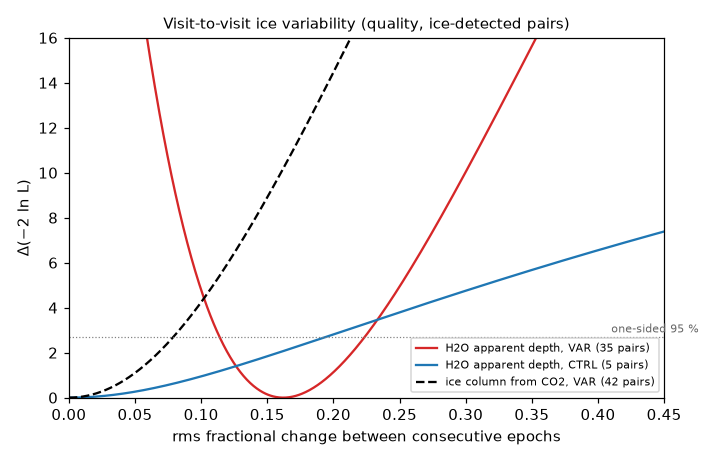
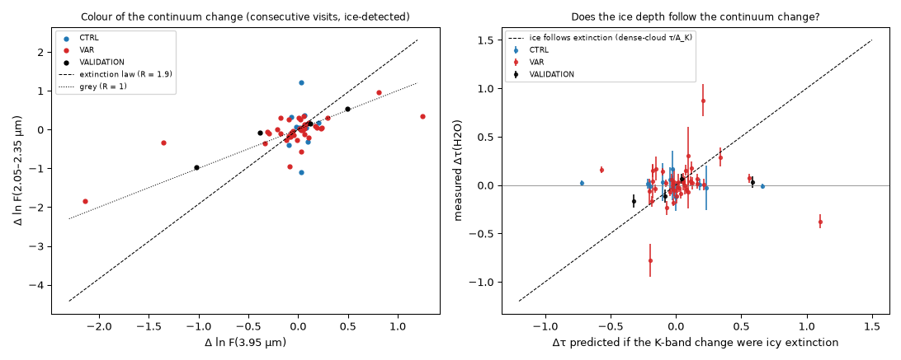
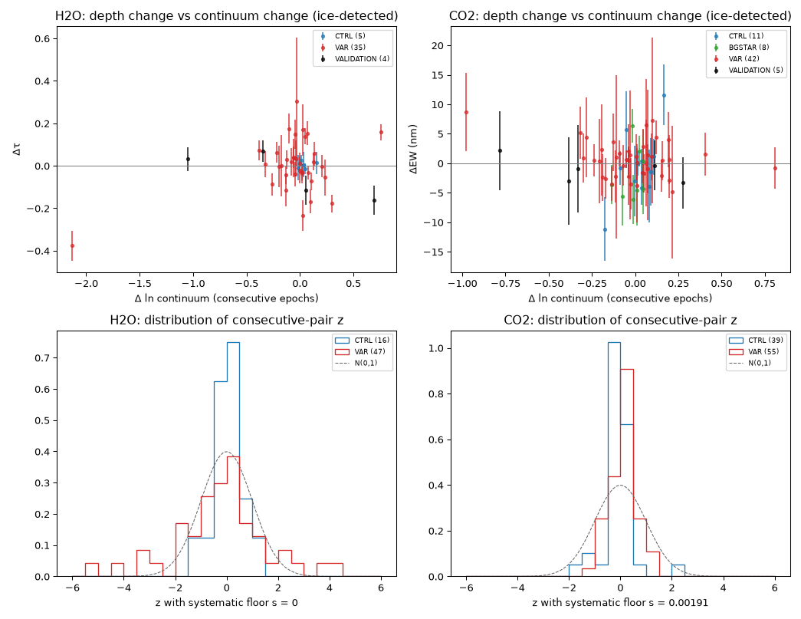
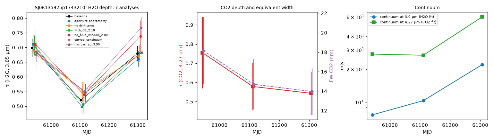
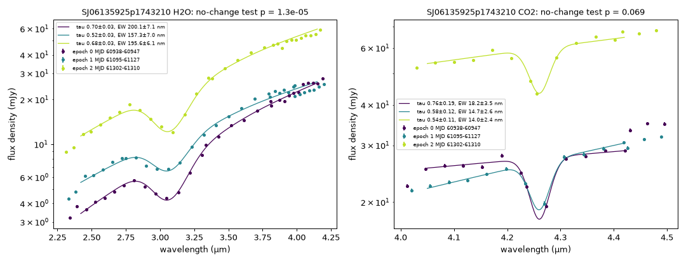

# Scientific results

Question (primary gap H1, `PRIMARY_RESEARCH_DECISION.md`): **do the 3 µm H2O and 4.27 µm CO2 ice absorption
features of variable embedded protostars change between independent SPHEREx visits, and are changes tied to the
infrared brightness changes?** Data: 86 targets (36 NEOWISE-variable protostars VAR, 36 W2-matched non-variable
protostars CTRL, 12 background stars BGSTAR, 2 known-answer objects), every D3–D6 Level 2 exposure in DR1 and QR3
(median 240 per target), grouped into independent visit/pass epochs (`ARCHIVE_COVERAGE.md`).

Measured findings (§1–§6) are separated from interpretations (§7). All numbers come from the files cited; nothing is
simulated except the injection tests in `VALIDATION/`.

## 0. Pre-registered rules

Fixed before population results were inspected: an ice band of a target enters the primary analysis if it has ≥ 2
complete epochs and a joint-fit χ²_red ≤ 15 ("quality selection"); "ice-detected" = mean depth ≥ 5σ; a pair change is
*robust* if baseline |z| ≥ 3 and the same sign with |z| ≥ 2 in all six alternative analyses; Benjamini–Hochberg
5 % FDR across all target-bands tested (103 in the quality selection); only consecutive pairs in population statistics;
bootstrap over targets (seed 20261113). The sample without the quality cut is reported as a sensitivity check.

## 1. Ice detection (measured)

| Band | VAR detected | CTRL detected | Fisher p |
|---|---|---|---|
| H2O | 25 / 34 | 8 / 29 | 3.8 × 10⁻⁴ |
| CO2 | 26 / 36 | 5 / 34 | 1.2 × 10⁻⁶ |

NEOWISE-variable protostars show ice absorption 2–5 times more often than W2-matched non-variable ones (after
removing SIMBAD-identified non-protostars, §3: H2O 23/32 vs 7/23, p = 0.003; CO2 25/34 vs 5/26, p = 6 × 10⁻⁵). This is
consistent with variability being commoner in the youngest, most embedded protostars (Park et al. 2021 scheme used by
SPLICES, R3) and is not claimed as new; it means the variable sample is the better-suited one for ice-change tests.

## 2. Per-target change tests (measured; quality selection)

| Band / role | Target-bands tested | ice-detected | p < 0.05 | BH-significant | with a robust pair |
|---|---|---|---|---|---|
| H2O / VAR | 28 | 21 | 7 | 6 | **1** (SJ06135925p1743210) |
| H2O / CTRL | 9 | 3 | 0 | 0 | 0 |
| CO2 / VAR | 33 | 25 | 4 | 1 (SJ22280291p6901168) | 0 |
| CO2 / CTRL | 20 | 5 | 0 | 0 | 0 |
| CO2 / BGSTAR | 9 | 4 | 3 | 0 | 0 |
| H2O / VALIDATION | 2 | 2 | 1 (V1647 Ori) | 1 | 0 |

Five of the six H2O BH-significant variables lose the change when the blue continuum window is removed or the
continuum is allowed to curve (`REJECTED_CANDIDATES.md` §1). Empirical floors from ice-detected controls: H2O s = 0
(MAD z = 0.36, fit errors conservative), CO2 s = 0.0019 µm (MAD z = 1.09). The robust candidate survives the floor.

## 3. Variables vs controls (measured)

Median |z| of consecutive pairs, ice-detected targets (controls = CTRL plus background stars, z after the empirical
floor; no background star is ice-detected in H2O, so the H2O controls are CTRL protostars only):

| Selection | Band | VAR (pairs) | controls (pairs) | Mann–Whitney p (VAR > controls) |
|---|---|---|---|---|
| quality | H2O | 1.03 (35) | 0.25 (5) | 0.019 |
| quality, VAR restricted to the CTRL continuum range (|Δln F| ≤ 0.16) | H2O | 1.02 (24) | 0.25 (5) | 0.005 |
| no quality cut | H2O | 1.02 (42) | 0.25 (15) | 0.0026 (p < 0.05 in 32 % of VAR vs 0 % of CTRL) |
| quality | CO2 | 0.42 (42) | 0.74 (19) | 0.98 |

Within the variables, |z_H2O| does not correlate with the size of the continuum change (Spearman ρ = 0.16, p = 0.36,
35 pairs). **The apparent H2O depth varies more in variable than in non-variable protostars; CO2 does not.**

**Sample purity (post-hoc sensitivity check, `EXPERIMENTAL_RESULTS/population/purity_check.json`).** The SIMBAD
cross-match, possible only after the analysis (CDS outage), shows that 2 VAR and 9 CTRL "protostars" are other
objects: V445 Pup (nova) and IRAS 07121-1158 (planetary-nebula candidate) among the variables; Mira and long-period
variables, AGB candidates, a planetary nebula (WRAY 16-162), a high-proper-motion star and a B-type binary
(HD 37017) among the controls. None is an ice-detected quality control. Excluding them: ice detection VAR 23/32 vs
CTRL 7/23 (H2O, Fisher p = 0.003) and 25/34 vs 5/26 (CO2, p = 6 × 10⁻⁵); H2O |z| VAR 1.06 (34) vs 0.25 (5),
p = 0.019; CO2 p = 0.98; apparent H2O scatter 0.164 (upper limit 0.228); CO2-inferred column < 0.081, Δχ² = 10.1 at
the H2O scatter. No conclusion changes; the detection-rate contrast is smaller but remains significant.

## 4. How large are the changes? (measured, maximum likelihood)

Model: fractional change r = Δ/mean depth ~ N(0, σ² + s²) per consecutive pair; s = rms intrinsic fractional change
between epochs (0.5–12 months apart). `EXPERIMENTAL_RESULTS/population/intrinsic_scatter.json`,
`co2_h2o_consistency.json`.

| Quantity | Pairs / targets | s (MLE) | bootstrap 16–84 % | one-sided 95 % upper limit |
|---|---|---|---|---|
| H2O apparent depth, VAR | 35 / 21 | **0.16** | 0.09–0.21 | 0.22 (0.29 with errors rescaled to the control MAD) |
| H2O apparent depth, CTRL | 5 / 3 | 0 | — | 0.20 |
| CO2 equivalent width, VAR | 42 / 25 | 0 | — | 0.046 |
| **Ice column inferred from CO2, VAR** (EW response to τ per target, median g = d ln EW / d ln τ = 0.64) | 42 / 25 | 0 | — | **0.080** |
| same, targets with both bands usable | 31 / 18 | 0 | — | 0.084 |

A column change equal to the apparent H2O scatter (s = 0.16) is disfavoured by the CO2 data with Δχ² = 10.2
(all VAR) and 9.1 (both-band subset), i.e. at ≈ 3σ.

## 5. Do depth changes follow the continuum? (measured)

* Slope of Δτ/τ̄ against Δln continuum (VAR, quality): H2O +0.21 ± 0.11 (bootstrap 95 % range −0.10 … +0.30;
  Δln continuum −2.13 … +0.76); CO2 EW −0.08 ± 0.08 (−0.14 … +0.16). Without the quality cut H2O gives −0.06 ± 0.17.
  No significant response in either band. With g = 0.64, a CO2 column that falls faster than 0.23 per e-fold of
  4.3 µm brightening is excluded at 95 %.
* Colour of the continuum change (`EXPERIMENTAL_RESULTS/colour/`): extinction by the absorbing dust would give
  R = Δln F(2.2 µm)/Δln F(3.95 µm) = 1.92. The seven quality, ice-detected pairs with |Δln F(3.95 µm)| ≥ 0.3 have
  R = 0.19–1.18 (EC 53, whose change is accretion-driven: 0.19 and 0.96). The measured Δτ_H2O is −0.15 ± 0.07 times
  the change predicted if the K-band change were icy extinction (33 pairs; Spearman ρ = −0.09, p = 0.60).

## 6. Merged-visit bias (measured; secondary gap H10)

Fitting the same exposures as one merged spectrum (as in Serna et al. 2026, R4, who use all valid measurements of each
source) instead of per epoch (`EXPERIMENTAL_RESULTS/population/merged_bias.csv`):

| Group | n | median |bias|/τ | max |bias|/τ | merged error / per-epoch error | χ²_red merged / per-epoch | Spearman ρ (χ² ratio vs |Δln cont|) |
|---|---|---|---|---|---|---|
| H2O VAR | 21 | 0.9 % | 18 % | 1.72 | 2.32 | 0.89 (p = 6 × 10⁻⁸) |
| H2O CTRL | 3 | 2.8 % | 3.3 % | 1.64 | 2.04 | — |
| H2O validation (EC 53, V1647 Ori) | 2 | 10 % | 13 % | 5.9 | 28 | — |
| CO2 VAR | 25 | 3.4 % | 100 % (one EW driven to 0) | 3.57 | 10.4 | 0.65 (p = 4 × 10⁻⁴) |
| CO2 CTRL | 9 | 3.2 % | 7.6 % | 1.77 | 3.3 | 0.55 (p = 0.12) |

Merging visits of a variable protostar rarely biases the median depth much, but it inflates the misfit in proportion
to the source's variability and can bias individual sources by 10–100 %. The bias here is for this pipeline; the
size in the Serna et al. template fits is not known.

## 7. The single robust candidate: SJ06135925p1743210 = IRAS 06110+1744 (measured)

Class I protostar in Gem OB1 (A_V 37 in SPLICES; NEOWISE W2 class "irregular", amplitude 1.6 mag); no Gaia DR3
counterpart within 2″; SIMBAD lists 4 references, none spectroscopic.

| Epoch (MJD) | τ_H2O (baseline) | range over 7 analyses | τ_CO2 | EW_CO2 (nm) | continuum 3.0 µm (mJy) | continuum 4.27 µm (mJy) |
|---|---|---|---|---|---|---|
| 0 (60938–60947, Oct 2025, DR1) | 0.699 ± 0.031 | 0.677–0.711 | 0.76 ± 0.19 | 18.2 ± 3.5 | 7.7 | 27.5 |
| 1 (61095–61127, Mar–Apr 2026, DR1) | 0.521 ± 0.027 | 0.499–0.552 | 0.58 ± 0.13 | 14.7 ± 2.6 | 10.3 | 26.8 |
| 2 (61302–61310, Oct 2026, QR3) | 0.680 ± 0.026 | 0.661–0.767 | 0.54 ± 0.11 | 14.0 ± 2.4 | 22.0 | 60.1 |

H2O no-change test p = 1.3 × 10⁻⁵; consecutive z = −4.3 and +4.2; the same sign with |z| ≥ 2.2 in every analysis;
leave-one-exposure-out z(0→1) −4.5 … −3.4; insensitive to epoch boundaries; neighbours constant
(`VALIDATION/README.md` §4, §7, §8). CO2: p = 0.07; the EW is 19 % lower at epoch 1 (0.8σ) and stays low at
epoch 2, so CO2 neither confirms nor contradicts the H2O dip.

## 8. Interpretations

**I1 — Ice columns of variable protostars are stable on 6-month timescales.** The CO2-inferred column changes by
< 8 % rms (95 %) while the 4.3 µm continua change by up to a factor 2.7 (median |Δln F| 0.11), extending the
single-object EC 53 (R8) and HH 100 IR
(R20) results to 25 variable protostars. Assumptions: CO2 ice is in the same column as H2O ice and in front of the
same continuum; the g correction is correct.

**I2 — The extra 3 µm depth scatter of variable protostars is a continuum-geometry effect, not an ice-column change.**
Evidence: it exceeds the CO2-allowed column change (≈ 3σ); it is not extinction-like (§5); in five of six significant
cases it disappears when the blue continuum window is removed; a fixed column covering a variable fraction of the
continuum fits as well as a column change in 7 of 10 tested targets (`VALIDATION/scatter_model.csv`); the 3 µm band
sits where the continuum of an embedded protostar changes shape (hot-dust emission, scattered light), and its apparent
depth depends on the absorption/scattering balance (R18). Alternative not excluded: the 2.4–4.2 µm continuum model
(power law, linear drift) is too simple for spectra whose shape changes, so part of the scatter may be a modelling
term specific to variable sources; either way it is not a change of ice.

**I3 — SJ06135925p1743210.** The 25 % shallower band at epoch 1 coincides with a brightening confined to short
wavelengths (+35 % at 3.0 µm, none at 4.27 µm); at epoch 2 both continua doubled and the depth returned. Compared
physical explanations:

| Mechanism | Prediction | Observed | Verdict |
|---|---|---|---|
| Sublimation by a luminosity rise, then recondensation | depth falls when the source brightens and stays low while it is bright; recondensation needs ≥ 10³–10⁴ yr at envelope densities (R15), i.e. 0.5 yr only at ~10⁴× higher (disk-like) densities | depth recovered while the source became 2× brighter | disfavoured |
| Icy extinction change | depth and K-band flux change together with R ≈ 1.9 | epoch 1→2 colour R = 1.18 with depth *rising* as the source brightens | disfavoured |
| Additive blue/grey unabsorbed light (scattered light) | additive component of fixed colour | ΔBIC +24 to +63 against | disfavoured |
| Varying covering fraction / line-of-sight geometry (fixed column in front of a varying part of the 3 µm emitting region; or icy structure moving across it) | shallower band when extra, less-obscured short-wavelength light appears | 20 % unobscured fraction at epoch 1 fits as well as a column change; the extra light at epoch 1 is confined to short wavelengths | **consistent**; Keplerian motion moves material ~1–3 au in 6 months at 1–10 au from a solar-mass star, enough to change the covering of a sub-au hot-dust region |
| Instrumental: crowding, single exposures, epoch boundaries, continuum window | change tracks neighbours, one exposure, one window, or the boundaries | none of these | excluded |

## 9. Mission strong test (§7.8) — number of targets that pass

| Criterion | SJ06135925p1743210 |
|---|---|
| 1. Independent outburst / luminosity change | **partial**: NEOWISE shows 1.6 mag irregular variability before 2024; the 2025–2026 brightening (×2.9 at 3 µm) is measured by SPHEREx itself, not independently |
| 2. ≥ 2 independent SPHEREx epochs | **met** (3 epochs, change and reversal) |
| 3. Significant feature change | **met** (H2O p = 1.3 × 10⁻⁵, BH-significant, robust; CO2 not significant) |
| 4. Plausible temporal relation with the luminosity event | **not met**: the depth dip coincides with a modest blue brightening and recovers during a larger brightening; no monotonic relation |
| 5. No comparable change in matched controls | **met** (no control robust or BH-significant) |
| 6. Foreground, continuum, blending, detector effects excluded | **met for artefacts** (variants, jackknife, neighbours, epoch boundaries); a constant foreground cannot produce a reversible change; the geometry/covering degeneracy remains |
| 7. Independent observational or literature support | **not met** (no other spectra of this object found) |

**Targets that pass all seven criteria: 0 of 86.** Targets that pass criteria 2, 3, 5 and 6: 1
(SJ06135925p1743210). The population results (§3–§6) are not single-target claims and are not scored this way.

## 10. Statistical summary (mission §13)

| Result | H0 | H1 | Measured quantity and error | Test | Multiple comparisons | Controls / alternatives |
|---|---|---|---|---|---|---|
| Per-target change | depths equal in all epochs | not equal | τ_H2O or EW_CO2 per epoch, errors ×√χ²_red | F-test of common vs per-epoch depth | BH 5 % over 103 target-bands | 6 alternative analyses, empirical floor, controls |
| VAR vs CTRL | same |z| distribution | VAR larger | |z| of consecutive pairs | one-sided Mann–Whitney | 4 comparisons reported (2 bands × 2 selections) + matched range | ice-detected only (bounded-τ bias), no-cut sensitivity |
| Column variability | s_column = s_H2O,apparent | s_column smaller | r = ΔEW/EW with per-target g | profile likelihood, Δχ² | one comparison | both-band subset; error rescaling |
| Merged bias | merged = per-epoch | differ | relative bias, error and χ² ratios | Spearman vs |Δln cont| | 2 bands | controls, validation targets |

Selection effects: W1 > 6.5 (no saturated outbursters), IRAC isolation, SPLICES embedded class, a random draw of 36
of 171 variables; controls sit in more nebulous fields (PSF χ²_red 107 vs 11) and fewer pass the quality rule; 2 VAR
and 9 CTRL are not protostars according to SIMBAD (purity check in §3; conclusions unchanged).
Independence: consecutive pairs only; epochs within a visit are separate passes of different sky scans. Epoch
boundaries: one p < 0.01 status change in 149 fits. Temporal separation: 5–7 months between visits, 3–6 weeks between
passes.
